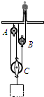

# Physics - 题目 2540

**ID**: 29c5abe687964f8a8d5e282b6a4bf230
**年级**: Grade 9
**难度**: Medium-Hard
**题型**: Calculation

## 题目
如图所示，质量为70kg的小刚站在高台上通过滑轮组匀速提升货物。​​​​​​​‌第一次提升货物的质量为100kg，第二次提升货物的质量为130kg。小刚第二次提升货物时对滑轮组做功的功率为220W。已知滑轮A、B的质量均为4kg，滑轮C的质量为8kg，绳重及滑轮的摩擦均可忽略不计，g取10N/kg。求：①第一次提升货物时，滑轮组的机械效率是多少？②第二次提升货物时，小刚对高台的压力是多少？③第二次提升货物时，货物上升的速度是多少？（计算结果保留2位小数）

## 解答

1. 解：①第一次提升货物时，在B处向上的拉力FB为
2. $F{{}_{B}}=\frac {1}{3}\left ({G{{}_{物}}+G{{}_{C}}}\right )=\frac {{\rm{1}}}{{\rm{3}}}\times \left ({{\rm{1}}{\rm{0}}{\rm{0}}{\rm{k}}{\rm{g}}\times {\rm{1}}{\rm{0}}{\rm{N}}{\rm{/}}{\rm{k}}{\rm{g}}{\rm{+}}{\rm{8}}{\rm{k}}{\rm{g}}\times {\rm{1}}{\rm{0}}{\rm{N}}{\rm{/}}{\rm{k}}{\rm{g}}}\right ){\rm{=}}{\rm{3}}{\rm{6}}{\rm{0}}{\rm{N}}$
3. 小刚受到向下的拉力为
4. $F{{}_{拉}}=\frac {1}{2}\left ({F{{}_{B}}+G{{}_{B}}}\right )=\frac {{\rm{1}}}{{\rm{2}}}\times \left ({{\rm{3}}{\rm{6}}{\rm{0}}{\rm{N}}{\rm{+}}{\rm{4}}{\rm{k}}{\rm{g}}\times {\rm{1}}{\rm{0}}{\rm{N}}{\rm{/}}{\rm{k}}{\rm{g}}}\right ){\rm{=}}{\rm{2}}{\rm{0}}{\rm{0}}{\rm{N}}$
5. 第一次滑轮组的机械效率为
6. $η=\frac {W{{}_{有}}}{W{{}_{总}}}\times {\rm{1}}{\rm{0}}{\rm{0}}{{\rm{0}}}/{{\rm{0}}}=\frac {Gh}{F\cdot {\rm{6}}h}\times 100\%=\frac {{\rm{1}}{\rm{0}}{\rm{0}}{\rm{k}}{\rm{g}}\times {\rm{1}}{\rm{0}}{\rm{N}}{\rm{/}}{\rm{k}}{\rm{g}}}{{\rm{2}}{\rm{0}}{\rm{0}}{\rm{N}}\times {\rm{6}}}\times {\rm{1}}{\rm{0}}{\rm{0}}{{\rm{0}}}/{{\rm{0}}}\approx {\rm{8}}{\rm{3}}{\rm{.}}{\rm{3}}{{\rm{0}}}/{{\rm{0}}}$
7. ②第二次提升货物时，在B处向上的拉力为 $F{{}_{B}}{^{\prime }}$ ，小刚受到向下的拉力为 $F{{}_{拉}}{^{\prime }}$ ，则
8. $F{{}_{B}}{^{\prime }}=\frac {1}{3}\left ({G{{}_{物}}{^{\prime }}+G{{}_{C}}}\right )=\frac {{\rm{1}}}{{\rm{3}}}\times \left ({{\rm{1}}{\rm{3}}{\rm{0}}{\rm{k}}{\rm{g}}\times {\rm{1}}{\rm{0}}{\rm{N}}{\rm{/}}{\rm{k}}{\rm{g}}{\rm{+}}{\rm{8}}{\rm{k}}{\rm{g}}\times {\rm{1}}{\rm{0}}{\rm{N}}{\rm{/}}{\rm{k}}{\rm{g}}}\right ){\rm{=}}{\rm{4}}{\rm{6}}{\rm{0}}{\rm{N}}$
9. $F{{}_{拉}}{^{\prime }}=\frac {1}{2}\left ({F{{}_{B}}{^{\prime }}+G{{}_{B}}}\right )=\frac {{\rm{1}}}{{\rm{2}}}\times \left ({{\rm{4}}{\rm{6}}{\rm{0}}{\rm{N}}{\rm{+}}{\rm{4}}{\rm{k}}{\rm{g}}\times {\rm{1}}{\rm{0}}{\rm{N}}{\rm{/}}{\rm{k}}{\rm{g}}}\right ){\rm{=}}{\rm{2}}{\rm{5}}{\rm{0}}{\rm{N}}$
10. 小刚对高台的压力为
11. $F{{}_{压}}=G{{}_{人}}+F{{}_{拉}}{^{\prime }}={\rm{7}}{\rm{0}}{\rm{k}}{\rm{g}}\times {\rm{1}}{\rm{0}}{\rm{N}}{\rm{/}}{\rm{k}}{\rm{g}}{\rm{+}}{\rm{2}}{\rm{5}}{\rm{0}}{\rm{N}}{\rm{=}}{\rm{9}}{\rm{5}}{\rm{0}}{\rm{N}}$
12. ③拉力上升的速度
13. $v=\frac {P}{F{{}_{拉}}{^{\prime }}}=\frac {{\rm{2}}{\rm{2}}{\rm{0}}{\rm{W}}}{{\rm{2}}{\rm{5}}{\rm{0}}{\rm{N}}}{\rm{=}}{\rm{0}}{\rm{.}}{\rm{8}}{\rm{8}}{\rm{m}}{\rm{/}}{\rm{s}}$
14. 货物上升的速度
15. $v^{′}=\frac {1}{6}v=\frac {1}{6}\times 0.88{\rm{m}}{\rm{/}}{\rm{s}}\approx {\rm{0}}{\rm{.}}{\rm{1}}{\rm{5}}{\rm{m}}{\rm{/}}{\rm{s}}$
16. 答：①第一次提升货物时，滑轮组的机械效率是83.3%；
17. ②第二次提升货物时，小刚对高台的压力是950N；
18. ③第二次提升货物时，货物上升的速度是0.15m/s。

## 知识点

**中文**:
  - 定滑轮及其工作特点
  - 速度公式及其应用
  - 滑轮（组）的机械效率及其计算

**English**:
  - Fixed Pulleys and Operating Characteristics
  - Velocity Formula and Applications
  - Mechanical Efficiency of Pulleys and Calculations

---
