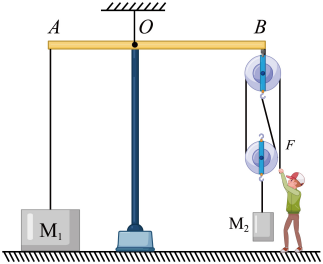

# Physics - 题目 636

**ID**: 2a30597dae854887ac86939a2702a5d5
**年级**: Grade 9
**难度**: Medium-Hard
**题型**: Calculation

## 题目
如图，杠杆在水平位置平衡，物体M_{1}重为500N，OA：OB=2：3，每个滑轮重为20N，滑轮组的机械效率为80%，在拉力F的作用下，物体M_{2}以0.​​​​​​​‌5m/速度匀速上升了5m．（杠杆与绳的自重摩擦均不计）求：（1）物体M_{2}的重力；（2）拉力F的功率；（3）物体M_{1}对水平面的压力．

## 解答

1. （1）因杠杆与绳的自重、摩擦均不计，故克服动滑轮重力做的功为额外功，
2. 则滑轮组的机械效率： $η{\rm{=}}\frac {W{{}_{有}}}{W{{}_{总}}}{\rm{=}}\frac {Gh}{Gh{{+}}G{{}_{动}}h}{\rm{=}}\frac {G}{G{{+}}G{{}_{动}}}$ 即 $80\%=\frac {G}{G+20N}$
3. 解得物体M_{2}的重力：G＝80N；
4. （2）由图知，绳子的有效段数为2，绳的自重、摩擦均不计，则作用在绳子自由端的拉力： $F{\rm{=}}\frac {G{{+}}G{{}_{动}}}{2}=\frac {80{\rm{N}}+20{\rm{N}}}{2}=50{\rm{N}}$ ，物体M_{2}以0.5m/s速度匀速上升了h，绳子自由端移动的距离为：s＝2h，由 $v=\frac {s}{t}$ 可得绳子自由端的速度为：v绳＝2v＝2×0.5m/s＝1m/s；拉力F的功率：
5. $P=\frac {W}{t}=\frac {Fs}{t}=Fv{{}_{绳}}=50{\rm{N}}\times 1{\rm{m}}/{\rm{s}}=50{\rm{W}}$
6. （3）由力的平衡条件可得，B端对定滑轮向上的拉力：F′B＝3F+G定＝3×50N+20N＝170N，
7. 根据力的作用是相互的，则定滑轮对杠杆B端的拉力为：FB＝F′B＝170N，根据杠杆的平衡条件可得：FA×OA＝FB×OB，故绳子对杠杆A端的拉力为： $F{{}_{A}}=\frac {OB}{OA}×F{{}_{B}}=\frac {3}{2}\times 170{\rm{N}}=255{\rm{N}}$ ，力的作用是相互的，则绳子对M_{1}向上的拉力为FA′＝FA＝255N，根据力的平衡，地面对M_{1}的支持力：F支＝G1﹣FA′＝500N﹣255N＝245N；由力的相互性可知，物体M_{1}对水平面的压力：F压＝F支＝245N．
8. 【点睛】本题考查有关滑轮的知识，力的平衡和相互性及杠杆的平衡条件、机械效率公式的运用，综合性强．

## 知识点

**中文**:
  - 功、功率、机械效率的综合计算
  - 杠杆平衡条件的应用
  - 滑轮组及其工作特点
  - 滑轮（组）的机械效率及其计算

**English**:
  - Comprehensive Calculation of Work, Power, and Efficiency
  - Application of Lever Equilibrium Conditions
  - Pulley Systems and Operating Characteristics
  - Mechanical Efficiency of Pulleys and Calculations

---
