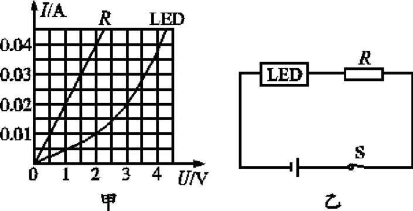

# Physics - 题目 45

**ID**: 389dbd46ad974e0fa2465f7dc8287b29
**年级**: Grade 9
**难度**: Medium-Hard
**题型**: Calculation

## 题目
用发光二极管制成的LED灯具有发光效率高、使用寿命长等优点。​​​​​​​‌图甲是一个定值电阻R和一个LED灯的电流与其两端电压关系的图像。（1）观察图像求 $R$ 的阻值。（2）如图乙所示，将LED灯与 $R$ 串联在电路中，若LED灯的电功率为 $0.06{\rm{W}}$ ，则 $R$ 中的电流为多少A？电路中的总功率？（3）若将LED灯与 $R$ 并联在电压为 $2{\rm{V}}$ 的电路中，此时电路中的总功率又为多少？

## 解答

1. 解：（1）根据图像可知，电流为 $0.04{\rm{A}}$ 时，电阻 $R$ 的电压为2V，则有
2. $R=\frac {U}{I}=\frac {2{\rm{V}}}{0.04{\rm{A}}}=50\Omega $
3. （2）由图甲知，LED灯的电功率为 $0.06{\rm{W}}$
4. $U{{}_{{\rm{L}}{\rm{E}}{\rm{D}}}}=3{\rm{V}}$
5. 因串联
6. $I{{}_{{\rm{R}}}}=I{{}_{{\rm{L}}{\rm{E}}{\rm{D}}}}=0.02{\rm{A}}$
7. 此时
8. $U{{}_{{\rm{R}}}}=1{\rm{V}}$
9. 所以
10. $P{{}_{总}}=P{{}_{{\rm{R}}}}+P{{}_{{\rm{L}}{\rm{E}}{\rm{D}}}}=1{\rm{V}}\times 0.02{\rm{A}}+0.06{\rm{W}}=0.08{\rm{W}}$
11. （3）若将LED灯与 $R$ 并联在电压为2V的电路中，此时电路中的总功率为
12. $P{{}_{总并}}=P{{}_{{\rm{R}}}}{{}_{并}}+P{{}_{{\rm{L}}{\rm{E}}{\rm{D}}}}{{}_{并}}=2{\rm{V}}\times 0.04{\rm{A}}+2{\rm{V}}\times 0.01{\rm{A}}=0.1{\rm{W}}$
13. 答：（1） $R$ 的阻值为 $50Ω$ 。
14. （2）如图乙所示，将LED灯与R串联在电路中，若LED灯的电功率为 $0.06{\rm{W}}$ ，则R中的电流为 $0.02{\rm{A}}$ ，电路中的总功率为 $0.08{\rm{W}}$ 。
15. （3）若将LED灯与R并联在电压为2V的电路中，此时电路中的总功率为  $0.1{\rm{W}}$ 。

## 知识点

**中文**:
  - 串、并联电路中的电功率
  - 欧姆定律的应用

**English**:
  - Electric Power in Series/Parallel Circuits
  - Applications of Ohm's Law

---
