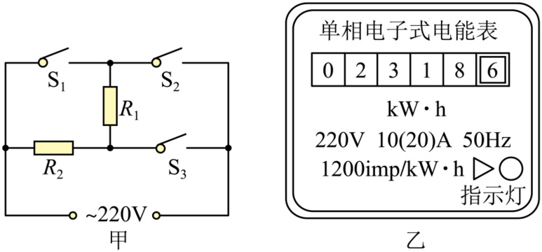

# Physics - 题目 1995

**ID**: 3a39d8102c754adf925c2ec9007b50c9
**年级**: Grade 9
**难度**: Medium-Hard
**题型**: Calculation

## 题目
小明家的电饭锅，额定电压220V，简化电路如图甲。​​​​​​​‌发热电阻R_{1}、R_{2}阻值不随温度变化，操作开关S_{1}、S_{2}、S_{3}的通断（S_{1}、S_{2}不会同时闭合），可实现煮饭、煲汤、保温三个档位调节，只闭合S_{3}时，为煲汤档，额定功率为440W。求：（1）电饭锅在煲汤档正常工作时，电路中的电流；（2）某天用电高峰，小明关闭其它用电器，只让电饭锅在煮饭档工作，发现电能表（如图乙）指示灯30s内闪烁11次，电饭锅煮饭档的实际功率；（3）若电阻R_{1}在保温档和煮饭档时，消耗的功率之比是1∶9，电阻R_{1}的阻值。

## 解答

1. 解：（1）电饭锅在煲汤挡正常工作时，电路中的电流 $I{{}_{1}}=\frac {P{{}_{煲汤}}}{U}=\frac {440{\rm{W}}}{220{\rm{V}}}=2{\rm{A}}$ 。
2. （2）“1200imp/( kW·h)”表示电路中每消耗1 kW·h的电能，电能表的指示灯闪烁1200次，电饭锅煮饭消耗的电能 $W=\frac {{{1}}{{1}}}{{{1}}{{2}}{{0}}{{0}}}{\rm{k}}{\rm{W}}\cdot {\rm{h}}$ ，电饭锅煮饭挡的实际功率 $P{{}_{煮饭}}=\frac {W}{t}=\frac {\frac {{{1}}{{1}}}{{{1}}{{2}}{{0}}{{0}}}{\rm{k}}{\rm{W}}\cdot {\rm{h}}}{\frac {{{3}}0}{{{3}}{{6}}{{0}}0}{\rm{h}}}=1.{{1}}{\rm{k}}{\rm{W}}=1{{1}}00{\rm{W}}$ 。
3. （3）闭合S_{3}时，为煲汤挡，只有R_{2}的简单电路，R_{2}的阻值 $R{{}_{{{2}}}}=\frac {U{^{2}}}{P{{}_{煲汤}}}=\frac {(220{\rm{V}}){^{2}}}{{{4}}{{4}}0{\rm{W}}}={{1}}{{1}}{{0}}Ω$ ，当只闭合开关S_{2}，两个电阻串联，电路的总电阻最大，由 $P=\frac {U{^{2}}}{R}$ 可知电路的总功率最小，电饭煲处于保温挡；只闭合开关S_{1}和S_{3}，两个电阻并联，电路的总电阻最小，由 $P=\frac {U{^{2}}}{R}$ 可知电路的总功率最大，电饭煲处于煮饭挡；电阻R_{1}在保温挡和煮饭挡时，消耗的功率之比是1：9，即 $\frac {P{{}_{1保温}}}{P{{}_{{{1}}煮饭}}}=\frac {1}{9}$ ，设电阻R_{1}在保温挡的电压为U_{1}，而电阻R_{1}在煮饭挡的电压等于电源电压U，所以根据 $P=\frac {U{^{2}}}{R}$ 可得 $\frac {U{{}_{1}}}{U}=\sqrt {\frac {P{{}_{1保温}}}{P{{}_{{{1}}煮饭}}}}=\sqrt {\frac {1}{9}}=\frac {1}{3}$ ，由串联电路的电压规律可得，保温时R_{1}、R_{2}分得的电压之比 $\frac {U{{}_{1}}}{U{{}_{2}}}=\frac {U{{}_{1}}}{U-U{{}_{1}}}=\frac {1}{3-1}=\frac {1}{2}$ ，由串联分压的规律可得R_{1}、R_{2}的阻值之比为 $\frac {R{{}_{1}}}{R{{}_{2}}}=\frac {U{{}_{1}}}{U{{}_{2}}}=\frac {1}{2}$ ，所以电阻R_{1}的阻值为 $R{{}_{1}}=\frac {1}{2}R{{}_{2}}=\frac {1}{2}\times 110Ω=55Ω$ 。
4. 答：（1）电饭锅在煲汤档正常工作时，电路中的电流为2A；
5. （2）某天用电高峰，小明关闭其它用电器，只让电饭锅在煮饭档工作，发现电能表（如图乙）指示灯30s内闪烁11次，电饭锅煮饭档的实际功率为1100W；
6. （3）若电阻R_{1}在保温档和煮饭档时，消耗的功率之比是1∶9，电阻R_{1}的阻值为55Ω。

## 知识点

**中文**:
  - 串、并联电路中的电功率
  - 电能表的读数及电能的求解

**English**:
  - Electric Power in Series/Parallel Circuits
  - Reading Energy Meters and Calculating Energy

---
