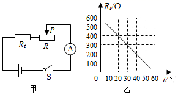

# Physics - 题目 310

**ID**: 3b93a3a7655643eea41fc069510c14d0
**年级**: Grade 9
**难度**: Medium-Hard
**题型**: Calculation

## 题目
热敏电阻广泛应用于控制电路中，其阻值会随环境温度的改变而改变。​​​​​​​‌图甲中，电流表允许通过的最大电流为0.02A，滑动变阻器R的铭牌上标有“200Ω 0.3A”字样，R_{t}为热敏电阻，其阻值随环境温度变化关系如图乙所示，闭合开关S，求：(1)当环境温度为10℃、调节滑P使滑动变阻器接入电路的电阻为100Ω时，电路中电流为0.01A，求电源电压和R_{t}通电100s产生的热量Q。(2)若环境温度为40℃时，要保证整个电路元件的安全，求滑动变阻器的阻值变化范围。

## 解答

1. (1) 由图乙可知，环境温度为10℃时，热敏电阻R_{t}=500Ω。已知，电流I=0.01A，由 $I=\frac {U}{R}$ 可知，电源电压为
2. U=I(R_{t}+R)=0.01A×(500Ω+100Ω)=6V
3. R_{t}通电100s产生的热量为
4. Q=I^{2}Rt=(0.01A)^{2}×500Ω×100s=5J
5. (2)电流表允许通过的最大电流为I_{最大}=0.02A，电源电压U=6V，由 $I=\frac {U}{R}$ 可知，电路中的最小电阻为
6. $R{{}_{{\rm \min }}}=\frac {U}{I{{}_{{\rm \max }}}}=\frac {{\rm{6}}{\rm{V}}}{{\rm{0}}{\rm{.}}{\rm{0}}{\rm{2}}{\rm{A}}}{\rm{=}}{\rm{3}}{\rm{0}}{\rm{0}}{\rm{Ω}}$
7. 当环境温度为40℃时，热敏电阻的阻值为200Ω，滑动变阻器接入的最小阻值为
8. R_{滑最小}=300Ω-200Ω=100Ω
9. 即滑动变阻器的阻值变化范围为100~200Ω。
10. 答：(1)电源电压为6V，R_{t}通电100s产生的热量为5J；
11. (2)滑动变阻器的阻值变化范围为100Ω~200Ω。

## 知识点

**中文**:
  - 电与热综合计算

**English**:
  - Comprehensive Calculation of Electricity and Heat

---
