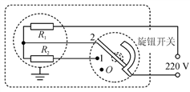
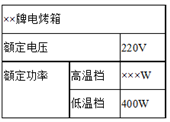

# Physics - 题目 1361

**ID**: 3d0d05f922cb4fdd8ec3161a23501eb1
**年级**: Grade 9
**难度**: Medium-Hard
**题型**: Calculation

## 题目
如表所示为某电烤箱的铭牌，高温档额定功率模糊不清．如图虚线内所示是电烤箱内部的简化电路图．R_{1}和R_{2}均为电热丝，R_{2}=72.​​​​​​​‌6Ω．电烤箱开关接1时是低温档，接2时是高温档．求：（1）电烤箱在低温档正常工作10min电流做的功；（2）R_{1}的阻值；（3）在某用电高峰期，若家庭电路中只有电烤箱在高温档工作，发现标有“3000imp/kW•h”的电能表的指示灯闪烁81次共用时2min，求此时家庭电路两端的实际电压．

## 解答

1. （1）由 $P=\frac {W}{t}$ 可得，电烤箱在低温档正常工作10min电流做的功：
2. $W=P{{}_{低}}t={\rm{4}}{\rm{0}}{\rm{0}}{\rm{W}}\times 10\times {\rm{6}}{\rm{0}}{\rm{s}}=2.4\times {\rm{1}}{\rm{0}}{^{{\rm{5}}}}{\rm{J}}$ ；
3. （2）由图可知，开关接1时，R_{1}与R_{2}串联，总电阻最大，由 $P=\frac {U{^{2}}}{R}$ 可知总功率最小，电烤箱处于低温档；开关接2时，只有R_{1}接入电路，电阻小，由 $P=\frac {U{^{2}}}{R}$ 可知功率大，电烤箱处于高温挡；
4. 处于低温挡时，电路的总电阻：
5. $R=\frac {U{^{2}}}{P{{}_{低}}}{\rm{=}}\frac {{\left({220V}\right)^{2}}}{400W}=121Ω$ ；
6. 则R_{1}的阻值：
7. $R{{}_{1}}=R-R{{}_{2}}=121Ω-72.6Ω=48.4Ω；$
8. （3）指示灯闪烁81次，电烤箱消耗的电能：
9. $W=81\times \frac {1}{3000}{\rm{k}}{\rm{W}}\cdot {\rm{h}}=0.027{\rm{k}}{\rm{W}}\cdot {\rm{h}}$ ，
10. 工作时间：
11. $t=2\min =\frac {1}{30}h，$
12. 则电烤箱在高温档的实际功率：
13. $P=\frac {W}{t}=\frac {0.027{\rm {\rm kW}}\cdot {\rm h}}{\frac {1}{30}{\rm{h}}}=0.81{\rm{k}}{\rm{W}}=810{\rm{W}}$ ；
14. 根据 $P=\frac {U{^{2}}}{R}$  可得，此时家庭电路两端的实际电压：
15. $U=\sqrt {PR{{}_{1}}}=\sqrt {810{\rm{W}}\times 48.4Ω}=198{\rm{V}}$ ．
16. 答：（1）电烤箱在低温档正常工作10min电流做的功为2.4×10^{5}J；
17. （2）R_{1}的阻值为48.4Ω；
18. （3）此时家庭电路两端的实际电压为198V．
19. 【点睛】
20. 本题考查了电功、电阻、电功率的计算，计算过程要注意单位的换算和统一．

## 知识点

**中文**:
  - 串、并联电路中的电功率
  - 电功与电能的计算
  - 电能表的读数及电能的求解
  - 实际电压与实际功率

**English**:
  - Electric Power in Series/Parallel Circuits
  - Calculation of Electric Work and Energy
  - Reading Energy Meters and Calculating Energy
  - Actual Voltage and Actual Power

---
