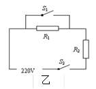

# Physics - 题目 2357

**ID**: 3d25f671beb24560a4a647d378216b6e
**年级**: Grade 9
**难度**: Medium-Hard
**题型**: Calculation

## 题目
甲表是某电热饮水机的铭牌。​​​​​​​‌图乙是它的电路原理图，其中电热丝R_{1}和R_{2}的阻值不变。工作时先闭合开关S_{2}，温控开关S_{1}可以根据水箱中水的温度自动控制饮水机处于加热状态或保温状态。求：（1）饮水机在加热状态下，电路中的电流；（2）饮水机在加热状态下，工作15min所消耗的电能；（3）保温状态下，电阻丝R_{1}的阻值。（4）当实际电压为200V时，保温状态下的实际功率是多少W。（结果保留整数）水桶容量20L热水箱容量1L加热功率440W保温功率44W额定电压220V

## 解答

1. （1）闭合S_{1}、S_{2}时，R_{1}被短路，电路中只有R_{2}工作，电路的总电阻最小，由 $P=\frac {U{^{2}}}{R}$ 可知电路的电功率最大，此时饮水机处于加热状态，电路中的电流
2. $I{{}_{加}}=\frac {P{{}_{加}}}{U}=\frac {{\rm{4}}{\rm{4}}{\rm{0}}{\rm{W}}}{{\rm{2}}{\rm{2}}{\rm{0}}{\rm{V}}}{\rm{=}}{\rm{2}}{\rm{A}}$
3. （2）饮水机在加热状态下，工作15min所消耗的电能
4. W=P_{加}t=440W×15×60s= 3.96 ×10^{5}J
5. R_{2}的阻值
6. $R{{}_{2}}=\frac {U{^{2}}}{P{{}_{加}}}{\rm{=}}\frac {(220{\rm{V}}){^{2}}}{440{\rm{W}}}$ =110Ω
7. （3）S_{2}闭合、S_{1}断开时，R_{1}、R_{2}串联，此时饮水机处于保温状态，总电阻
8. R= $\frac {U{^{2}}}{P{{}_{保温}}}{\rm{=}}\frac {(220{\rm{V}}){^{2}}}{44{\rm{W}}}$ =1100Ω
9. R_{1}的阻值
10. R_{1}=R-R_{2}=1100Ω-110Ω=990Ω
11. （4）保温状态下的实际功率是
12. P_{实}= $\frac {U{{}_{实}}{^{2}}}{R}=\frac {(200{\rm{V}}){^{2}}}{1100Ω}$ ≈36W
13. 答：（1）饮水机在加热状态下，电路中的电流是2A；
14. （2）饮水机在加热状态下，工作15min所消耗的电能是3.96 ×10^{5}J；
15. （3）保温状态下，电阻丝R_{1}的阻值是990Ω；
16. （4）当实际电压为200V时，保温状态下的实际功率是36W。

## 知识点

**中文**:
  - 电功与电能的计算
  - 电路的动态分析
  - 电功率的计算及应用
  - 额定电压与额定功率

**English**:
  - Calculation of Electric Work and Energy
  - Dynamic Circuit Analysis
  - Calculation and Application of Electric Power
  - Rated Voltage and Rated Power

---
