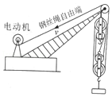

# Physics - 题目 2832

**ID**: 4099945ff0474df4a88325f36d7b92bc
**年级**: Grade 9
**难度**: Medium-Hard
**题型**: Calculation

## 题目
如图所示是打捞物体的模拟装置．现电动机带动钢丝绳自由端以0.​​​​​​​‌5m/s的速度匀速拉动滑轮组，经过5min将体积为0.1m^{3}的物体由海底提升到海面，物体离开海面后钢丝绳自由端的速度变为0.49m/s，此时电动机的输出功率比物体在海水中时增大了12%（不计物体的高度、绳重和摩擦，ρ_{物}=7.6×10^{3}kg/m^{3}，g取10N/kg，ρ_{海水}取1.0×10^{3}kg/m^{3}）．求：（1）物体浸没在海水中受到的浮力；（2）物体在海底时的深度；（3）物体在海底时受到海水的压强；（4）物体在海面下匀速上升过程中，该滑轮组的机械效率（不计动滑轮体积）

## 解答

1. 解：（1）由阿基米德原理的公式得：F_{浮}＝ρ海水gV排＝1.0×10^{3}kg/m^{3}×10N/kg×0.1m^{3}＝1000N；（2）因为n＝5，所以v_{物}＝ $\frac {1}{5}$v_{绳}＝ $\frac {1}{5}$ ×0.5m/s＝0.1m/s，则物体在海底时的深度：h＝v_{物}t＝0.1m/s×5×60s＝30m；（3）p＝ρ海水gh＝1.0×10^{3}kg/m^{3}×10N/kg×30m＝3×10^{5}Pa；（4）G＝mg＝ρ_{物}gV＝7.6×10^{3}kg/m^{3}×10N/kg×0.1m^{3}＝7600N，设物体在水中时电动机的功率为P，钢丝绳自由端的拉力为F，绳自由端的速度v＝0.5m/s，则P＝F×0.5m/s；离开水面后电动机的功率为P_{1}，钢丝绳自由端的拉力为F_{1}，绳自由端的速度v1＝0.49m/s，则P1＝F1×0.49m/s；由物体在离开水面后电动机的功率比物体在海水中时增大了12%可得P1＝P（1+12%），代入数据可得：F1×0.49m/s＝F×0.5m/s（1+12%），解得：F1＝ $\frac {8}{7}$F，由图知，n＝5，不计绳重和摩擦，两次的拉力分别为：F＝ $\frac {1}{5}$ （G﹣F浮+G轮），F1＝ $\frac {1}{5}$ （G+G_{轮}），可得： $\frac {1}{5}$ （G+G_{轮}）＝ $\frac {8}{7}$ × $\frac {1}{5}$ （G﹣F_{浮}+G_{轮}），G_{轮}＝8F_{浮}﹣G＝8×1000N﹣7600N＝400N，物体在海面下匀速上升过程中，动滑轮对物体的拉力G﹣F_{浮}_{ }所做的功为有用功，对动滑轮重力做的功为额外功，所以η＝ $\frac {W{{}_{有}}}{W{{}_{总}}}＝\frac {\left ({G-F{{}_{浮}}}\right )}{\left ({G-F{{}_{浮}}+G{{}_{动}}}\right )}＝\frac {7600N-1000N}{7600N-1000N+400N}\approx $ 94.3%．
2. 点睛：有物体排开海水的体积，利用阿基米德原理可求受到的浮力；由图知，n＝5，求出物体移动的速度，利用速度公式求物体在海底时的深度；利用p＝ρgh求物体在海底时受到海水的压强；利用G＝mg＝ρgV求物体重力；设物体在水中电动机的功率为P，钢丝绳自由端的拉力为F，P＝Fv；物体在离开水面后电动机的功率为P_{1}，钢丝绳自由端的拉力为F_{1}，P1＝F1v1；而物体在离开水面后电动机的功率比物体在海水中时增大了12%，据此求F_{1}、F_{2}的大小关系；由图知，n＝5，不计绳重和摩擦，拉力F，进一步求出动滑轮重力，物体在海面下匀速上升过程中，根据公式求出该滑轮组的机械效率．

## 知识点

**中文**:
  - 液体压强的大小及其计算
  - 速度公式及其应用
  - 阿基米德原理的应用
  - 滑轮组及其工作特点
  - 滑轮（组）的机械效率及其计算

**English**:
  - Magnitude and Calculation of Liquid Pressure
  - Velocity Formula and Applications
  - Applications of Archimedes' Principle
  - Pulley Systems and Operating Characteristics
  - Mechanical Efficiency of Pulleys and Calculations

---
