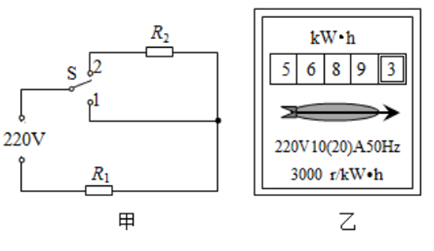

# Physics - 题目 1220

**ID**: 46be21c5b4b840f6b8e877ef09d63202
**年级**: Grade 9
**难度**: Medium-Hard
**题型**: Calculation

## 题目
如图甲为某电饭锅的简化电路原理图，R_{1}和R_{2}为加热电阻，且阻值保持不变，R_{1}=40Ω，S为靠近加热盘的感温开关，1、2是开关连接的触点，加热盘温度达到103℃时，S自动切换到保温状态。​​​​​​​‌某次煮饭时，仅将电饭锅接入220V的电路，按下开关S与触点1连接，工作了10min，S自动切换到保温状态，保温时图乙所示电能表的转盘在1min内转过10转。求：（1）加热状态时，电饭锅消耗的电能；（2）R_{2}的阻值；（3）用电高峰时，实际电压只有额定电压的90% ，求电饭锅加热状态的实际功率。

## 解答

1. 解：（1）加热状态时，电饭锅消耗的电能
2. $W{{}_{加热}}=\frac {U{^{2}}}{R{{}_{1}}}t=\frac {(220{\rm{V}}){^{2}}}{40Ω}\times 10\times 60{\rm{s}}=7.26\times 10{^{5}}{\rm{J}}$
3. （2）保温状态时，电饭锅消耗的电能
4. $W{{}_{保}}=\frac {n}{N}=\frac {{\rm{1}}{\rm{0}}{\rm{r}}}{{\rm{3}}{\rm{0}}{\rm{0}}{\rm{0}}{\rm{r}}{\rm{/}}{\rm{(}}{\rm{k}}{\rm{W}}\cdot {\rm{h}}{\rm{)}}}{\rm{=}}\frac {{\rm{1}}}{{\rm{3}}{\rm{0}}{\rm{0}}}{\rm{k}}{\rm{W}}\cdot {\rm{h}}$
5. 保温的功率
6. $P{{}_{保}}=\frac {W{{}_{保}}}{t{{}_{保}}}=\frac {\frac {1}{300}{\rm{k}}{\rm{W}}\cdot {\rm{h}}}{\frac {1}{60}{\rm{h}}}=0{\rm{.}}{\rm{2}}{\rm{k}}{\rm{W}}{\rm{=}}{\rm{2}}{\rm{0}}{\rm{0}}{\rm{W}}$
7. 当电路处于保温状态时，R_{1}和R_{2}串联在电路当中，总电阻
8. $R{{}_{串}}=\frac {U{^{2}}}{P{{}_{保}}}=\frac {(220{\rm{V}}){^{2}}}{200{\rm{W}}}=242Ω$
9. R_{2}的阻值为
10. $R{{}_{2}}=R{{}_{串}}-R{{}_{1}}=242Ω-40Ω=202Ω$
11. （3）此时的实际电压
12. $U{{}_{实}}=220{\rm{V}}\times 90\%=198{\rm{V}}$
13. 此时电饭锅加热的实际功率
14. $P{{}_{实}}=\frac {U{{}_{实}}{^{2}}}{R{{}_{1}}}=\frac {（198{\rm{V}}）{^{2}}}{40Ω}=980.1{\rm{W}}$
15. 答：（1）加热状态时，电饭锅消耗的电能是 $7.26\times 10{^{5}}{\rm{J}}$ ；
16. （2）R_{2}的阻值是202Ω；
17. （3）电饭锅加热状态的实际功率是980.1W。

## 知识点

**中文**:
  - 电与热综合计算

**English**:
  - Comprehensive Calculation of Electricity and Heat

---
