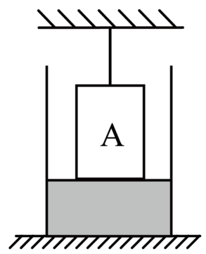

# Physics - 题目 2492

**ID**: 4d71f1b27bc24d039a9c2d0db71a3f8e
**年级**: Grade 9
**难度**: Medium-Hard
**题型**: Calculation

## 题目
如图所示，不吸水的长方体A固定在体积不计的轻杆下端，位于水平地面上的圆柱形容器内，杆上端固定不动。​​​​​​​‌容器内盛有10cm深的水，物体下表面刚好与容器内的水面相平。往容器中缓慢注水，加水过程中水没有溢出。当加500cm^{3}的水时，轻杆受力为6N，容器底部受到的压强较注水前变化了Δp_{1}；当加2000cm^{3}的水时，轻杆受力为3N，容器底部受到的压强较注水前变化了Δp_{2}，且Δp_{1}∶Δp_{2}=1∶4。（ρ_{水}=1.0×10^{3}kg/m^{3}）求：（1）加水前水对容器底的压强；（2）加2000cm^{3}的水时，加入水的质量；（3）物块A的重力G_{A}。

## 解答

1. 解：（1）加水前，容器内盛有10cm深的水，所以水对容器底的压强
2. $p=ρ{{}_{水}}gh={\rm{1}}{\rm{.}}{\rm{0}}\times {\rm{1}}{\rm{0}}{{}^{{\rm{3}}}}{{\rm{k}}{\rm{g}}}/{{\rm{m}}{{}^{{\rm{3}}}}}\times 10{{\rm{N}}}/{{\rm{k}}{\rm{g}}}\times 0.1{\rm{m}}=1000{\rm{P}}{\rm{a}}$
3. （2）加2000cm^{3}的水时，加入水的质量为
4. $m{{}_{水}}=ρ{{}_{水}}{\rm{v}}={\rm{1}}{\rm{.}}{\rm{0}}\times {\rm{1}}{\rm{0}}{{}^{{\rm{3}}}}{{\rm{k}}{\rm{g}}}/{{\rm{m}}{{}^{{\rm{3}}}}}\times 2000\times 10{{}^{{\rm{-}}6}}{\rm{m}}{{}^{3}}=2{\rm{k}}{\rm{g}}$
5. （3）第二次轻杆受到的力为3N小于第一次轻杆受到的力6N，说明第一次A未被浸没且所受浮力小于重力，第二次加水比第一次多，故A受到的浮力比第一次大，轻杆对A有向上的拉力，则圆柱形容器底部受到的水的压力增加量等于A受到的浮力与加入水的重力之和，即
6. $ΔF{{}_{1}}=ΔG{{}_{水1}}+F{{}_{浮}}=ΔG{{}_{水1}}+G{{}_{{\rm{A}}}}-F{{}_{拉1}}$
7. 第二次A所受的浮力可能小于重力，也有可能大于重力，所以轻杆对A的力可能向上也可能向下，则圆柱形容器底部受到的水的压力的增加量等于A受到的浮力与加入水的重力之和，即
8. $ΔF{{}_{2}}=ΔG{{}_{水2}}+F{{}_{浮}}=ΔG{{}_{水2}}+G{{}_{{\rm{A}}}}-F{{}_{拉2}}$
9. 或
10. $ΔF{{}_{2}}=ΔG{{}_{水2}}+F{{}_{浮}}=ΔG{{}_{水2}}+G{{}_{{\rm{A}}}}+F{{}_{拉2}}$
11. 第一次加水的重力为
12. $ΔG{{}_{水1}}=ρ{{}_{水}}ΔV{{}_{1}}g={\rm{1}}{\rm{.}}{\rm{0}}\times {\rm{1}}{\rm{0}}{{}^{{\rm{3}}}}{{\rm{k}}{\rm{g}}}/{{\rm{m}}{{}^{{\rm{3}}}}}\times 500\times 10{{}^{-6}}{\rm{m}}{{}^{3}}\times 10{{\rm{N}}}/{{\rm{k}}{\rm{g}}}=5{\rm{N}}$
13. 第一次压力变化量
14. $ΔF{{}_{1}}=ΔG{{}_{水1}}+F{{}_{浮}}=ΔG{{}_{水1}}+G{{}_{{\rm{A}}}}-F{{}_{拉1}}=5{\rm{N}}+G{{}_{{\rm{A}}}}-6{\rm{N}}=G{{}_{{\rm{A}}}}-1{\rm{N}}$
15. 第二次加水的重力为
16. $ΔG{{}_{水2}}=ρ{{}_{水}}ΔV{{}_{2}}g={\rm{1}}{\rm{.}}{\rm{0}}\times {\rm{1}}{\rm{0}}{{}^{{\rm{3}}}}{{\rm{k}}{\rm{g}}}/{{\rm{m}}{{}^{{\rm{3}}}}}\times 2000\times 10{{}^{-6}}{\rm{m}}{{}^{3}}\times 10{{\rm{N}}}/{{\rm{k}}{\rm{g}}}=20{\rm{N}}$
17. 第二次压力变化量
18. $ΔF{{}_{2}}=ΔG{{}_{水2}}+F{{}_{浮}}=ΔG{{}_{水2}}+G{{}_{{\rm{A}}}}-F{{}_{拉2}}=20{\rm{N}}+G{{}_{{\rm{A}}}}-3{\rm{N}}=G{{}_{{\rm{A}}}}+17{\rm{N}}$
19. 或
20. $ΔF{{}_{2}}=ΔG{{}_{水2}}+F{{}_{浮}}=ΔG{{}_{水2}}+G{{}_{{\rm{A}}}}+F{{}_{拉2}}=20{\rm{N}}+G{{}_{{\rm{A}}}}+3{\rm{N}}=G{{}_{{\rm{A}}}}+23{\rm{N}}$
21. 因为 $Δp=\frac {ΔF}{S}$ ，底面积相同，Δp_{1}∶Δp_{2}=1∶4，所以ΔF_{1}∶ΔF_{2}=1∶4。即有
22. $\frac {G{{}_{{\rm{A}}}}-1{\rm{N}}}{G{{}_{{\rm{A}}}}+17{\rm{N}}}=\frac {1}{4}$
23. 或
24. $\frac {G{{}_{{\rm{A}}}}-1{\rm{N}}}{G{{}_{{\rm{A}}}}+23{\rm{N}}}=\frac {1}{4}$
25. 解得G_{A}=7N或9N。
26. 答：（1）加水前水对容器底的压强是1000Pa；
27. （2）加2000cm^{3}的水时，加入水的质量为2kg；
28. （3）物块A的重力为7N或9N。

## 知识点

**中文**:
  - 液体压强的判断与计算

**English**:
  - Determination and Calculation of Liquid Pressure

---
