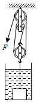

# Physics - 题目 360

**ID**: 509700b1f7c5497489cd090f02d34826
**年级**: Grade 9
**难度**: Medium-Hard
**题型**: Calculation

## 题目
如图所示，用滑轮组提升浸没在水中的边长为1m的正方体重物，重为2.6×10^{4}N，以0.1m/s匀速上升，重物在露出水面后，拉力F为1×10^{4}N，不计绳重及摩擦，求：（g取10N/kg）（1）重物在露出水面前受到的浮力；（2）动滑轮的重；（3）当重物完全露出水面前，滑轮组的机械效率；（4）当重物完全露出水面后，滑轮组的机械效率。​​​​​​​‌

## 解答

1. 解：（1）重物在露出水面前，全部浸没在水中
2. $V{{}_{排}}＝V{{}_{物}}＝（{\rm{1}}{\rm{m}}）{^{{\rm{3}}}}＝{\rm{1}}{\rm{m}}{^{{\rm{3}}}}$
3. 受到的浮力
4. $F{{}_{浮}}＝ρ{{}_{水}}gV{{}_{排}}＝{\rm{1}}{\rm{.}}{\rm{0}}\times {\rm{1}}{\rm{0}}{^{{\rm{3}}}}{\rm{k}}{\rm{g}}{\rm{/}}{\rm{m}}{^{{\rm{3}}}}\times {\rm{1}}{\rm{0}}{\rm{N}}{\rm{/}}{\rm{k}}{\rm{g}}\times {\rm{1}}{\rm{m}}{^{{\rm{3}}}}＝{\rm{1}}\times {\rm{1}}{\rm{0}}{^{{\rm{4}}}}{\rm{N}}$
5. （2）由图知，绳子根数n＝3，重物在露出水面后，拉力
6. $F＝\frac {1}{3}\left ({G+G{{}_{动}}}\right )$
7. 则动滑轮重力
8. $G{{}_{动}}＝3F-G＝{\rm{3}}\times {\rm{1}}\times {\rm{1}}{\rm{0}}{^{{\rm{4}}}}{\rm{N}}-{\rm{2}}{\rm{.}}{\rm{6}}\times {\rm{1}}{\rm{0}}{^{{\rm{4}}}}{\rm{N}}＝{\rm{4}}\times {\rm{1}}{\rm{0}}{^{{\rm{3}}}}{\rm{N}}$
9. （3）不计绳重及摩擦，当重物完全露出水面前，滑轮组的机械效率
10. $η=\frac {W{{}_{有用}}}{W{{}_{总}}}=\frac {\left ({G-F{{}_{浮}}}\right )h}{\left ({G-F{{}_{浮}}}\right )h+G{{}_{动}}h}=\frac {G-F{{}_{浮}}}{G-F{{}_{浮}}+G}{{}_{动}}=\frac {{\rm{2}}{\rm{.}}{\rm{6}}\times {\rm{1}}{\rm{0}}{^{{\rm{4}}}}{\rm{N}}{\rm{-}}{\rm{1}}\times {\rm{1}}{\rm{0}}{^{{\rm{4}}}}{\rm{N}}}{{\rm{2}}{\rm{.}}{\rm{6}}\times {\rm{1}}{\rm{0}}{^{{\rm{4}}}}{\rm{N}}{\rm{-}}{\rm{1}}\times {\rm{1}}{\rm{0}}{^{{\rm{4}}}}{\rm{N}}{\rm{+}}{\rm{4}}\times {\rm{1}}{\rm{0}}{^{{\rm{3}}}}{\rm{N}}}{\rm{=}}{\rm{8}}{\rm{0}}{\rm{\%}}$
11. （4）不计绳重及摩擦，当重物完全露出水面后，滑轮组的机械效率
12. $η^{′}=\frac {W^{′}{{{}_{有用}}}}{W^{′}{{{}_{总}}}}=\frac {Gh}{Gh+G{{}_{动}}h}=\frac {G}{G+G}{{}_{动}}=\frac {{\rm{2}}{\rm{.}}{\rm{6}}\times {\rm{1}}{\rm{0}}{^{{\rm{4}}}}{\rm{N}}}{{\rm{2}}{\rm{.}}{\rm{6}}\times {\rm{1}}{\rm{0}}{^{{\rm{4}}}}{\rm{N}}{\rm{+}}{\rm{4}}\times {\rm{1}}{\rm{0}}{^{{\rm{3}}}}{\rm{N}}}{\rm{=}}{\rm{8}}{\rm{6}}{\rm{.}}{\rm{7}}{\rm{\%}}$
13. 答：（1）重物在露出水面前受到的浮力为1×10^{4}N；
14. （2）动滑轮的重4×10^{3}N；
15. （3）当重物完全露出水面前，滑轮组的机械效率为80%；
16. （4）当重物完全露出水面后，滑轮组的机械效率约为86.7%。

## 知识点

**中文**:
  - 滑轮组及其工作特点
  - 阿基米德原理的应用
  - 滑轮（组）的机械效率及其计算

**English**:
  - Pulley Systems and Operating Characteristics
  - Applications of Archimedes' Principle
  - Mechanical Efficiency of Pulleys and Calculations

---
