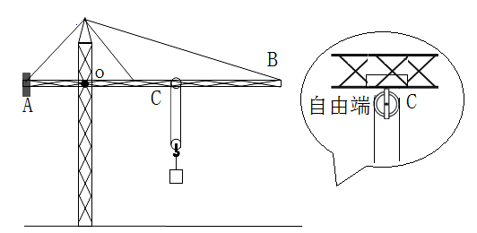

# Physics - 题目 2844

**ID**: 53293cc9b1844949858a480b8315acbf
**年级**: Grade 9
**难度**: Medium-Hard
**题型**: Calculation

## 题目
某建筑工地上有一台巨大的起重设备“塔吊”，其主要构成为电动机和机械装置两个部分，简化组成如图所示，A为塔吊的配重，OB为塔吊的起重臂，C为能在起重臂上移动的载重小车，载重小车下挂有滑轮组，OB＝25m。​​​​​​​‌当载重小车在B点时，能安全起吊重物的最大质量是1.2t。如果这台“塔吊”配置的电动机铭牌参数为“额定电压380V，额定功率38kW”。在某次起吊作业中，该“塔吊”电动机正常工作25s，通过载重小车从距离O点为10m的载重臂上把一底面积为0.8m^{3}、质量为2.4t的方形重物匀速提升20m。（不计挂钩、滑轮组和钢丝绳重及摩擦，取g＝10N/kg）那么：(1)起吊后，当重物匀速上升时，载重小车下电动机牵引钢丝绳自由端的拉力N，在这次起吊过程中，塔吊上的电动机对重物做功的效率（保留整数）。(2)起吊前，该重物对地面的压强为多大？(3)本次将重物从起吊点提升20m后，为保证塔吊安全工作，载重小车最多能向B点方向再平移多少m？

## 解答

1. (1)重物的重力
2. $G=mg=2.4\times 10{^{3}}{\rm{k}}{\rm{g}}\times 10{\rm{N}}{\rm{/}}{\rm{k}}{\rm{g}}=2.4\times 10{^{4}}{\rm{N}}$
3. 由图可知，绳子段数n=4，因不计挂钩、滑轮组和钢丝绳重及摩擦，所以，电动机牵引钢丝绳自由端的拉力
4. $F{{}_{拉}}=\frac {G}{n}=\frac {2.4\times 10{^{4}}{\rm{N}}}{4}=6000{\rm{N}}$
5. 电动机所做有用功
6. $W{{}_{有用}}=Gh=4.2\times 10{^{4}}{\rm{N}}\times 20{\rm{m}}=4.8\times 10{^{5}}{\rm{J}}$
7. 电动机所做总功
8. $W{{}_{总}}=Pt=3.8\times 10{^{4}}{\rm{W}}\times 25{\rm{s}}=9.5\times 10{^{5}}{\rm{J}}$
9. 塔吊上的电动机对重物做功的效率
10. $η=\frac {W{{}_{有用}}}{W{{}_{总}}}\times 100{\rm{\%}}=\frac {4.8\times 10{^{5}}{\rm{J}}}{9.5\times 10{^{5}}{\rm{J}}}\times 100{\rm{\%}}\approx 51{\rm{\%}}$
11. (2)起吊前，该重物对地面的压力
12. $F=G=2.4\times 10{^{4}}{\rm{N}}$
13. 该重物对地面的压强
14. $p=\frac {F}{S}=\frac {2.4\times 10{^{4}}{\rm{N}}}{0.8{\rm{m}}{^{2}}}=3\times 10{^{4}}{\rm{P}}{\rm{a}}$
15. (3)由杠杆平衡条件可知
16. $G{{}_{{\rm{A}}}}\times OA=m{{}_{最大}}g\times OB$
17. 当提升2.4t重物时
18. $G{{}_{{\rm{A}}}}\times OA=m{{}_{物}}g\times OC＇$
19. 所以
20. $m{{}_{最大}}g\times OB=m{{}_{物}}g\times OC＇$
21. 即
22. $1200{\rm{k}}{\rm{g}}\times 10{\rm{N}}{\rm{/}}{\rm{k}}{\rm{g}}\times 25{\rm{m}}=2400{\rm{k}}{\rm{g}}\times 10{\rm{N}}{\rm{/}}{\rm{k}}{\rm{g}}\times OC＇$
23. 解得
24. $OC＇=12.5{\rm{m}}$
25. 所以，载重小车最多能向B点方向再平移的距离
26. $s=OC＇-OC=12.5{\rm{m}}-10{\rm{m}}=2.5{\rm{m}}$
27. 答：(1)起吊后，当重物匀速上升时，载重小车下电动机牵引钢丝绳自由端的拉力为6000N；这次起吊过程中，塔吊上的电动机对重物做功的效率为51%；
28. (2)起吊前，该重物对地面的压强为3×10^{4}Pa；
29. (3)载重小车最多能向B点方向再平移2.5m。

## 知识点

**中文**:
  - 动滑轮及其工作特点
  - 重力公式的应用
  - 压强的计算
  - 杠杆平衡条件的应用

**English**:
  - Movable Pulleys and Operating Characteristics
  - Application of Gravity Formula
  - Calculation of Pressure
  - Application of Lever Equilibrium Conditions

---
