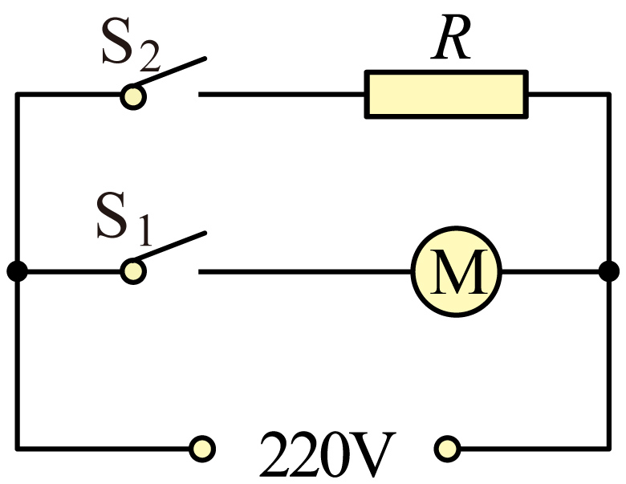

# Physics - 题目 2692

**ID**: 5616ba62967b4d639931438a7bb890fb
**年级**: Grade 9
**难度**: Medium-Hard
**题型**: Calculation

## 题目
如图是某晾衣机的工作电路图，电源电压U=220V，其中R是发热电阻。​​​​​​​‌当开关S_{1}闭合、S_{2}断开时，晾衣机开启风干功能，其额定功率P_{1}=44W；当开关S_{1}、S_{2}均闭合时，晾衣机开启烘干功能，通过R的电流I_{2}=1A。求：（1）使用风干功能时通过电动机的电流；（2）使用烘干功能时电阻R在1min内产生的热量；（3）使用烘干功能1h消耗的电能。

## 解答

1. 解：（1）使用风干功能时，电路中只有电动机工作,由 $P=UI$ 知道，此时通过电动机的电流
2. $I{{}_{1}}=\frac {P{{}_{1}}}{U}=\frac {44{\rm{W}}}{220{\rm{V}}}=0.2{\rm{A}}$
3. （2）使用烘干功能时，电路中电动机和发热电阻 $R$ 并联，两端电压相同，由 $W=UIt$  知道，1min内产生的热量
4. $Q=W{{}_{2}}=UI{{}_{2}}t{{}_{1}}=220{\rm{V}}\times 1{\rm{A}}\times 60{\rm{s}}=1.32\times 10{^{4}}{\rm{J}}$
5. （3）电阻 $R$ 的功率
6. $P{{}_{2}}=UI{{}_{2}}=220{\rm{V}}\times 1{\rm{A}}=220{\rm{W}}$
7. 电路消耗的总功率
8. $P=P{{}_{1}}+P{{}_{2}}=44{\rm{W}}+220{\rm{W}}=264{\rm{W}}$
9. 电路消耗的总电能
10. $W=Pt{{}_{2}}=264\times 10{^{-3}}{\rm{k}}{\rm{W}}\times 1{\rm{h}}=0.264{\rm{k}}{\rm{W}}\cdot {\rm{h}}$
11. 答：（1）使用风干功能时通过电动机的电流是0.2A；
12. （2）使用烘干功能时电阻R在1min内产生的热量是1.32×10^{4}J；
13. （3）使用烘干功能1h消耗的电能是0.264kW•h。

## 知识点

**中文**:
  - 焦耳定律的计算公式及其应用
  - 电功与电能的计算
  - 电功率的计算及应用

**English**:
  - Formula and Application of Joule's Law
  - Calculation of Electric Work and Energy
  - Calculation and Application of Electric Power

---
