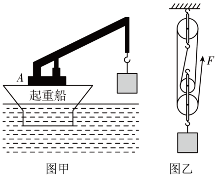

# Physics - 题目 2400

**ID**: 5a1aacda73f247349b39f8d4f4acefea
**年级**: Grade 9
**难度**: Medium-Hard
**题型**: Calculation

## 题目
图甲是某起重船的示意图，A处为卷扬机，吊臂前端滑轮组如图乙所示．在一次吊装施工中，当起重船从运输船上吊起重物时，起重船浸入海水中的体积增加了18m^{3}，重物在空中匀速竖直上升了3m，所用时间为30s．已知动滑轮总重为2×10^{4}N，不计钢丝绳重及摩擦．（ρ_{海水}＝1.​​​​​​​‌0×10^{3}kg/m^{3}）（1）求该重物的重力是多少？（2）求钢丝绳拉力F做功的功率是多少？（3）求该重物在空中匀速上升过程中滑轮组的机械效率．

## 解答

1. （1）．起重船增大的浮力：
2. △F_{浮}＝ρ_{水}g△V_{排}＝1×10^{3}kg/m^{3}×10N/kg×18m^{3}＝1.8×10^{5}N，
3. 因为起重船始终漂浮，所以该重物的重力与增大的浮力相等：
4. G＝△F_{浮}＝1.8×10^{5}N；
5. （2）．由图知，n＝4，不计钢丝绳重及摩擦，钢丝绳的拉力：
6. ${\rm \mathit{F}＝}\frac {1}{4}$ （G+G_{动}）＝ $\frac {1}{4}{\rm ×（1.8×10^{5}N+2×10^{4}N）＝5×10^{4}N}$ ；
7. 拉力端移动距离：
8. s＝4h＝4×3m＝12m，
9. 拉力做的总功：
10. W_{总}＝Fs＝5×10^{4}N×12m＝6×10^{5}J，
11. 拉力做功的功率：
12. $P=\frac {W{{}_{总}}}{t}=\frac {6\times 10{^{5}}{\rm{J}}}{30{\rm{s}}}=2\times 10{^{4}}{\rm{W}}$ ；
13. （3）．拉力做的有用功：
14. W_{有用}＝Gh＝1.8×10^{5}N×3m＝5.4×10^{5}J，
15. 滑轮组的机械效率：
16. $η=\frac {W{{}_{有用}}}{W{{}_{总}}}=\frac {5.4\times 10{^{5}}{\rm{J}}}{6\times 10{^{5}}{\rm{J}}}\times 100{\rm{\%}}=90{\rm{\%}}$
17. 答：（1）．该重物的重力是1.8×10^{5}N；
18. （2）．钢丝绳拉力F做功的功率是2×10^{4}W；
19. （3）．该重物在空中匀速上升过程中滑轮组的机械效率为90%．

## 知识点

**中文**:
  - 滑轮（组）

**English**:
  - Pulleys (Systems)

---
