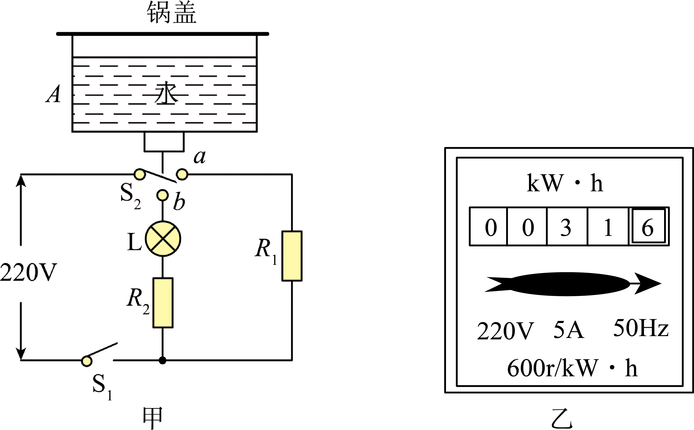

# Physics - 题目 403

**ID**: 5fe3ce80c1ce4336b3cfddc03f030fef
**年级**: Grade 9
**难度**: Medium-Hard
**题型**: Calculation

## 题目
电压力锅结合了压力锅和电饭锅的特点，能快速、安全、自动实现多种烹调方式。​​​​​​​‌如图甲是一种电压力锅的简易原理图，A为密闭锅体，R_{1}为工作时的加热电阻，L为指示灯，其电阻为20Ω，R_{2}为保温电阻，S_{1}为电源开关，S_{2}为压力开关，闭合S_{1}后，电路通过R_{1}对电压力锅加热，当锅内气体压强达到设定值时，水开始沸腾，锅底向下移动，压力开关S_{2}与触点a断开，并与b点接通，起到控压控温的目的，此时保温电路的总功率为20W。求：（1）保温电阻R_{2}的阻值；（2）晓红家的电能表如图乙所示，当晓红家只有电压力锅工作并且处于加热状态10分钟，则电能表的转盘转的圈数；（3）已知锅内水的质量为lkg，初温为16℃，测出闭合开关S_{1}到电路中指示灯L亮用了500s，则该电压力锅从开始加热至锅内气压达到设定时的电热效率。[水的比热容为4.2×10^{3}J/(kg·℃)]。表一：水的沸点T与气体压强p的关系T/℃100105110112114116118120p/kPa101121143154163175187199表二：电压力锅的铭牌额定电压加热功率压强设定值220V1000W175kPa

## 解答

1. 解：（1）当S_{2}解b时，灯L与R_{2}串联，此时为保温状态，此时保温电路的总功率为20W，所以电路的总电阻为
2. $R{{}_{总}}=\frac {U{^{2}}}{P{{}_{保}}}=\frac {{\left({220{\rm{V}}}\right)^{2}}}{20{\rm{W}}}=2420Ω$
3. R_{2}的阻值为
4. $R{{}_{2}}=R{{}_{总}}-R{{}_{{\rm{L}}}}=2420Ω-20Ω=2400Ω$
5. （2）只有电压力锅工作并且处于加热状态10分钟，消耗的电能为
6. $W=P{{}_{加}}t=1000{\rm{W}}\times 10\times 60{\rm{s}}=6\times 10{^{5}}{\rm{J}}=\frac {1}{6}{\rm{k}}{\rm{W}}\cdot {\rm{h}}$
7. 电能表的转盘转的圈数为
8. $n=NW=600{\rm{r}}/{\rm{k}}{\rm{W}}\cdot {\rm{h}}\times \frac {1}{6}{\rm{k}}{\rm{W}}\cdot {\rm{h}}=100{\rm{r}}$
9. （3）气压达到设定为175kPa，由表一可知，设定的温度为116℃，所以水升高的温度为
10. $Δt=t-t{{}_{0}}=116℃-16℃=100℃$
11. 水吸收的热量为
12. $Q=cmΔt=4.2\times 10{^{3}}{\rm{J}}/({\rm{k}}{\rm{g}}·℃）\times 1{\rm{k}}{\rm{g}}\times 100℃=4.2\times 10{^{5}}{\rm{J}}$
13. 加热500s消耗的电能为
14. $W\prime =P{{}_{加}}t\prime =1000{\rm{W}}\times 500{\rm{s}}=5\times 10{^{5}}{\rm{J}}$
15. 电热效率为
16. $η=\frac {Q}{W\prime }=\frac {4.2\times 10{^{5}}{\rm{J}}}{5\times 10{^{5}}{\rm{J}}}=84\%$
17. 答：（1）保温电阻R_{2}的阻值为2400Ω；
18. （2）只有电压力锅工作并且处于加热状态10分钟，则电能表的转盘转的圈数为100r；
19. （3）电压力锅的电热效率为84%。

## 知识点

**中文**:
  - 电与热综合计算

**English**:
  - Comprehensive Calculation of Electricity and Heat

---
