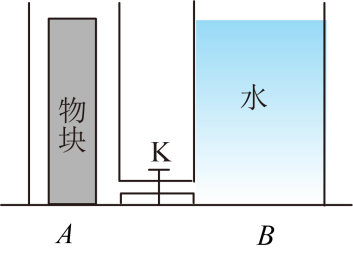

# Physics - 题目 288

**ID**: 6296c1b758d54fd780929870863b5d94
**年级**: Grade 9
**难度**: Medium-Hard
**题型**: Calculation

## 题目
如图所示，水平桌面上放置下端用毛细管连通的A、B两薄壁容器，底面积分别为 $250{\rm{c}}{\rm{m}}²$ 和300cm^{2}。​​​​​​​‌阀门K打开前，A容器内竖直放置一底面积为 $50{\rm{c}}{\rm{m}}²$ ，高为0.3m的长方体物块，B容器内盛有0.3m深的水。已知水的密度为 $1.0\times 10³{\rm{k}}{\rm{g}}/{\rm{m}}³。$（1）阀门K打开前，求水对B容器底部的压强；（2）现将阀门K打开，水从B容器进入A容器，当B容器中水面下降 $\frac {1}{3}$ 时，物块刚好要离开A容器底部，此时A容器中的水对容器底的压强为 $p{{}_{{\rm{A}}}}$ 、B容器中的水对容器底的压强为 $p{{}_{{\rm{B}}}}$ ，且 $p{{}_{{\rm{A}}}}=\frac {3}{4}p{{}_{{\rm{B}}}}$ ，求：①此时A容器中水的深度；②物块的密度。

## 解答

1. 解：（1）阀门K打开前，水对B容器底部的压强p_{B}=ρ_{水}gh=1.0×10^{3}kg/m^{3}×10N/kg×0.3m=3000Pa。
2. （2）①当B容器中水面下降 $\frac {1}{3}$ 时，物块刚好要离开A容器底部，B容器中的水对容器底的压强 $p{{}_{{\rm{B}}}}=ρgh{{}_{{\rm{B}}}}=1\times 10{^{3}}{\rm{k}}{\rm{g}}{\rm{/}}{\rm{m}}{^{3}}\times 10{\rm{N}}{\rm{/}}{\rm{k}}{\rm{g}}\times (1-\frac {1}{3})\times 0.3{\rm{m}}=2000{\rm{P}}{\rm{a}}$ ，A容器中的水对容器底的压强为 $p{{}_{{\rm{A}}}}=\frac {3}{4}p{{}_{{\rm{B}}}}=\frac {3}{4}\times 2000{\rm{P}}{\rm{a}}=1500{\rm{P}}{\rm{a}}$ ，此时A容器中水的深度 $h{{}_{{\rm{A}}}}=\frac {p{{}_{{\rm{A}}}}}{ρg}=\frac {1500{\rm{P}}{\rm{a}}}{1\times 10{^{3}}{\rm{k}}{\rm{g}}{\rm{/}}{\rm{m}}{^{3}}\times 10{\rm{N}}{\rm{/}}{\rm{k}}{\rm{g}}}=0.15{\rm{m}}$ ，②物块体积V_{物}=S_{物}h_{物}=50×10^{-4}m^{2}×0.3m=1.5×10^{-3}m^{3}^{，}
3. 物块排开水的体积V_{排}=S_{物}h_{浸}=50×10^{-4}m^{2}×0.15m=7.5×10^{-4}m^{3}^{，}物块受到的浮力F_{浮}=ρgV_{排}=1×10^{3}kg/m^{3}×10N/kg×7.5×10^{-4}m^{3}=7.5N，物块漂浮，浮力等于重力，即G_{物}=F_{浮}=7.5N，物块的密度 $ρ=\frac {m}{V}=\frac {G}{gV}=\frac {7.5{\rm{N}}}{10{\rm{N}}{\rm{/}}{\rm{k}}{\rm{g}}\times 1.5\times 10{^{-3}}{\rm{m}}{^{3}}}=0.5\times 10{^{3}}{\rm{k}}{\rm{g}}{\rm{/}}{\rm{m}}{^{3}}$ 。
4. 答：（1）阀门K打开前，水对B容器底部的压强是3000Pa；
5. （2）①此时A容器中水的深度是0.15m；
6. ②物块的密度是0.5×10^{3}kg/m^{3}。

## 知识点

**中文**:
  - 液体压强计算公式的应用
  - 重力公式的应用
  - 阿基米德原理的应用
  - 物体的浮沉条件及其应用

**English**:
  - Application of Liquid Pressure Formula
  - Application of Gravity Formula
  - Applications of Archimedes' Principle
  - Floating/Sinking Conditions and Applications

---
