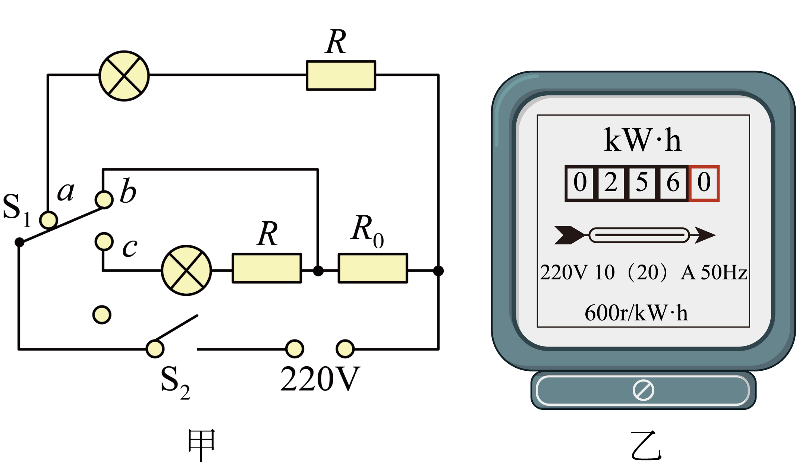

# Physics - 题目 2837

**ID**: 696c1218080c4f31bcc8dbb857baa6af
**年级**: Grade 9
**难度**: Medium-Hard
**题型**: Calculation

## 题目
小华家有一个标有“220V　2200W”的即热式水龙头，在使用时发现不能满足家人对冬夏两季水温的需求，于是他增加了两个相同的发热电阻R和两个指示灯（指示灯电阻不计），设计了如图甲所示的电路进行改进，其中 $R{{}_{0}}$ 为改进前水龙头的发热电阻，开关 ${\rm{S}}{{}_{1}}$ 可以同时与a、b相连或只与c相连，使其具有两挡工作状态（忽略发热电阻阻值的变化）。​​​​​​​‌（1）请求出 $R{{}_{0}}$ 的阻值；（2）改进前，小华关闭家中其他电器，只让该水龙头工作，发现家中电能表（如图乙所示）1min转20r，请求出此时该水龙头的实际功率；（3）改进后，水龙头正常工作时两挡电功率之比为4∶1，请求出正常工作时高温挡的电功率。

## 解答

1. 解：（1）根据 $P=\frac {U{^{2}}}{R}$ 可得， $R{{}_{0}}$ 的阻值为 $R{{}_{0}}=\frac {U{^{2}}}{P{{}_{额}}}=\frac {(220{\rm{V}}){^{2}}}{2200{\rm{W}}}=22{\rm{Ω}}$
2. （2）根据图乙可知，当电能表转600r时，消耗的电能为 $1{\rm{k}}{\rm{W}}\cdot {\rm{h}}$ ，当转20r时，消耗的电能为 $W=\frac {20{\rm{r}}}{600{\rm{r}}}\times 1{\rm{k}}{\rm{W}}\cdot {\rm{h}}=\frac {1}{30}{\rm{k}}{\rm{W}}\cdot {\rm{h}}$ ，则此时该水龙头的实际功率为 $P{{}_{实}}=\frac {W}{t}=\frac {\frac {1}{30}{\rm{k}}{\rm{W}}\cdot {\rm{h}}}{\frac {1}{60}{\rm{h}}}=2{\rm{k}}{\rm{W}}={\rm{2}}{\rm{0}}{\rm{0}}{\rm{0}}{\rm{W}}$
3. （3）由电路图可知，将开关S与a、b相连时，电阻R与R_{0}并联，电阻较小，根据 $P=UI=\frac {U{^{2}}}{R}$ 可知，此时电路的总功率最大，水龙头处于高温挡，由电路图可知，将开关S与c相连时，R与R_{0}串联，总电阻较大，总功率较小，水龙头处于低温状态，因为水龙头分别处于高温挡与低温挡时，两挡电功率之比为4∶1，则有 $P{{}_{高}}=P+P{{}_{R{{}_{0}}}}=\frac {U{^{2}}}{R}+2200{\rm{W}}$ ， $P{{}_{低}}=\frac {U{^{2}}}{R+R{{}_{0}}}=\frac {U{^{2}}}{R+22\Omega }$ ，由于水龙头分别处于高温挡与低温挡时，两挡电功率之比为4:1，可得 $\frac {4U{^{2}}}{R+22\Omega }=\frac {U{^{2}}}{R}+2200{\rm{W}}$ ，解得 $R=22{\rm{Ω}}$ ，则高温挡时的电功率为 $P{{}_{高}}=P+P{{}_{R{{}_{0}}}}=\frac {U{^{2}}}{R}+2200{\rm{W}}=\frac {(220{\rm{V}}){^{2}}}{22{\rm{Ω}}}+2200{\rm{W}}=4400{\rm{W}}$
4. 答：（1） $R{{}_{0}}$ 的阻值为 $22{\rm{Ω}}$ ；
5. （2）该水龙头的实际功率为 ${\rm{2}}{\rm{0}}{\rm{0}}{\rm{0}}{\rm{W}}$ ；
6. （3）正常工作时高温挡的电功率为 $4400{\rm{W}}$ 。

## 知识点

**中文**:
  - 串、并联电路中的电功率
  - 电能表的读数及电能的求解
  - 电功率的计算及应用

**English**:
  - Electric Power in Series/Parallel Circuits
  - Reading Energy Meters and Calculating Energy
  - Calculation and Application of Electric Power

---
