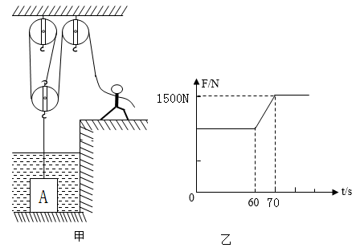

# Physics - 题目 2466

**ID**: 6cb0fcedf1044067b8e3e3daa3cddd96
**年级**: Grade 9
**难度**: Medium-Hard
**题型**: Calculation

## 题目
某工人站在水平地面上，用如图甲所示装置，将实心长方体A从井底沿竖直方向匀速拉起。​​​​​​​‌A体积为0.12m^{3}，重3600N，上升的速度始终为0.1m/s，图乙是人对绳子的拉力F随时间t变化的图象。（不计绳与滑轮间的摩擦及绳重，且忽略水对物体的阻力，g取10N/kg，ρ_{水}＝1×10^{3}kg/m^{3}）求：(1)实心长方体A的高度；（不考虑井中水面高度的变化）(2)实心长方体A浸没在水中时受到的浮力；(3)实心长方体A完全露出水面后，在提升过程中滑轮组的机械效率；

## 解答

1. (1)A上升的速度始终为0.1m/s，A从顶部到达水面到完全离开水面时，排开水的体积逐渐变小，由阿基米德原理，受到浮力变小，故人的拉力逐渐变大，故由图乙知，长方体A从顶部到达水面到离开水面一共用时
2. $t＝{\rm{7}}{\rm{0}}{\rm{s}}﹣{\rm{6}}{\rm{0}}{\rm{s}}＝{\rm{1}}{\rm{0}}{\rm{s}}$
3. 则长方体的高度
4. $h＝vt＝{\rm{0}}{\rm{.}}{\rm{1}}{\rm{m}}{\rm{/}}{\rm{s}}{\rm{×}}{\rm{1}}{\rm{0}}{\rm{s}}＝{\rm{1}}{\rm{m}}$
5. (2)根据阿基米德原理，实心长方体A浸没在水中时受到的浮力
6. $F{{}_{浮}}＝ρ{{}_{水}}gV{{}_{排}}＝{\rm{1}}{\rm{.}}{\rm{0}}{\rm{×}}{\rm{1}}{\rm{0}}{^{{\rm{3}}}}{\rm{k}}{\rm{g}}{\rm{/}}{\rm{m}}{^{{\rm{3}}}}{\rm{×}}{\rm{1}}{\rm{0}}{\rm{N}}{\rm{/}}{\rm{k}}{\rm{g}}{\rm{×}}{\rm{0}}{\rm{.}}{\rm{1}}{\rm{2}}{\rm{m}}{^{{\rm{3}}}}＝{\rm{1}}{\rm{2}}{\rm{0}}{\rm{0}}{\rm{N}}$
7. (3)由图乙知，A完全露出水面后，人对绳子的拉力不变
8. $F＝{\rm{1}}{\rm{5}}{\rm{0}}{\rm{0}}{\rm{N}}$
9. 绳子的有效段为3，则绳子自由端移动的距离
10. $s＝3h$
11. 滑轮组的机械效率
12. $η=\frac {W{{}_{有}}}{W{{}_{总}}}\times 100\%{\rm{=}}\frac {{\rm{G}}{\rm{h}}}{{\rm{F}}\times {\rm{3}}h}\times 100\%=\frac {G}{3F}\times 100\%=\frac {{\rm{3}}{\rm{6}}{\rm{0}}{\rm{0}}{\rm{N}}}{{\rm{3}}{\rm{×}}{\rm{1}}{\rm{5}}{\rm{0}}{\rm{0}}{\rm{N}}}{\rm{×}}{\rm{1}}{\rm{0}}{\rm{0}}{\rm{\%}}{\rm{=}}{\rm{8}}{\rm{0}}\%$
13. 答：(1)实心长方体A的高度为1m；
14. (2)A实心长方体A浸没在水中时受到的浮力为1200N；
15. (3)实心长方体A完全露出水面后，在提升过程中滑轮组的机械效率为80%。

## 知识点

**中文**:
  - 滑轮（组）的机械效率及其计算
  - 阿基米德原理的应用

**English**:
  - Mechanical Efficiency of Pulleys and Calculations
  - Applications of Archimedes' Principle

---
