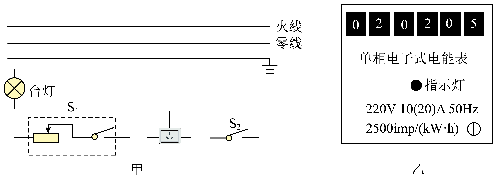

# Physics - 题目 365

**ID**: 79146129209645449eedb83b72d9527f
**年级**: Grade 9
**难度**: Medium-Hard
**题型**: Calculation

## 题目
如图甲是家庭电路的一部分。​​​​​​​‌（1）请用笔画线，将图甲中的台灯、开关和插座按照安全用电的原则接入家庭电路中。要求：S1（旋转开关）单独控制台灯，S2单独控制插座；（2）台灯的灯泡标着“220V 44W”，闭合开关，求：①灯泡正常发光时电阻是多少？②调节旋转开关，测得当灯两端的电压为110V时，灯的实际功率为12.1W，求此时通过灯的电流是多少？通电200s灯消耗的电能是多少？（忽略温度对灯丝电阻的影响）（3）关闭其他用电器，单独接入电热水壶（具体参数见下面表格）工作6min，此过程中如图乙所示的电能表一共闪了250次，求电热水壶这段时间内消耗的电能是多少？（忽略温度对灯丝电阻的影响）

## 解答

1. （1）据题目可知，此时变阻器必须与台灯串联，S1开关与火线相连，台灯与零线相连。从安全用电的角度分析，S2为单独三孔插座的开关，则S2应与三孔插座串联，三孔插座的接法：上孔接地线；左孔接零线；右孔接火线。如下图：
2. 
3. （2）①灯泡正常发光时的电压为220V，功率为44W；由P＝UI可得正常发光时的电流
4. $I=\frac {P}{U}{\rm{=}}\frac {44{\rm{W}}}{220{\rm{V}}}=0.2{\rm{A}}$
5. 则正常发光的电阻
6. $R=\frac {U}{I}{\rm{=}}\frac {220{\rm{V}}}{0.2{\rm{A}}}=1100\Omega $
7. ②灯两端电压为110V时，灯的电功率
8. $P\prime ＝12.1{\rm{W}}{\rm{=}}U^{′}I^{′}=110{\rm{V}}\times I^{′}$
9. 通过灯的电流
10. $I^{′}=\frac {P\prime }{U^{′}}＝\frac {12.1{\rm{W}}}{110{\rm{V}}}=0.11{\rm{A}}$
11. 通电200s灯消耗的电能为
12. $W＝P\prime t＝12.1{\rm{W}}\times 200{\rm{s}}＝2420{\rm{J}}$
13. （3）2500imp/（kW•h）表示的是电路中每消耗1kW•h的电能，指示灯闪烁2500次，
14. 所以指示灯闪烁250次消耗的电能为
15. $W=\frac {250{\rm{i}}{\rm{m}}{\rm{p}}}{2500{\rm{i}}{\rm{m}}{\rm{p}}/{\rm{k}}{\rm{W}}·{\rm{h}}}{\rm{=}}{\rm{0}}{\rm{.}}{\rm{1}}{\rm{k}}{\rm{W}}·{\rm{h}}=3.6\times 10{^{5}}{\rm{J}}$
16. 答：（1）；
17. （2）①灯泡正常发光时电阻是1100Ω；②通电200s灯消耗的电能是2420J；
18. （3）电热水壶这段时间内消耗的电能是3.6×105J。

## 知识点

**中文**:
  - 家庭电路的连接
  - 欧姆定律的应用
  - 电功与电能的计算
  - 电能表的读数及电能的求解
  - 电功率的计算及应用

**English**:
  - Connection of Household Circuits
  - Applications of Ohm's Law
  - Calculation of Electric Work and Energy
  - Reading Energy Meters and Calculating Energy
  - Calculation and Application of Electric Power

---
