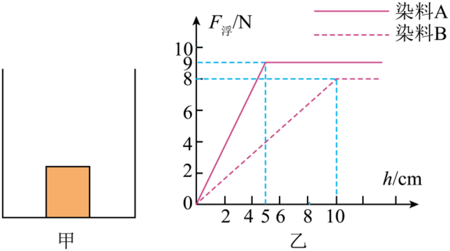

# Physics - 题目 237

**ID**: 7bba10deb6954d2291e291e1c67868ae
**年级**: Grade 9
**难度**: Medium-Hard
**题型**: Calculation

## 题目
小明尝试用两种染料给3D打印出来的模型上色，如图甲所示，实心正方体模型放入底面积为 $200{\rm{c}}{\rm{m}}{^{2}}$ 柱形容器底部，逐渐向容器内倒入染料A，模型受到的浮力F与容器内染料深度h的图像如图乙实线所示，更换另一种染料B重复上述过程，F与h的图像如图乙虚线所示。​​​​​​​‌（液体始终未溢出）求：(1)物块受到的重力；(2)倒入液体B的密度；(3)倒出液体B，更换加水，当加水的体积为 $2100{\rm{c}}{\rm{m}}{^{3}}$ 时，液体对容器底部的压强。

## 解答

1. （1）由图乙可知，当容器内染料A的深度h>5cm时，正方体模型受到的浮力为9N不再发生变化，当容器内染料B的深度h>10cm时，正方体模型受到的浮力为8N不再发生变化，若模型在两染料中最终都沉底，则模型受到浮力刚达到最大时两染料的深度应该相等，由前面的分析可知这种情况不可能；若模型在两染料中最终都漂浮，则由漂浮条件可知，模型在两种染料中最终受到的浮力大小相等，均等于模型的重力，由前面的分析可知这种情况不可能，则模型在两染料中最终只能是“一漂一沉”；因5cm<10cm，所以可知模型在A染料中最终处于漂浮状态，在B染料中处于沉底，则模型受到的重力为 $G=F{{}_{浮{\rm{A}}}}=9{\rm{N}}$
2. （2）物块体积为 $V={\left({10{\rm{c}}{\rm{m}}}\right)^{3}}=1000{\rm{c}}{\rm{m}}{^{3}}=0.001{\rm{m}}{^{3}}$ ，模型在B染料中处于沉底，且最大浮力 $F{{}_{浮B}}=8{\rm{N}}$ ，则倒入液体B的密度为 $ρ{{}_{{\rm{B}}}}=\frac {F{{}_{浮{\rm{B}}}}}{gV{{}_{排}}}=\frac {8{\rm{N}}}{10{\rm{N}}/{\rm{k}}{\rm{g}}\times 0.001{\rm{m}}{^{3}}}=0.8\times {{1}}{{0}}{^{3}}{\rm{k}}{\rm{g}}/{\rm{m}}{^{3}}$
3. （3）模型的密度为 $ρ=\frac {m}{V}=\frac {\frac {G}{g}}{V}=\frac {G}{gV}=\frac {9{\rm{N}}}{10{\rm{N}}/{\rm{k}}{\rm{g}}\times 0.001{\rm{m}}{^{3}}}=0.9\times {{1}}{{0}}{^{3}}{\rm{k}}{\rm{g}}/{\rm{m}}{^{3}}<ρ{{}_{水}}$ ，所以更换加水后，若模型恰好漂浮，排开水的体积为 $V{{}_{排}}{^{^{′}}}=\frac {F{{}_{浮}}}{ρ{{}_{水}}g}=\frac {G}{ρ{{}_{水}}g}=\frac {9{\rm{N}}}{1\times {{1}}{{0}}{^{3}}{\rm{k}}{\rm{g}}/{\rm{m}}{^{3}}\times 10{\rm{N}}/{\rm{k}}{\rm{g}}}=9\times 10{^{-4}}{\rm{m}}{^{3}}=900{\rm{c}}{\rm{m}}{^{3}}$ ，此时容器中水位为
4. $h{{}_{水}}=\frac {V{{}_{排}^{^{′}}}}{S}=\frac {900{\rm{c}}{\rm{m}}{^{3}}}{10{\rm{c}}{\rm{m}}\times 10{\rm{c}}{\rm{m}}}=9{\rm{c}}{\rm{m}}$ ，此时加水的体积为 $V{{}_{加水}}=\left ({S{{}_{容}}-S}\right )h{{}_{水}}=\left ({200{\rm{c}}{\rm{m}}{^{2}}-10{\rm{c}}{\rm{m}}\times 10{\rm{c}}{\rm{m}}}\right )\times 9{\rm{c}}{\rm{m}}=900{\rm{c}}{\rm{m}}{^{3}}<2100{\rm{c}}{\rm{m}}{^{3}}$ ，所以当加水的体积为 $2100{\rm{c}}{\rm{m}}{^{3}}$ 时，模型漂浮，此时水的重力为 $G{{}_{水}}=m{{}_{水}}g=ρ{{}_{水}}V{{}_{水}}g=1\times {{1}}{{0}}{^{3}}{\rm{k}}{\rm{g}}/{\rm{m}}{^{3}}\times 2100\times 10{^{-6}}{\rm{m}}{^{3}}\times 10{\rm{N}}/{\rm{k}}{\rm{g}}=21{\rm{N}}$ ，则液体对容器底部的压强为 $p=\frac {F}{S{{}_{容}}}=\frac {G{{}_{水}}+G}{S{{}_{容}}}=\frac {21{\rm{N}}+9{\rm{N}}}{200\times 10{^{-4}}{\rm{m}}{^{2}}}=1500{\rm{P}}{\rm{a}}$

## 知识点

**中文**:
  - 密度、压强和浮力的综合

**English**:
  - Integrated Density, Pressure, and Buoyancy

---
