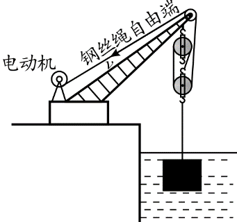

# Physics - 题目 2335

**ID**: 8c053031b4674af3811d61a1e6580312
**年级**: Grade 9
**难度**: Medium-Hard
**题型**: Calculation

## 题目
如图所示，有一体积为1m^{3}、密度为1.45×10^{3}kg/m^{3}的物体置于水底，欲将其打捞上来，现用电动机带动钢丝绳自由端通过滑轮组使物体以0.1m/s的速度在水中匀速上升，经过3min的时间物体由水底提升到水面，在此过程中滑轮组的机械效率为90%（不计物体的高度、绳重和摩擦，g取10N/kg， $ρ{{}_{水}}$ =1.0×10^{3}kg/m^{3})，求：(1)物体浸没在水中时受到的浮力；(2)物体在水底时受到水的压强；(3)动滑轮的重力；(4)若物体离开水中后匀速上升，且电动机的输出功率比物体在水中时增大了20%，此时钢丝绳自由端的速度。​​​​​​​‌

## 解答

1. 解：(1)由题意，根据阿基米德原理，则物体浸没在水中时受到的浮力
2. $F{{}_{浮}}=ρ{{}_{水}}gV{{}_{排}}{\rm{=}}{\rm{1}}{\rm{.}}{\rm{0}}\times {\rm{1}}{\rm{0}}{^{{\rm{3}}}}{\rm{k}}{\rm{g}}{\rm{/}}{\rm{m}}{^{{\rm{3}}}}\times {\rm{1}}{\rm{0}}{\rm{N}}{\rm{/}}{\rm{k}}{\rm{g}}\times 1{\rm{m}}{^{3}}{\rm{=}}1\times 10{^{4}}{\rm{N}}$
3. (2)由题意，根据 $v=\frac {s}{t}$ ，则水深
4. $h=v{{}_{物}}t{\rm{=}}0.1{\rm{m}}{\rm{/}}{\rm{s}}\times 3\times 60{\rm{s}}{\rm{=}}{\rm{1}}{\rm{8}}{\rm{m}}$
5. 根据液体压强公式，物体在水底时受到水的压强
6. $p{{}_{水}}=ρ{{}_{水}}gh{\rm{=}}{\rm{1}}{\rm{.}}{\rm{0}}\times {\rm{1}}{\rm{0}}{^{{\rm{3}}}}{\rm{k}}{\rm{g}}{\rm{/}}{\rm{m}}{^{{\rm{3}}}}\times {\rm{1}}{\rm{0}}{\rm{N}}{\rm{/}}{\rm{k}}{\rm{g}}\times 18{\rm{m}}{\rm{=}}1.8\times 10{^{5}}{\rm{P}}{\rm{a}}$
7. (3)由题意，根据 $ρ=\frac {m}{V}$ 和 $G=mg$ ，则物体的重力
8. $G{{}_{物}}=m{{}_{物}}g{\rm{=}}ρ{{}_{物}}gV{{}_{物}}{\rm{=}}1.45\times 10{^{3}}{\rm{k}}{\rm{g}}{\rm{/}}{\rm{m}}{^{{\rm{3}}}}\times {\rm{1}}{\rm{0}}{\rm{N}}{\rm{/}}{\rm{k}}{\rm{g}}\times 1{\rm{m}}{^{{\rm{3}}}}{\rm{=}}1.45\times 10{^{4}}{\rm{N}}$
9. 不计绳重和摩擦，则物体由水底提升到水面，在此过程中滑轮组的机械效率
10. $η=\frac {W{{}_{有}}}{W{{}_{总}}}=\frac {(G{{}_{物}}{\rm{-}}F{{}_{浮}})h}{Fs}=\frac {(G{{}_{物}}{\rm{-}}F{{}_{浮}})h}{\frac {1}{n}(G{{}_{物}}{\rm{-}}F{{}_{浮}}+G{{}_{动}})nh}=\frac {G{{}_{物}}{\rm{-}}F{{}_{浮}}}{G{{}_{物}}{\rm{-}}F{{}_{浮}}+G{{}_{动}}}$
11. 则动滑轮重
12. $G{{}_{动}}=(G{{}_{物}}-F{{}_{浮}}){\rm{(}}\frac {1}{η}{\rm{-}}{\rm{1}}{\rm{)}}{\rm{=}}{\rm{(}}1.45\times 10{^{4}}{\rm{N}}{\rm{-}}1\times 10{^{4}}{\rm{N}}{\rm{)}}\times (\frac {1}{90\%}-1)=500{\rm{N}}$
13. (4)由图可知绳子股数
14. n=3
15. 根据功率定义，则
16. $P=\frac {W}{t}=\frac {Fs}{t}=Fv$
17. 由题意，物体在水中时，电动机的输出功率
18. $P=Fv{{}_{绳}}$
19. 物体在水中时，绳子自由端的拉力
20. $F=\frac {1}{n}(G{{}_{物}}+G{{}_{动}}-F{{}_{浮}})$
21. 物体在水中时，绳子自由端移动的速度
22. $v{{}_{绳}}=nv{{}_{物}}$
23. 物体在空气中时，电动机的输出功率
24. $P^{′}=F^{′}v{{}_{绳}^{^{′}}}$
25. 物体在空气中时，绳子自由端的拉力
26. $F^{′}=\frac {1}{n}(G{{}_{物}}+G{{}_{动}})$
27. 根据题意，则有
28. $P^{′}=(1+Δη)P$
29. 综上，则
30. $\frac {1}{n}(G{{}_{物}}{\rm{+}}G{{}_{动}})v{{}_{绳}^{^{′}}}=(1+Δη)\frac {1}{n}(G{{}_{物}}{\rm{+}}G{{}_{动}}{\rm{-}}F{{}_{浮}})nv{{}_{物}}$
31. 则此时钢丝绳自由端的速度
32. $v{{}_{绳}^{^{′}}}=\frac {(1+Δη)(G{{}_{物}}+G{{}_{动}}-F{{}_{浮}})nv{{}_{物}}}{G{{}_{物}}+G{{}_{动}}}$  $v{{}_{绳}^{^{′}}}=\frac {(1+20\%)\times (1.45\times 10{^{4}}{\rm{N}}+500{\rm{N}}-1\times 10{^{4}}{\rm{N}})\times 3\times 0.1{\rm{m}}{\rm{/}}{\rm{s}}}{1.45\times 10{^{4}}{\rm{N}}+500{\rm{N}}}=0.12{\rm{m}}{\rm{/}}{\rm{s}}$
33. 答：(1)物体浸没在水中时受到的浮力为1×10^{4}N；
34. (2)物体在水底时受到水的压强为1.8×10^{5}Pa；
35. (3)动滑轮的重力为500N；
36. (4)钢丝绳自由端的速度为0.12m/s。

## 知识点

**中文**:
  - 液体压强计算公式的应用
  - 速度公式及其应用
  - 阿基米德原理的应用
  - 滑轮（组）的机械效率及其计算

**English**:
  - Application of Liquid Pressure Formula
  - Velocity Formula and Applications
  - Applications of Archimedes' Principle
  - Mechanical Efficiency of Pulleys and Calculations

---
