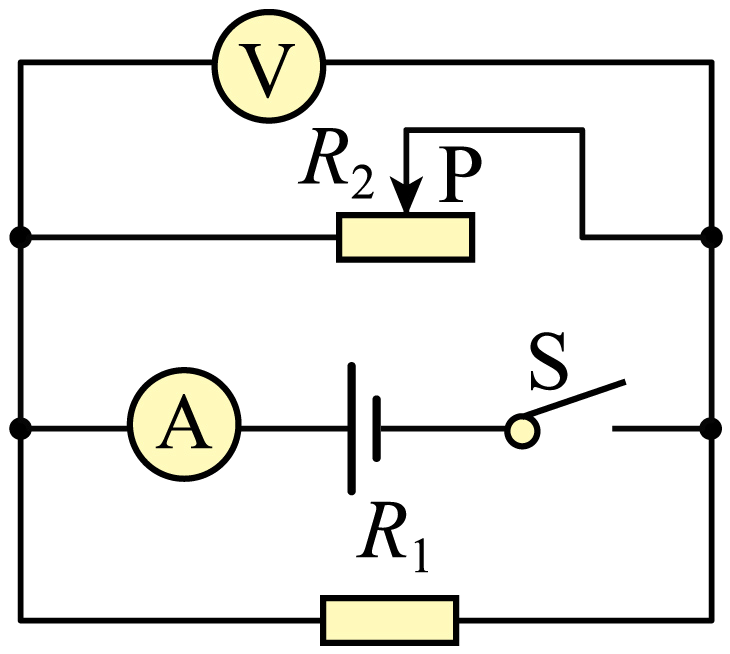

# Physics - 题目 2726

**ID**: 92af1d92d98745d3a95aea5f0edae150
**年级**: Grade 9
**难度**: Medium-Hard
**题型**: Calculation

## 题目
如图所示电路，电源电压为6伏且保持不变。​​​​​​​‌电阻R_{1}的阻值为10欧，滑动变阻器R_{2}标有“20欧2安”字样。闭合开关S，电流表的示数为1安。（1）求通过R_{1}的电流I_{1}。（2）通电10秒，求电流通过电阻R_{1}所做的功W_{1}。（3）在确保电路正常工作的情况下，能否通过移动滑动变阻器的滑片使电流表A的示数达到3安？若能，请计算出此时滑动变阻器R_{2}连入电路的阻值；若不能，请说明理由。

## 解答

1. 解：（1）由图可知，电阻R_{1}和变阻器R_{2}并联，电流表测量干路中的电流，电压表测量电源电压，由并联电路电压的规律可知R_{1}两端的电压
2. U_{1}=U=6V
3. 欧姆定律得到通过R_{1}的电流
4. $I{{}_{1}}=\frac {U{{}_{1}}}{R{{}_{1}}}=\frac {6{\rm{V}}}{10Ω}=0.6{\rm{A}}$
5. （2）通电10秒，电流通过电阻R_{1}所做的功
6. W_{1}=U_{1}I_{1}t=6V×0.6A×10s=36J
7. （3）允许通过滑动变阻器R_{2}的最大电流是2A，通过R_{1}的电流是0.6A不变，由并联电路的特点可知，干路电流最大值为
8. I_{最大}=I_{1}+I_{2}=0.6A+2A=2.6A
9. 所以通过移动滑动变阻器的滑片不能使电流表A的示数达到3A。
10. 答：（1）通过R_{1}的电流是0.6A；
11. （2）通电10秒，求电流通过电阻R_{1}所做的功是36J；
12. （3）不能，见解析。

## 知识点

**中文**:
  - 并联电路的电流规律
  - 欧姆定律的应用
  - 电功与电能的计算

**English**:
  - Current Law in Parallel Circuits
  - Applications of Ohm's Law
  - Calculation of Electric Work and Energy

---
