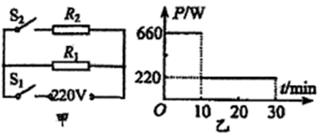

# Physics - 题目 2199

**ID**: a3c9f2525d9545bc934f0fa38d5f6f89
**年级**: Grade 9
**难度**: Medium-Hard
**题型**: Calculation

## 题目
小明家新买一个电热饮水机，电路图如图甲所示，R_{1}和R_{2}均为电热丝，S_{2}是自动控制开关，可实现“低档”、“高档”之间的转换，饮水机工作时功率随时间的关系图像如图乙所示。​​​​​​​‌求：（1）饮水机工作时，通过电阻R_{1}的电流；（2）电阻R_{2}的阻值；（3）30min内电路消耗的总电能。

## 解答

1. (1)从图甲可以看到，当开关S_{1}、S_{2}闭合时，两电阻并联，根据 $P=\frac {U{^{2}}}{R}$ 可知，这时电路的电功率较大，这是“高档”；当开关S_{1}闭合、开关S_{2}断开时，只有R_{1}接入电路中，根据 $P=\frac {U{^{2}}}{R}$ 可知，这时电路的电功率较小，这是“低档”；从图乙可以看到，低档功率是220W，根据 $P=UI$ 可知，通过电阻R_{1}的电流是
2. $I{{}_{{\rm{1}}}}=\frac {P{{}_{低}}}{U}=\frac {{\rm{2}}{\rm{2}}{\rm{0}}{\rm{W}}}{{\rm{2}}{\rm{2}}{\rm{0}}{\rm{V}}}={\rm{1}}{\rm{A}}$ ；
3. (2)当电路处于“高档”时，电路的电功率是660W，根据 $P=UI$ 可知，干路中的电流是
4. $I{{}_{总}}=\frac {P{{}_{高}}}{U}=\frac {{\rm{6}}{\rm{6}}{\rm{0}}{\rm{W}}}{{\rm{2}}{\rm{2}}{\rm{0}}{\rm{V}}}={\rm{3}}{\rm{A}}$
5. 由上述可知，这情况下，电阻R_{1}的阻值大小不变，两端的电压也不变，则流过电阻R_{1}的电流还是1A，根据并联电路的电流规律可知，流过电阻R_{2}的电流是
6. $I{{}_{{\rm{2}}}}=I{{}_{总}}-I{{}_{{\rm{1}}}}={\rm{3}}{\rm{A}}-{\rm{1}}{\rm{A}}={\rm{2}}{\rm{A}}$
7. 根据 $R=\frac {U}{I}$ 可知，电阻R_{2}的阻值是
8. $R{{}_{{\rm{2}}}}=\frac {U}{I{{}_{{\rm{2}}}}}=\frac {{\rm{2}}{\rm{2}}{\rm{0}}{\rm{V}}}{{\rm{2}}{\rm{A}}}={\rm{1}}{\rm{1}}{\rm{0}}{\rm{Ω}}$ ；
9. (3)从图乙可以看到，30min内电路消耗的总电能是
10. $W=P{{}_{高}}t{{}_{{\rm{1}}}}+P{{}_{低}}t{{}_{{\rm{2}}}}={\rm{6}}{\rm{6}}{\rm{0}}{\rm{W}}\times {\rm{1}}{\rm{0}}\times {\rm{6}}{\rm{0}}{\rm{s}}+{\rm{2}}{\rm{2}}{\rm{0}}{\rm{W}}\times {\rm{2}}{\rm{0}}\times {\rm{6}}{\rm{0}}{\rm{s}}={\rm{6}}{\rm{.}}{\rm{6}}\times {\rm{1}}{\rm{0}}{^{{\rm{5}}}}{\rm{J}}$ 。
11. 答：(1)饮水机工作时，通过电阻R_{1}的电流是 ${\rm{1}}{\rm{A}}$ ；(2)电阻R_{2}的阻值是 ${\rm{1}}{\rm{1}}{\rm{0}}{\rm{Ω}}$ ；(3)30min内电路消耗的总电能是 ${\rm{6}}{\rm{.}}{\rm{6}}\times {\rm{1}}{\rm{0}}{^{{\rm{5}}}}{\rm{J}}$ 。

## 知识点

**中文**:
  - 并联电路的电流规律
  - 欧姆定律的应用
  - 电功与电能的计算
  - 电功率的计算及应用

**English**:
  - Current Law in Parallel Circuits
  - Applications of Ohm's Law
  - Calculation of Electric Work and Energy
  - Calculation and Application of Electric Power

---
