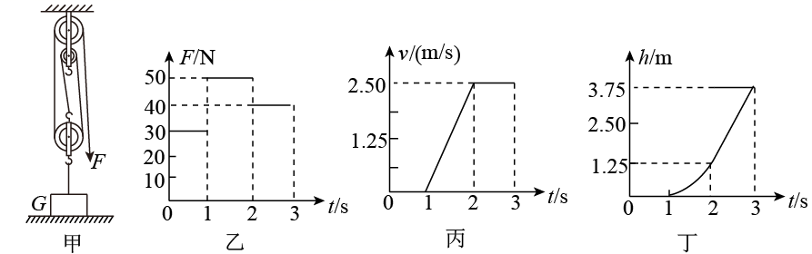

# Physics - 题目 455

**ID**: a569429b7e954aa8b0eb04226860d1fc
**年级**: Grade 9
**难度**: Medium-Hard
**题型**: Calculation

## 题目
为了将放置在水平地面上质量为10kg的建筑材料提升到高处。​​​​​​​‌小王同学设计了图甲所示的滑轮组装置.当小明用图乙所示随时间变化的竖直向下拉力拉绳时，重物的速度和上升的高度随时间变化的关系图像分别如图丙和丁所示.不计摩擦，绳对滑轮的拉力方向均可看成在竖直方向。求：（1）在1～2s内拉力做的功。（2）在2～3s内拉力的功率。（3）在2～3s内滑轮组的机械效率（精确到0.1%）。

## 解答

1. （1）由图乙知道，在1～2s内，拉力F′=50N，由图丁知道，重物上升高度h′=1.25m，由图甲知道，承担物重的绳子股数，n=3，则拉力F的作用点下降的距离
2. s=nh=3×1.25m=3.75m
3. 拉力做的功
4. W=Fs=50N×3.75m=187.5J
5. （2）由图丙知道，在2～3s内，重物做匀速运动，由图乙知道，此时拉力F′=40N，由图丁知道，重物升高的高度
6. h′=3.75m-1.25m=2.5m
7. 在2～3s内拉力做的功
8. W_{总}=F′s′=40N×3×2.5m=300J
9. 在2～3s内拉力的功率
10. $P=\frac {W{{}_{总}}}{t}=\frac {300{\rm{J}}}{{\rm{1}}{\rm{s}}}=300{\rm{W}}$
11. （3）建筑材料的重力
12. G=mg=10kg×10N/kg=100N
13. 在2～3s内，拉力做的有用功
14. W_{有用}=G h′=100N×2.5m=250J
15. 滑轮组的机械效率
16. $η=\frac {W{{}_{有用}}}{W{{}_{总}}}\times 100{\rm{\%}}{\rm{=}}\frac {250{\rm{J}}}{300{\rm{J}}}\times 100{\rm{\%}}\approx 83.3\%$
17. 答：（1）在1～2s内拉力做的功187.5J；
18. （2）在2～3s内拉力的功率300W；
19. （3）在2～3s内滑轮组的机械效率83.3%。

## 知识点

**中文**:
  - 功、功率、机械效率的综合计算

**English**:
  - Comprehensive Calculation of Work, Power, and Efficiency

---
