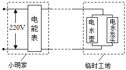

# Physics - 题目 1177

**ID**: acea93ef09ff4e34ad588f77a350a502
**年级**: Grade 9
**难度**: Medium-Hard
**题型**: Calculation

## 题目
小明在离家不远处施工，临时用导线将电水壶和电水龙头（打开几秒钟就能流出热水）接入家中电能表[3000r/(kW•h)]。​​​​​​​‌如图所示。电水壶的规格为“220V 1210W”，电水龙头的规格为“220V 2420W”，当电路中单独使用电水壶烧水时，铝盘转动110r，用时120s。在电路中单独使用电水龙头洗漱时，用了180s。导线、电水壶和电水龙头的电阻不随温度变化。求：(1)电水壶和电水龙头的电阻；(2)导线的电阻；(3)在洗漱时，导线上产生的热量。

## 解答

1. 解：(1)电水壶的规格为“220V 1210W”，电水龙头的规格为“220V 2420W”，根据公式 $P{\rm{=}}\frac {U{^{2}}}{R}$ 可知，电水壶的电阻为
2. $R{{}_{壶}}＝\frac {U{{}_{电水壶}^{2}}}{P{{}_{电水壶}}}=\frac {(220{\rm{V}}){^{2}}}{1210{\rm{W}}}=40\Omega $
3. 电水龙头的电阻为
4. $R{{}_{水龙头}}＝\frac {U{{}_{水龙头}^{2}}}{P{{}_{水龙头}}}=\frac {(220{\rm{V}}){^{2}}}{2420{\rm{W}}}=20\Omega $
5. (2)当电路中单独使用电水壶烧水时，消耗的电能为
6. $W{\rm{=}}\frac {110}{3000}{\rm{k}}{\rm{W}}\cdot {\rm{h}}{\rm{=}}\frac {11}{300}{\rm{k}}{\rm{W}}\cdot {\rm{h}}$
7. 此时电路的总功率为
8. $P{{}_{实}}{\rm{=}}\frac {W}{t}{\rm{=}}\frac {\frac {11}{300}{\rm{k}}{\rm{W}}\cdot {\rm{h}}}{\frac {120}{3600}{\rm{h}}}{\rm{=}}1100{\rm{W}}$
9. 此时电水壶和导线的总电阻为
10. $R{{}_{总}}{\rm{=}}\frac {U{^{2}}}{P{{}_{实}}}=\frac {(220{\rm{V}}){^{2}}}{{\rm{1}}{\rm{1}}{\rm{0}}{\rm{0}}{\rm{W}}}=44\Omega $
11. 由于导线与电水壶串联接入电路中，则导线的电阻为
12. R_{线}=R_{总}−R_{壶}=44Ω−40Ω=4Ω
13. (3)电水龙头和导线的总电阻为
14. R'=R_{线}+R_{水龙头}=20Ω+4Ω=24Ω
15. 此时导线和水龙头的功率为
16. $P^{′}{{\rm{=}}}\frac {U{^{2}}}{R^{′}}{\rm{=}}\frac {(220{\rm{V}}){^{2}}}{24\Omega }=\frac {6050}{3}{\rm{W}}$
17. 根据公式P=I^{2}R可知，I^{2}= $\frac {P^{′}}{R^{′}}$
18. 则导线上产生的热量为
19. Q=I^{2}R't= $\frac {\frac {6050{\rm{W}}}{3}}{24\Omega }$ ×4Ω×180s=60500J
20. 答：(1)电水壶和电水龙头的电阻分别为40Ω和20Ω；
21. (2)导线的电阻为4Ω；
22. (3)在洗漱时，导线上产生的热量为60500J。
23. 【点评】
24. 本题考查了电功率公式的灵活运用，关键是电能表参数理解和电能的求法，有较大的难度。

## 知识点

**中文**:
  - 焦耳定律的计算公式及其应用
  - 电阻的串联
  - 电功与电能的计算
  - 电功率的计算及应用

**English**:
  - Formula and Application of Joule's Law
  - Series Connection of Resistors
  - Calculation of Electric Work and Energy
  - Calculation and Application of Electric Power

---
