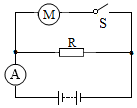

# Physics - 题目 1445

**ID**: b87b8513d232409ea66c10bc66e2cf65
**年级**: Grade 9
**难度**: Medium-Hard
**题型**: Calculation

## 题目
如图是电动机和定值电阻R组成的电路，电源电压为U，电动机内阻为r，定值电阻阻值为R，开关S闭合时，电动机正常工作，电流表示数为I，请用以上字母表示：(1)证明定值电阻R将电能全部转化为内能；(2)电动机正常工作的电功率；(3)若电动机卡住，电流表的示数。​​​​​​​‌

## 解答

1. (1)纯电阻电路：电阻 $R$ ，电路两端电压 $U$ ，通过的电流为 $I$ 。电热： $Q=I{^{2}}Rt$ ，电功： $W=UIt$ ，纯电阻电路中 $I=\frac {U}{R}$ ，则
2. $Q=I{^{2}}Rt=IR\times It=UIt=W$
3. 则电热和电功的关系 $Q=W$ ，表明：在纯电阻电路中，电功与电热相等。也就是说电流做功将电能全部转化为内能。
4. (2)当S闭合时，电动机与 $R$ 并联，通过电阻 $R$ 的电流 $I{{}_{R}}=\frac {U}{R}$ ，根据并联电路电流的功率可知，通过电动机的电流为
5. $I{{}_{M}}=I-I{{}_{R}}=I-\frac {U}{R}$
6. 电动机正常工作的电功率为
7. $P=UI=U\times (I-\frac {U}{R})=UI-\frac {U{^{2}}}{R}$
8. (3)若电动机卡住，此电路为纯电阻电路，通过电动机的电流 $I{{}_{M}}=\frac {U}{r}$ ，根据并联电路电流的规律可知，干路的电流为
9. $I=I{{}_{M}}+I{{}_{R}}=\frac {U}{r}+\frac {U}{R}=\frac {U(R+r)}{rR}$
10. 即电流表的示数为 $\frac {U(R+r)}{rR}$ 。

## 知识点

**中文**:
  - 非纯电阻电路的相关计算

**English**:
  - Calculations for Non-Pure Resistive Circuits

---
