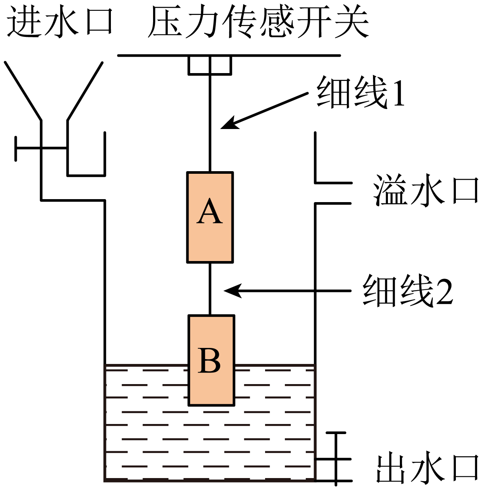

# Physics - 题目 611

**ID**: be26d72dff2b462094c7f484f3eacf2b
**年级**: Grade 9
**难度**: Medium-Hard
**题型**: Calculation

## 题目
水箱是生活中常用的供水工具，如图所示是该模型的示意图，储水箱主要由一个重为10N，底面积是200cm^{2}，高度为32cm（溢水口到桶底）的圆柱形金属水桶、一个压力传感开关和两个体积相同的实心圆柱体A、B组成，其中圆柱体A、B通过细线1与压力传感开关相连。​​​​​​​‌已知加水前水箱的水桶内储水高度为15cm，圆柱体B恰好一半浸在水中，此时压力传感器受到细线1竖直向下的拉力达到6.5N，水泵接受到信号从进水口开始向桶内加水，已知实心圆柱体A、B的重力分别为G_{A}=2N、G_{B}=7N，它们的底面积都是50cm^{2}。（1）水泵向桶内加水前，水桶底部受到水的压强是多少？（2）B浸入一半时，排开液体的体积是多少？（3）若细线2长5cm，当加水至细线1对A的拉力为1N时，细线1末端的拉力传感器突然失控，导致A、B平稳下落（不考虑水波动），试求A、B稳定后容器对桌面的压强。

## 解答

1. 解：（1）加水前水箱的水桶内储水高度为15cm，即0.15m，则水桶底部受到水的压强 $p=ρgh=1\times 10{^{3}}{\rm{k}}{\rm{g}}{\rm{/}}{\rm{m}}{^{{{3}}}}\times 10{\rm{N}}{\rm{/}}{\rm{k}}{\rm{g}}\times 0.15{\rm{m}}=1500{\rm{P}}{\rm{a}}$
2. （2）圆柱体B恰好一半浸在水中，此时压力传感器受到细线1竖直向下的拉力达到6.5N，实心圆柱体A、B的重力分别为G_{A}=2N、G_{B}=7N，则圆柱体B受到浮力F_{浮}=G_{A}+G_{B}-F_{拉}=2N+7N-6.5N=2.5N
3. 则B浸入一半时，排开液体的体积 $V{{}_{排}}=\frac {F{{}_{浮}}}{ρ{{}_{水}}g}=\frac {2.5{\rm{N}}}{1\times 10{^{3}}{\rm{k}}{\rm{g}}{\rm{/}}{\rm{m}}{^{{{3}}}}\times 10{\rm{N}}{\rm{/}}{\rm{k}}{\rm{g}}}=2.5\times 10{^{{{-}}4}}{\rm{m}}{^{{{3}}}}$
4. （3）当加水至细线1对A的拉力为1N时，A、B受到浮力F_{浮}_{1}=G_{A}+G_{B}-F_{拉}_{1}=2N+7N-1N=8N
5. 由于B恰好一半浸在水中，受到浮力为2.5N，则B完全浸没，受到浮力为5N，则A受到浮力F_{浮}_{3}=F_{浮}_{1}-F_{拉}_{2}=8N-5N=3N
6. 则A浸入水中体积 $V{{}_{{\rm{A}}排}}=\frac {F{{}_{浮}}}{ρ{{}_{水}}g}=\frac {3{\rm{N}}}{1\times 10{^{3}}{\rm{k}}{\rm{g}}{\rm{/}}{\rm{m}}{^{{{3}}}}\times 10{\rm{N}}{\rm{/}}{\rm{k}}{\rm{g}}}=3\times 10{^{{{-}}4}}{\rm{m}}{^{{{3}}}}$
7. A、B的底面积都是50cm^{2}，则A、B浸入水中的深度 $h=\frac {V}{S}=\frac {V{{}_{{\rm{A}}排}}+V{{}_{{\rm{B}}半}}}{S}=\frac {3\times 10{^{-4}}{\rm{m}}{^{3}}+2.5\times 10{^{-4}}{\rm{m}}{^{3}}}{50\times 10{^{-4}}{\rm{m}}{^{2}}}=0.11{\rm{m}}={{1}}{{1}}{\rm{c}}{\rm{m}}$
8. 细线2长5cm，则水面上升高度为5cm+11cm=16cm
9. 加水前水箱的水桶内储水高度为15cm，底面积是200cm^{2}，则水的体积 $V{{}_{水}}=Sh^{′}-V{{}_{{\rm{A}}浸}}-V{{}_{{\rm{B}}}}=200{\rm{c}}{\rm{m}}{^{2}}\times \left ({15{\rm{c}}{\rm{m}}{{+}}16{\rm{c}}{\rm{m}}}\right )-3\times 10{^{-4}}{\rm{m}}{^{3}}-2\times 2.5\times 10{^{-4}}{\rm{m}}{^{3}}=5.4\times 10{^{-3}}{\rm{m}}{^{3}}$
10. 则桶内水的质量 $m{{}_{水}}=ρ{{}_{水}}V{{}_{水}}=1\times 10{^{3}}{\rm{k}}{\rm{g}}{\rm{/}}{\rm{m}}{^{3}}\times 5.4\times 10{^{-3}}{\rm{m}}{^{3}}=5.4{\rm{k}}{\rm{g}}$
11. 则容器对桌面的压力F_{压}=G_{桶}+G_{A}+G_{B}+G_{水}=10N+2N+7N+5.4kg×10N/kg=73N
12. 则容器对桌面的压强 $p=\frac {F{{}_{压}}}{S^{′}}=\frac {73{\rm{N}}}{200\times 10{^{-4}}{\rm{m}}{^{2}}}=3650{\rm{P}}{\rm{a}}$
13. 答：（1）水泵向桶内加水前，水桶底部受到水的压强是1500Pa；
14. （2）B浸入一半时，排开液体的体积是 $2.5\times 10{^{{{-}}4}}{\rm{m}}{^{{{3}}}}$ ；
15. （3）A、B稳定后容器对桌面的压强是3650Pa。

## 知识点

**中文**:
  - 压力的概念及其计算
  - 压强的计算
  - 液体压强计算公式的应用
  - 阿基米德原理的应用

**English**:
  - Concept and Calculation of Pressure Force
  - Calculation of Pressure
  - Application of Liquid Pressure Formula
  - Applications of Archimedes' Principle

---
