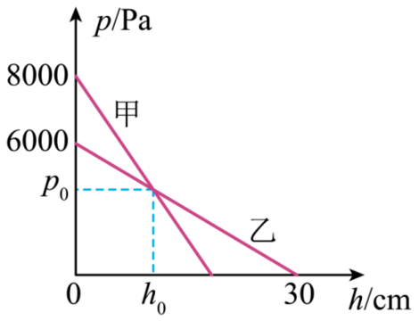

# Physics - 题目 1132

**ID**: bfb39b67650e43ce928039812cb3d4d0
**年级**: Grade 9
**难度**: Medium-Hard
**题型**: Calculation

## 题目
甲、乙为两个质量分布均匀的实心圆柱体，放置在水平桌面上。​​​​​​​‌分别沿水平方向切去上部分，剩余部分对桌面的压强p与切去部分高度h的关系如图所示，已知甲的密度为 $4\times 10{^{3}}{\rm{k}}{\rm{g}}{\rm{/}}{\rm{m}}{^{3}}$ 。求：（1）圆柱体甲的高度为多少cm？（2）当切去部分高度为5cm时，圆柱体乙剩余部分对桌面的压强为多少Pa？（3）当切去部分高度为h_{0}时，圆柱体甲、乙剩余部分对桌面的压强均为 $p{{}_{0}}$ ， $p{{}_{0}}$ 的值为多少Pa？

## 解答

1. 解：（1）由图像知，质量分布均匀的实心圆柱体甲对地面的压强为8000Pa。据 $p=ρgh$ 得，圆柱体甲的高度 $h{{}_{甲}}=\frac {p{{}_{甲}}}{ρ{{}_{甲}}g}=\frac {8000{\rm{P}}{\rm{a}}}{4\times 10{^{3}}{\rm{k}}{\rm{g}}{\rm{/}}{\rm{m}}{^{3}}\times 10{\rm{N}}{\rm{/}}{\rm{k}}{\rm{g}}}=0.2{\rm{m}}{\rm{=}}{{2}}{{0}}{\rm{c}}{\rm{m}}$ 。
2. （2）由图像知，乙的高度为30cm，其对地面的压强为6000Pa，切去5cm高度时，剩余的高度 $h{{}_{1}}=30{\rm{c}}{\rm{m}}{{-}}{{5}}{\rm{c}}{\rm{m}}{\rm{=}}{{2}}{{5}}{\rm{c}}{\rm{m}}$ ，则乙剩余部分对桌面的压强 $p{{}_{1}}=\frac {h{{}_{1}}}{h}\cdot p{{}_{乙}}=\frac {2{{5}}{\rm{c}}{\rm{m}}}{30{\rm{c}}{\rm{m}}}\times 6000{\rm{P}}{\rm{a}}=5000{\rm{P}}{\rm{a}}$ 。
3. （3）当切去部分高度为h_{0}时，圆柱体甲、乙剩余部分对桌面的压强相等，都为p_{0}，则有 $p{{}_{0}}=\frac {30{\rm{c}}{\rm{m}}-h{{}_{0}}}{30{\rm{c}}{\rm{m}}}\cdot 6000{\rm{P}}{\rm{a}}$ ， $p{{}_{0}}=\frac {20{\rm{c}}{\rm{m}}-h{{}_{0}}}{20{\rm{c}}{\rm{m}}}\cdot 8000{\rm{P}}{\rm{a}}$ ，解得 $p{{}_{0}}=4000{\rm{P}}{\rm{a}}$ 。
4. 答：（1）圆柱体甲的高度为20cm；
5. （2）圆柱体乙剩余部分对桌面的压强为5000Pa；
6. （3）p_{0}的值为4000Pa。

## 知识点

**中文**:
  - 固体压强的判断与计算

**English**:
  - Determination and Calculation of Solid Pressure

---
