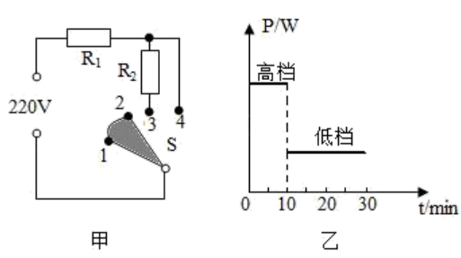

# Physics - 题目 2298

**ID**: c22ce29b11a941479f87f9fa6abd8c56
**年级**: Grade 9
**难度**: Medium-Hard
**题型**: Calculation

## 题目
小明家有一台额定电压为220 V的加湿器，说明书上的电路图为图甲。​​​​​​​‌R_{1}、R_{2}为发热电阻，且 $R{{}_{1}}=3R{{}_{2}}$ ，S为旋转型开关。1、2、3、4为触点，通过旋转开关S可实现“关”、“低档”、“高档”之间的转换(低档为小功率加热。高档为大功率加热)，其高档功率为440 W。(1)求电阻 $R{{}_{2}}$ 的阻值；(2)求加湿器处于低档时的电功率；(3)加湿器的P-t关系如图乙所示，加湿器工作30分钟消耗的电能为多少？

## 解答

1. (1)由题意可知，旋转开关S到3、4触点时，只有电阻R_{1}接入电路，根据 $P=\frac {U{^{2}}}{R}$ 可知电路中的电阻最小，电功率最大，这是高档功率，可知
2. $P{{}_{{\rm \max }}}=\frac {U{^{{\rm{2}}}}}{R{{}_{{\rm{1}}}}}=\frac {\left ({{\rm{2}}{\rm{2}}{\rm{0}}{\rm{V}}}\right ){^{{\rm{2}}}}}{R{{}_{{\rm{1}}}}}={\rm{4}}{\rm{4}}{\rm{0}}{\rm{W}}$
3. 可得电阻
4. $R{{}_{{\rm{1}}}}=\frac {\left ({{\rm{2}}{\rm{2}}{\rm{0}}{\rm{V}}}\right ){^{{\rm{2}}}}}{{\rm{4}}{\rm{4}}{\rm{0}}{\rm{W}}}={\rm{1}}{\rm{1}}{\rm{0}}{\rm{Ω}}$
5. 因为 $R{{}_{1}}=3R{{}_{2}}$ ，可得到
6. $R{{}_{{\rm{2}}}}=\frac {{\rm{1}}}{{\rm{3}}}R{{}_{{\rm{1}}}}=\frac {{\rm{1}}}{{\rm{3}}}\times {\rm{1}}{\rm{1}}{\rm{0}}{\rm{Ω}}=\frac {{\rm{1}}{\rm{1}}{\rm{0}}}{{\rm{3}}}{\rm{Ω}}$
7. (2)加湿器处于低档时，电功率比较小，电路中的总电阻较大，那么可知这应该是旋转开关S到2、3触点，此时电阻R_{1}、R_{2}串联接在电路中，可求得此时的电功率是
8. $P{{}_{{\rm \min }}}=\frac {U{^{{\rm{2}}}}}{R{{}_{{\rm{1}}}}+R{{}_{{\rm{2}}}}}=\frac {\left ({{\rm{2}}{\rm{2}}{\rm{0}}{\rm{V}}}\right ){^{{\rm{2}}}}}{{\rm{1}}{\rm{1}}{\rm{0}}{\rm{Ω}}+\frac {{\rm{1}}{\rm{1}}{\rm{0}}}{{\rm{3}}}{\rm{Ω}}}={\rm{3}}{\rm{3}}{\rm{0}}{\rm{W}}$
9. (3)从图乙可以看到，0到10min加湿器处于高档，10到30min加湿器处于低档，那么可知加湿器工作30分钟消耗的电能是
10. $W=P{{}_{{\rm \max }}}t{{}_{{\rm{1}}}}+P{{}_{{\rm \min }}}t{{}_{{\rm{2}}}}={\rm{4}}{\rm{4}}{\rm{0}}{\rm{W}}\times {\rm{1}}{\rm{0}}\times {\rm{6}}{\rm{0}}{\rm{s}}+{\rm{3}}{\rm{3}}{\rm{0}}{\rm{W}}\times {\rm{2}}{\rm{0}}\times {\rm{6}}{\rm{0}}{\rm{s}}={\rm{6}}{\rm{.}}{\rm{6}}\times {\rm{1}}{\rm{0}}{^{{\rm{5}}}}{\rm{J}}$
11. 答：(1)电阻 $R{{}_{2}}$ 的阻值是 $\frac {{\rm{1}}{\rm{1}}{\rm{0}}}{{\rm{3}}}{\rm{Ω}}$ ；(2)加湿器处于低档时的电功率是 ${\rm{3}}{\rm{3}}{\rm{0}}{\rm{W}}$ ；(3)加湿器工作30分钟消耗的电能是 ${\rm{6}}{\rm{.}}{\rm{6}}\times {\rm{1}}{\rm{0}}{^{{\rm{5}}}}{\rm{J}}$ 。

## 知识点

**中文**:
  - 电功与电能的计算
  - 电路的动态分析
  - 电功率的计算及应用

**English**:
  - Calculation of Electric Work and Energy
  - Dynamic Circuit Analysis
  - Calculation and Application of Electric Power

---
