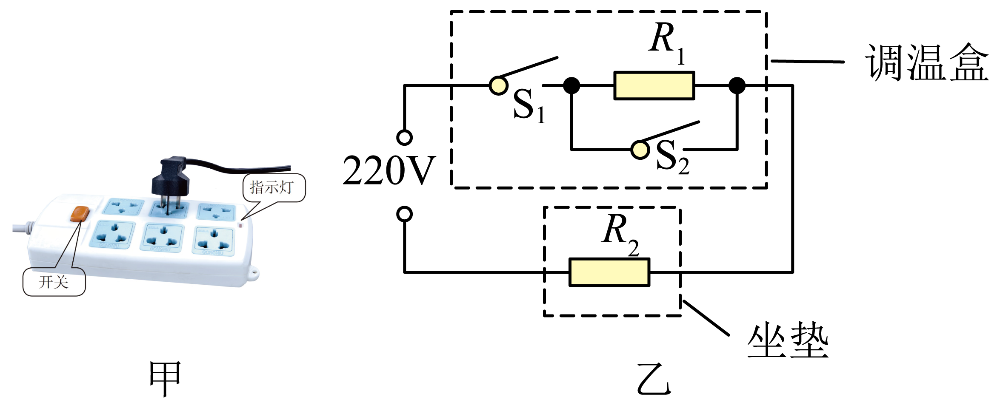

# Physics - 题目 647

**ID**: c2cf6e544d3647aaa909998680f98480
**年级**: Grade 9
**难度**: Medium-Hard
**题型**: Calculation

## 题目
小明家有一个标有“ $220{\rm{V}}10{\rm{A}}$ ”的插排（图甲所示），同时接入一个电加热坐垫（“ $220{\rm{V}}\,\,24.2{\rm{W}}$ ”）和一台吸尘器（“ $220{\rm{V}}\,\,1100{\rm{W}}$ ”），吸尘器的电动机线圈电阻为 $2{\rm{Ω}}$ ，小明家电压恒为 $220{\rm{V}}$ 。​​​​​​​‌（1）吸尘器工作 $10{\rm{m}}{\rm{i}}{\rm{n}}$ 消耗的电能是多少？（2）现有一个电吹风机（“ $220{\rm{V}}880{\rm{W}}$ ”），请通过计算说明插排能否允许再接入此电吹风机，使3个用电器同时工作。（3）图乙是电加热坐垫（“ $220{\rm{V}}24.2{\rm{W}}$ ”）的简化电路图，通过调控开关可实现保温和加热两个功能。电阻R_{1}在调温盒内，电阻R_{2}置于坐垫内用于加热。电加热坐垫处于保温状态时电阻R_{2}消耗的电功率为20W，则R_{1}的阻值为多少？

## 解答

1. 解：（1）吸尘器消耗的电能W=Pt=1100W×600s=6.6×10^{5}J。
2. （2）插排最大功率P_{最大}=UI_{最大}=220V×10A=2200W，允许接入功率P=P_{总}-P_{1}-P_{2}=2200W-24.2W-1100W=1075.8W，P=1075.8W>P_{3}=880W，可以接入该电吹风机。
3. （3）当开关S_{1}、S_{2}都闭合时，只有R_{2}的简单电路，电加热垫处于加热档，R_{2}的阻值 $R{{}_{2}}=\frac {U{^{2}}}{P}=\frac {({{2}}{{2}}{{0}}{\rm{V}}){^{2}}}{24.2{\rm{W}}}=2000{\rm{Ω}}$ ，当开关S_{1}闭合、S_{2}断开时，电加热垫处于保温档，R_{1}与R_{2}串联。由P_{2}=I^{2}R_{2}，代入20W=I^{2}×2000Ω，解得 ${\rm \mathit{I}=0.1A，}R{{}_{总}}{\rm{=}}\frac {U}{I}=\frac {220V}{{{0}}{{.}}{{1}}{\rm{A}}}=2200{\rm{Ω}}{\rm ，\mathit{R}_{1}}$ 的阻值R_{1}=R_{总}-R_{2}=2200Ω-2000Ω=200Ω。
4. 答：（1）吸尘器工作 消耗的电能是6.6×10^{5}J；
5. （2）可以接入该电吹风机；
6. （3）R_{1}的阻值为200Ω。

## 知识点

**中文**:
  - 电功与电能的计算
  - 电路的动态分析
  - 电功率的计算及应用

**English**:
  - Calculation of Electric Work and Energy
  - Dynamic Circuit Analysis
  - Calculation and Application of Electric Power

---
