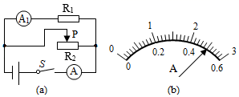

# Physics - 题目 110

**ID**: c5b9623460a2469dbfdd960cdb1fa644
**年级**: Grade 9
**难度**: Medium-Hard
**题型**: Calculation

## 题目
如图所示，电源电压为4V，电阻R_{1}=10Ω，闭合开关S，当滑动变阻器的滑片P移至中点时，电流表A的示数如图（b）所示。​​​​​​​‌求：（1）电流表A_{1}的示数；（2）滑动变阻器的最大阻值。

## 解答

1. （1）R_{1}、R_{2}并联，电流表A_{1}的测R_{1}电流I_{1}，并联电路中总电压与各支路电压相等，可得
2. U_{1}=U_{2}=U=4V
3. 电流表A_{1}的示数为
4. I_{1}= $\frac {U{{}_{{\rm{1}}}}}{R{{}_{{\rm{1}}}}}$ = $\frac {{\rm{4}}{\rm{V}}}{{\rm{1}}{\rm{0}}{\rm{Ω}}}$ =0.4A
5. （2）由图可知，电流表A测干路上的总电流I_{总}，其示数大于电流表A_{1}的示数，即I_{总}>0.4A。结合图（b）可知，若电流表使用0~3A量程，由图可读出其示数为I_{总}=2.5A，则
6. I_{2}=I_{总}﹣I_{1}=2.5A﹣0.4A=2.1A
7. 此时变阻器接入电路的阻值
8. R_{中}= $\frac {U{{}_{{\rm{2}}}}}{I{{}_{{\rm{2}}}}}$ = $\frac {{\rm{4}}{\rm{V}}}{2{\rm{.}}{\rm{1}}{\rm{A}}}$ =1.9Ω
9. 则滑动变阻器的最大阻值
10. R_{滑}=2R_{中}=3.8Ω
11. 若电流表使用0~0.6A量程，由图可读出其示数为I_{总}=0.5A，则
12. I’_{2}=I’_{总}﹣I_{1}=0.5A﹣0.4A=0.1A
13. 此时变阻器接入电路的阻值
14. R’_{中}= $\frac {U{{}_{{\rm{2}}}}}{I’{{}_{{\rm{2}}}}}$ = $\frac {{\rm{4}}{\rm{V}}}{{\rm{0}}{\rm{.}}{\rm{1}}{\rm{A}}}$ =40Ω
15. 则滑动变阻器的最大阻值
16. R’_{滑}=2R’_{中}=80Ω
17. 答：（1）电流表A_{1}的示数为0.5A；
18. （2）滑动变阻器的最大阻值为3.8Ω或80Ω。

## 知识点

**中文**:
  - 并联电路的电压规律
  - 并联电路的电流规律
  - 欧姆定律的应用

**English**:
  - Voltage Law in Parallel Circuits
  - Current Law in Parallel Circuits
  - Applications of Ohm's Law

---
