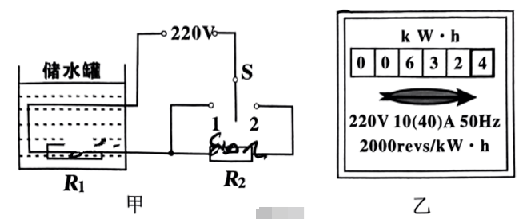

# Physics - 题目 1083

**ID**: cece2aa09d184b0ea6222b70b2bcfa1d
**年级**: Grade 9
**难度**: Medium-Hard
**题型**: Calculation

## 题目
小雷和小美一起设计了一台简易饮水机，其简化的电路图如图甲所示。​​​​​​​‌它有“加热”和“保温”两挡，其中R_{1}为发热电阻，R_{2}为定值电阻，额定电压为220V，加热挡额定功率为605W。图乙是实验室电能表的示意图。已知饮水机在保温挡和加热挡工作时，发热电阻R_{1}的电功率之比为1∶121。不考虑温度对电阻的影响。求：（1）电阻R_{1}的阻值为多少Ω？（2）该饮水机保温状态时的额定功率为多少W？（3）在测试时将其他用电器都关闭，只将饮水机置于加热挡工作，发现电能表的转盘在6min内转了100转，则此时实验室电路的实际电压为多少V？

## 解答

1. 解：（1）由图甲可知，当S接1时电路为R_{1}的简单电路，当S接2时R_{1}和R_{2}串联，因串联电路中总电阻大于任何一个分电阻，所以，当S接1时，电路的总电阻最小，电源的电压一定时，电路的电流最大，由P=UI=I^{2}R可知，发热电阻R_{1}的电功率最大，饮水机处于加热挡；同理可知，当S接2时，饮水机处于保温挡；当S接1时，电路为R_{1}的简单电路，饮水机处于加热挡，由 $P=UI=\frac {U{^{2}}}{R}$ 可得，R_{1}的阻值 $R{{}_{1}}=\frac {U{^{2}}}{P{{}_{加热}}}=\frac {{\left({220{\rm{V}}}\right)^{2}}}{605{\rm{W}}}=80{\rm{Ω}}$
2. （2）当S接2时，R_{1}和R_{2}串联，饮水机处于保温挡，此时发热电阻R_{1}的电功率 $P{{}_{1}}=\frac {1}{121}P{{}_{加热}}=\frac {1}{121}\times 605{\rm{W}}=5{\rm{W}}$
3. 因串联电路中各处的电流相等，所以，由P=UI=I2R可得，电路中的电流 $I=\sqrt {\frac {P{{}_{1}}}{R{{}_{1}}}}=\sqrt {\frac {5{\rm{W}}}{80{\rm{Ω}}}}=0.25{\rm{A}}$ ，由 $I=\frac {U}{R}$ 可得，电路的总电阻 $R{{}_{总}}=\frac {U}{I}=\frac {220{\rm{V}}}{0.25{\rm{A}}}=880{\rm{Ω}}$ ，保温状态时的额定功率 $P{{}_{保温}}=\frac {U{^{2}}}{R{{}_{总}}}=\frac {{\left({220{\rm{V}}}\right)^{2}}}{880{\rm{W}}}=55{\rm{Ω}}$ ，因串联电路中总电阻等于各分电阻之和，所以，R_{2}的阻值R_{2}=R_{总}-R_{1}=880Ω-80Ω=800Ω
4. （3）因2000r/(kW•h)表示电路每消耗1kW•h的电能电能表转盘转动2000r，所以饮水机在加热挡工作3min消耗的电能 $W=\frac {100{\rm{r}}}{2000{\rm{r}}/\left ({{\rm kW}·{\rm{h}}}\right )}=0.05{\rm kW}·{\rm{h}}=1.8\times 10{^{5}}{\rm{J}}$
5. 根据 $W=UIt=\frac {U{^{2}}}{R}t$ ，可得，此时实验室电路的实际电压 $U{{}_{实}}=\sqrt {\frac {WR{{}_{1}}}{t}}=\sqrt {\frac {1.8\times 10{^{5}}{\rm{J}}\times 80{\rm{Ω}}}{6\times 60{\rm{s}}}}=200{\rm{V}}$
6. 答：（1）电阻R_{1}的阻值为80Ω；
7. （2）饮水机保温状态时的额定功率为55W；
8. （3）此时实验室电路的实际电压是200V。

## 知识点

**中文**:
  - 串、并联电路中的电功率
  - 电能表的读数及电能的求解
  - 实际电压与实际功率

**English**:
  - Electric Power in Series/Parallel Circuits
  - Reading Energy Meters and Calculating Energy
  - Actual Voltage and Actual Power

---
