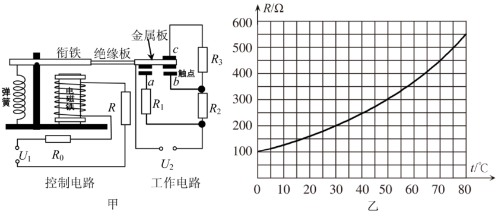

# Physics - 题目 1807

**ID**: cf8cad150a46451f80ae80442f1f2f3e
**年级**: Grade 9
**难度**: Medium-Hard
**题型**: Calculation

## 题目
某电热水器具有加热和保温功能，其工作原理如图甲所示．其中控制电路中的电磁铁线圈电阻不计，R为热敏电阻，热敏电阻中允许通过的最大电流Ig＝15mA，其阻值R随温度变化的规律图象如图乙所示，电源电压U恒为6V，当电磁铁线圈中的电流I＞8mA时，电磁铁的衔铁被吸下，继电器下方触点a、b接触，加热电路接通：当电磁铁线圈中的电流I≤8mA时，继电器上方触点c接触，保温电路接通，热敏电阻R和工作电路中的三只电阻丝R_{1}、R_{2}、R_{3}，均置于储水箱中，U_{2}＝220V，加热时的功率P_{加热}═2200W，保温时的功率P_{保温}＝110W，加热效率η＝90%，R_{2}＝2R_{1}，水的比热容，c_{水}＝4.​​​​​​​‌2×10^{3}J/（kg•℃），水箱内最低温度为0℃．（1）为使控制电路正常工作，保护电阻R_{0}的阻值至少为多大？若R_{0}为该值，试求热水器刚开始保温时水的温度．（2）电阻丝R_{1}、R_{2}、R_{3}的阻值分别为多少欧姆？（3）该热水器在加热状态下，将44kg、20℃的水加热到50℃需要多少时间？

## 解答

1. （1）．由题意可知，热敏电阻中允许通过的最大电流I_{0}＝15mA，电源电压U_{1}＝6V，
2. 控制电路中最小值：
3. R_{总小}＝ $\frac {U{{}_{1}}}{I{{}_{0}}}$ = $\frac {6{\rm{V}}}{15\times 10{^{-3}}{\rm{A}}}$ ＝400Ω，
4. 当水箱内最低温度为0℃时，热敏电阻阻值最小，R最小，
5. R_{最小}＝100Ω．
6. 保护电阻R_{0}的最小值，保护电阻阻值至少为：
7. R_{0}＝R_{总小}﹣R_{最小}＝400Ω﹣100Ω＝300Ω，
8. 热水器刚开始保温时，控制电路中的总电阻：
9. R_{总}＝ $\frac {U{{}_{1}}}{I{{}_{{\rm{m}}{\rm{a}}{\rm{x}}}}}$ = $\frac {6{\rm{V}}}{8\times 10{^{-3}}{\rm{A}}}$ ＝750Ω，
10. 热敏电阻的阻值为：
11. R＝R_{总}﹣R_{最小}＝750Ω﹣300Ω＝450Ω，
12. 由图乙可知，此时水温为70℃；
13. （2）．由题意和电路图知：衔铁被吸下时，R_{1}、R_{2}并联，电热水器处于加热状态，
14. P_{加热}＝ $\frac {U{^{2}}}{R{{}_{1}}}$ + $\frac {U{^{2}}}{R{{}_{2}}}$ ＝2200W，且R_{2}＝2R_{1}，
15. 所以 $\frac {U{^{2}}}{R{{}_{1}}}$ + $\frac {U{^{2}}}{2R{{}_{1}}}$ ＝2200W，
16. $\frac {3U{^{2}}}{2R{{}_{1}}}$ ＝2200W，
17. $\frac {3\times {\left({220{\rm{V}}}\right)^{2}}}{2R{{}_{1}}}$ ＝2200W，
18. 解得：R_{1}＝33Ω，
19. R_{2}＝2R_{1}＝2×33Ω＝66Ω；
20. 根据题意可知，电磁继电器上方触点和触点c接通时，电热水器处于保温状态，则由电路图知，此时R_{2}、R_{3}串联，
21. 根据电阻的串联特点和欧姆定律可得保温功率：
22. P_{保温}＝ $\frac {U{^{2}}}{R{{}_{2}}+R{{}_{3}}}$ ＝110W，即 $\frac {{\left({110{\rm{V}}}\right)^{2}}}{66{\rm{Ω}}+R{{}_{3}}}$ ＝110W，
23. 解得：R_{3}＝374Ω；
24. （3）．水吸收的热量：
25. Q_{吸}＝cm（t﹣t_{0}）＝4.2×10^{3}J/（kg•℃）×44kg×（50℃﹣20℃）＝5.544×10^{6}J：
26. 根据热效率公式η＝ $\frac {Q{{}_{吸}}}{W}$ 可得，
27. 加热电路消耗的能量：
28. W＝ $\frac {Q{{}_{吸}}}{η}$ ＝ $\frac {5.544\times 10{^{6}}{\rm{J}}}{90\%}$ ＝6.16×10^{6}J，
29. 加热时间：
30. t＝ $\frac {W}{P}$ = $\frac {6.16\times 10{^{6}}{\rm{J}}}{2200{\rm{W}}}$ ＝2800s．
31. 答：（1）．为使控制电路正常工作，保护电阻R_{0}的阻值至少为450Ω；
32. 若R_{0}为该值，热水器刚开始保温时水的温度为70℃．
33. （2）．电阻丝R_{1}、R_{2}、R_{3}的阻值分别为33Ω、66Ω、374Ω；
34. （3）．该热水器在加热状态下，将44kg、20℃的水加热到50℃需要2800s．

## 知识点

**中文**:
  - 串、并联电路中的电功率
  - 比热容的概念及其计算
  - 欧姆定律的应用
  - 电功率的计算及应用
  - 电与热综合计算

**English**:
  - Electric Power in Series/Parallel Circuits
  - Concept and Calculation of Specific Heat Capacity
  - Applications of Ohm's Law
  - Calculation and Application of Electric Power
  - Comprehensive Calculation of Electricity and Heat

---
