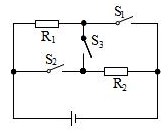

# Physics - 题目 401

**ID**: d0fac7f15e8b459c9a99f2ad4e667703
**年级**: Grade 9
**难度**: Medium-Hard
**题型**: Calculation

## 题目
生活中大多数电热器都有多个档位，学习了电功率知识后，小锐同学利用电压为6V的电源，两个阻值不同的定值电阻，设计了如下图所示的电路来探究电热器多档位的问题，已知R_{1}=10Ω，R_{2}=30Ω，请计算：(1)S_{1}、S_{2}断开，S_{3}闭合时，电路中的电流是多少？(2)S_{1}断开，S_{2}、S_{3}闭合时，通电5min电路消耗的电能是多少？(3)S_{1}、S_{2}闭合，S_{3}断开时，电路消耗的总功率是多少？​​​​​​​‌

## 解答

1. (1)当只闭合S_{3}时，两电阻串联，在串联电路中总电阻等于各分电阻之和，根据欧姆定律可得，电路中的电流：
2. $I=\frac {U}{R{{}_{1}}+R{{}_{2}}}=\frac {{\rm{6}}{\rm{V}}}{1{\rm{0}}{\rm{Ω}}+3{\rm{0}}{\rm{Ω}}}=0{\rm{.}}{\rm{1}}{\rm{5}}{\rm{A}}$ ；
3. (2)当S_{1}断开，S_{2}、S_{3}闭合时，电路为R_{2}的简单电路，通电5min电路消耗的电能：
4. $W=\frac {U{^{2}}}{R}t=\frac {\left ({{\rm{6}}{\rm{V}}}\right ){^{{\rm{2}}}}}{{\rm{3}}{\rm{0}}{\rm{Ω}}}\times 5\times 6{\rm{0}}{\rm{s}}=36{\rm{0}}{\rm{J}}$ ；
5. (3)当S_{1}、S_{2}闭合，S_{3}断开时，电阻R_{1}、R_{2}并联，根据并联电路中支路电压与电源电压都相等，则电路消耗的总功率：
6. $P{{}_{总}}=P{{}_{1}}+P{{}_{2}}=\frac {U{^{2}}}{R{{}_{1}}}+\frac {U{^{2}}}{R{{}_{2}}}=\frac {\left ({{\rm{6}}{\rm{V}}}\right ){^{{\rm{2}}}}}{{\rm{1}}{\rm{0}}{\rm{Ω}}}+\frac {\left ({{\rm{6}}{\rm{V}}}\right ){^{{\rm{2}}}}}{{\rm{3}}{\rm{0}}{\rm{Ω}}}=4{\rm{.}}{\rm{8}}{\rm{W}}$ 。
7. 答：(1)S_{1}、S_{2}断开，S_{3}闭合时，电路中的电流是0.15A；(2)S_{1}断开，S_{2}、S_{3}闭合时，通电5min电路消耗的电能是360J；(3)S_{1}、S_{2}闭合，S_{3}断开时，电路消耗的总功率是4.8W。

## 知识点

**中文**:
  - 串并联电路电功的特点
  - 欧姆定律的应用
  - 电阻的串联
  - 电功与电能的计算
  - 电功率的计算及应用

**English**:
  - Characteristics of Electric Work in Series/Parallel
  - Applications of Ohm's Law
  - Series Connection of Resistors
  - Calculation of Electric Work and Energy
  - Calculation and Application of Electric Power

---
