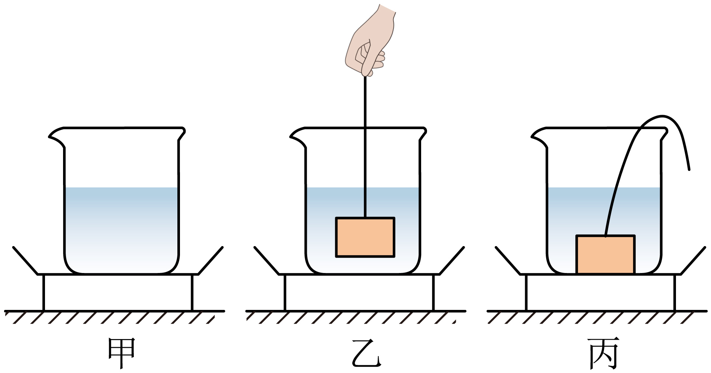

# Physics - 题目 578

**ID**: d29ddc14acf24d95b34ba6534cedaac2
**年级**: Grade 9
**难度**: Medium-Hard
**题型**: Calculation

## 题目
小明利用电子秤、细绳（质量不计）、烧杯、水测量一不溶于水的物块的密度，具体实验操作如下：首先，在烧杯中装入适量的水，用电子秤测出其质量的示数为 $m{{}_{1}}$ （如图甲所示）；用细绳将物块拴住，将物块浸没在水中，静止时电子秤的示数为 $m{{}_{2}}$ （如图乙所示），缓慢将物体放在烧杯底部，静止时电子秤的示数为 $m{{}_{3}}$ （如图丙所示）。​​​​​​​‌（水的密度用 $ρ{{}_{水}}$ 表示）求：（1）物块的质量 $m$ ；（2）物块的体积 $V$ ；（3）物块的密度 $ρ$ 。

## 解答

1. （1）甲图测量水杯和水的质量，丙图添加了物块，增大的质量为物块的质量，故 $m=m{{}_{3}}{{-}}m{{}_{1}}$
2. （2）对比甲、乙两图，乙图物体浸入液体中，因而给整体向下的作用力等于浮力，使得电子秤示数增大，增大部分的重力等于浮力，即 $F{{}_{浮}}{\rm{=}}(m{{}_{2}}{{-}}m{{}_{1}})g$
3. 根据阿基米德原理知：物体的体积 $V{\rm{=}}V{{}_{排}}{\rm{=}}\frac {F{{}_{浮}}}{ρ{{}_{水}}g}=\frac {(m{{}_{2}}{{-}}m{{}_{1}})g}{ρ{{}_{水}}g}{\rm{=}}\frac {m{{}_{2}}{{-}}m{{}_{1}}}{ρ{{}_{水}}}$
4. （3）根据 $ρ{\rm{=}}\frac {m}{V}$ 可得，物块的密度为 $ρ{\rm{=}}\frac {m}{V}{\rm{=}}\frac {m{{}_{3}}{{-}}m{{}_{1}}}{\frac {m{{}_{2}}{{-}}m{{}_{1}}}{ρ{{}_{水}}}}{\rm{=}}\frac {m{{}_{3}}{{-}}m{{}_{1}}}{m{{}_{2}}{{-}}m{{}_{1}}}ρ{{}_{水}}$

## 知识点

**中文**:
  - 特殊方法测密度

**English**:
  - Special Methods for Measuring Density

---
