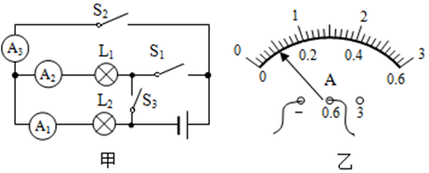

# Physics - 题目 1487

**ID**: d3881d323724447d8d0c4c4ddb2928d8
**年级**: Grade 9
**难度**: Medium-Hard
**题型**: Calculation

## 题目
如图甲所示，当开关S_{1}闭合，S_{2}和S_{3}都断开时，电流表A_{1}的示数如图乙所示，求：(1)电流表A_{2}和A_{3}的示数；(2)当开关S_{2}和S_{3}闭合，S_{1}断开时，电流表A_{3}和A_{2}的示数分别为0.​​​​​​​‌7A和0.3A，电流表A_{1}的示数；(3)若将S_{1}、S_{2}和S_{3}同时闭合会发生什么现象？

## 解答

1. 解：(1)根据电路图可知，当S_{1}闭合、S_{2}和S_{3}都断开时，L_{1}、L_{2}串联；电流表A_{1}和A_{2}的都测量电路电流，而串联电路处处电流相等，故电流表A_{1}和A_{2}的示数相等，都等于图乙中的示数0.1A；电流表A_{3}处于断路状态，因此示数为0。
2. (2)当开关S_{2}和S_{3}闭合，S_{1}断开时，L_{1}、L_{2}并联；电流表A_{1}测通过L_{2}的电流，A_{2}测通过L_{1}的电流，A_{3}测干路电流；因为并联电路中，干路电流等于各支路电流之和，所以电流表A_{1}的示数
3. $I{{}_{1}}=I{{}_{3}}-I{{}_{2}}=0{\rm{.}}7{\rm{A}}-0{\rm{.}}3{\rm{A}}=0{\rm{.}}4{\rm{A}}$
4. (3)当S_{1}、S_{2}和S_{3}同时闭合时，电流从电源正极流出，直接从S_{1}、S_{3}回到电源负极，故发生电源短路，电源将被烧坏。
5. 答：(1)电流表A_{2}的示数为0.1A，A_{3}的示数为0；
6. (2)当开关S_{2}和S_{3}闭合，S_{1}断开时，电流表A_{3}和A_{2}的示数分别为0.7A和0.3A，电流表A_{1}的示数为0.4A；
7. (3)若将S_{1}、S_{2}和S_{3}同时闭合，会发生电源短路，电源将被烧坏。

## 知识点

**中文**:
  - 串联电路的电流规律
  - 并联电路的电流规律

**English**:
  - Current Law in Series Circuits
  - Current Law in Parallel Circuits

---
