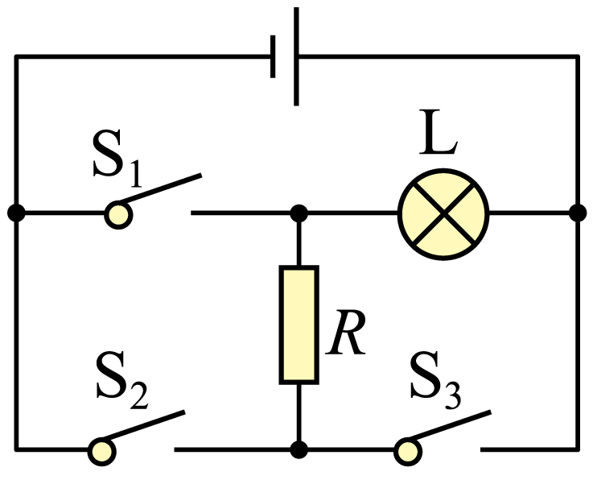

# Physics - 题目 338

**ID**: d63b9ea2b9264fd7bcf358d96911be21
**年级**: Grade 9
**难度**: Medium-Hard
**题型**: Calculation

## 题目
如图所示，灯L标有“6V  3W”字样，电源电压恒为6V，定值电阻R=6Ω，设灯L的阻值不随温度变化而变化，求：（1）灯L正常发光时的电阻是多少；（2）只闭合S_{1}、S_{3}时，电阻R在60s内产生的热量是多少；（3）要使整个电路消耗的电功率最小（且电路电流不为0），各开关的合 闭情况应如何 ；此时的最小电功率为多少。​​​​​​​‌

## 解答

1. 解：（1）由题意及 $P=\frac {U{^{2}}}{R}$ 可得，灯L正常发光的电阻为
2. $R{{}_{{\rm{L}}}}=\frac {U{^{2}}}{P}=\frac {（6{\rm{V}}）{^{2}}}{3{\rm{W}}}=12{\rm{Ω}}$
3. （2）只闭合S_{1}、S_{3}时，灯L与R并联，R两端的电压为
4. U_{R}=U=6V
5. 电阻R在60s内产生的热量
6. $Q=W=\frac {U{^{2}}}{R}t=\frac {{\left({6{\rm{V}}}\right)^{2}}}{6{\rm{Ω}}}\times 60{\rm{s}}=360{\rm{J}}$
7. （3）根据 $P=\frac {U{^{2}}}{R}$ 可知，电压一定时，电阻越大，电功率越小，要使整个电路消耗的电功率最小，应使R与L串联，所以闭合开关S_{2}，断开S_{1}、S_{3}_{；}因为灯L的阻值不随温度变化而变化，由题意可得，最小电功率为
8. $P=\frac {U{^{2}}}{R+R{{}_{L}}}=\frac {{\left({6{\rm{V}}}\right)^{2}}}{6{\rm{Ω}}+12{\rm{Ω}}}=2{\rm{W}}$
9. 答：（1）灯L正常发光时的电阻是12Ω；
10. （2）电阻R在60s内产生的热量是360J；
11. （3）开关的合闭情况应为闭合开关S_{2}，断开S_{1}、S_{3}，此时的最小电功率为2W。

## 知识点

**中文**:
  - 焦耳定律的计算公式及其应用
  - 电路的动态分析
  - 电功率的计算及应用

**English**:
  - Formula and Application of Joule's Law
  - Dynamic Circuit Analysis
  - Calculation and Application of Electric Power

---
