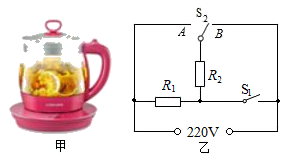

# Physics - 题目 1332

**ID**: d7e32b56aac2463e9ad474920bc85aea
**年级**: Grade 9
**难度**: Medium-Hard
**题型**: Calculation

## 题目
如图甲所示是小明家的养生壶，它有高温、中温、低温三个挡位，图乙是他的工作电路图，下表所列的是其部分参数，其中R_{1}、R_{2}为发热电阻，R_{2}＝88Ω，求：（1）发热电阻R_{1}的阻值是多少？（2）该养生壶中温挡的电功率是多少？（3）小明在额定电压下用高温挡加热3kg的水，使其温度从20℃上升到100℃，则烧开一壶水需要多长时间？（不计热量损失，c_{水}＝4.​​​​​​​‌2×10^{3}J/（kg•℃），计算结果保留整数）额定电压220V低温挡功率275W容量3L防烧干功能有

## 解答

1. 解：（1）由乙图可知，当开关S_{2}接B，S_{1}断开时，两电阻串联；当开关S_{2}接B，S_{1}闭合时，电路为R_{1}的简单电路；当开关S_{2}接A，S_{1}闭合时，两电阻并联。因串联电路中总电阻大于任何一个分电阻，并联电路的总电阻小于任何一个分电阻，所以当开关S_{2}接B，S_{1}断开时，电路中的总电阻最大，当开关S_{2}接A，S_{1}闭合时，总电阻最小。由 $P=\frac {U{^{2}}}{R}$ 可知，电压一定时，电阻越小，电功率越大；电阻越大，电功率越小。则开关S_{2}接A，S_{1}闭合时，为高温挡；开关S_{2}接B，S_{1}断开时，为低温挡；开关S_{2}接B，S_{1}闭合时，为中温挡。则低温挡时的总电阻为
2. $R{{}_{总}}=\frac {U{^{2}}}{P{{}_{低}}}=\frac {\left ({{\rm{2}}{\rm{2}}{\rm{0}}{\rm{V}}}\right ){^{{\rm{2}}}}}{{\rm{2}}{\rm{7}}{\rm{5}}{\rm{W}}}{\rm{=}}{\rm{1}}{\rm{7}}{\rm{6}}{\rm{Ω}}$
3. 则电阻R_{1}的阻值是
4. $R{{}_{1}}=R{{}_{总}}-R{{}_{2}}={\rm{1}}{\rm{7}}{\rm{6}}{\rm{Ω}}{\rm{-}}{\rm{8}}{\rm{8}}{\rm{Ω}}{\rm{=}}{\rm{8}}{\rm{8}}{\rm{Ω}}$
5. （2）根据 $P=\frac {U{^{2}}}{R}$ 可知，养生壶中温挡的电功率是
6. $P{{}_{中}}=\frac {U{^{2}}}{R{{}_{1}}}=\frac {\left ({{\rm{2}}{\rm{2}}{\rm{0}}{\rm{V}}}\right ){^{{\rm{2}}}}}{{\rm{8}}{\rm{8}}{\rm{Ω}}}{\rm{=}}{\rm{5}}{\rm{5}}{\rm{0}}{\rm{W}}$
7. （3）根据 $Q{{}_{吸}}=cmΔt$ 可知，水吸收的热量为
8. $Q{{}_{吸}}=cmΔt{\rm{=}}{\rm{4}}{\rm{.}}{\rm{2}}\times {\rm{1}}{\rm{0}}{^{{\rm{3}}}}{\rm{J}}{\rm{/}}\left ({{\rm{k}}{\rm{g}}\cdot ℃}\right )\times {\rm{3}}{\rm{k}}{\rm{g}}\times \left ({{\rm{1}}{\rm{0}}{\rm{0}}℃{\rm{-}}{\rm{2}}{\rm{0}}℃}\right ){\rm{=}}{\rm{1}}{\rm{.}}{\rm{0}}{\rm{0}}{\rm{8}}\times {\rm{1}}{\rm{0}}{^{{\rm{6}}}}{\rm{J}}$
9. 因为不计热量损失，所以
10. $W=Q{{}_{吸}}{\rm{=}}{\rm{1}}{\rm{.}}{\rm{0}}{\rm{0}}{\rm{8}}\times {\rm{1}}{\rm{0}}{^{{\rm{6}}}}{\rm{J}}$
11. 高温挡的功率为
12. $P{{}_{高}}=P{{}_{1}}+P{{}_{2}}=2P{{}_{1}}={\rm{2}}\times {\rm{5}}{\rm{5}}{\rm{0}}{\rm{W}}{\rm{=}}{\rm{1}}{\rm{1}}{\rm{0}}{\rm{0}}{\rm{W}}$
13. 根据 $t=\frac {W}{P{{}_{高}}}$ 可知，烧开一壶水需要的时间为
14. $t=\frac {W}{P{{}_{高}}}{\rm{=}}\frac {{\rm{1}}{\rm{.}}{\rm{0}}{\rm{0}}{\rm{8}}\times {\rm{1}}{\rm{0}}{^{{\rm{6}}}}{\rm{J}}}{{\rm{1}}{\rm{1}}{\rm{0}}{\rm{0}}{\rm{W}}}\approx {\rm{9}}{\rm{1}}{\rm{6}}{\rm{s}}$
15. 答：（1）发热电阻R_{1}的阻值是88Ω；
16. （2）该养生壶中温挡的电功率是550W；
17. （3）烧开一壶水需要916s。

## 知识点

**中文**:
  - 焦耳定律的计算公式及其应用
  - 电功率的计算及应用
  - 电与热综合计算

**English**:
  - Formula and Application of Joule's Law
  - Calculation and Application of Electric Power
  - Comprehensive Calculation of Electricity and Heat

---
