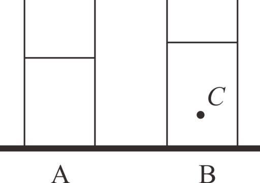

# Physics - 题目 2635

**ID**: d8122feb2bb64ea5a801df2c562bde9f
**年级**: Grade 9
**难度**: Medium-Hard
**题型**: Calculation

## 题目
如图所示，完全相同的圆柱形容器A和B静置在水平地面上。​​​​​​​‌容器A中装有深为1.4米、体积为2×10^{﹣}^{3}米^{3}的水。容器B中装有深为1.6米、密度为0.8×10^{3}千克/米^{3}的酒精。求：①容器A中水的质量m_{水}；②距容器B底部0.6米处C点的压强pC；③若从A、B两容器中分别抽出高为h的液体后，液体对各自容器底部的压强分别为p_{A}、p_{B}，通过计算比较p_{A}、p_{B}的大小。

## 解答

1. 解：①由 $ρ=\frac {m}{V}$ 得水的质量
2. $m{{}_{水}}＝ρ{{}_{水}}V{{}_{水}}＝1.0\times 10{^{3}}{\rm{k}}{\rm{g}}{\rm{/}}{\rm{m}}{^{3}}\times 2\times 10{^{﹣3}}{\rm{m}}{^{{\rm{3}}}}＝{\rm{2}}{\rm{k}}{\rm{g}}$
3. ②距容器B底部0.6米处C点的压强为
4. $p{{}_{C}}＝ρ{{}_{酒精}}gh{{}_{C}}＝0.8\times 10{^{3}}{\rm{k}}{\rm{g}}{\rm{/}}{\rm{m}}{^{3}}\times 10{\rm{N}}{\rm{/}}{\rm{k}}{\rm{g}}\times \left ({{\rm{1}}{\rm{.}}{\rm{6}}{\rm{m}}-{\rm{0}}{\rm{.}}{\rm{6}}{\rm{m}}}\right )＝8\times 10{^{3}}{\rm{P}}{\rm{a}}$
5. ③若从A、B两容器中分别抽出高均为h的液体后，减小的压强为
6. $Δp{{}_{{\rm{A}}}}＝ρ{{}_{水}}gh$  ， $Δp{{}_{{\rm{B}}}}＝ρ{{}_{酒精}}gh$
7. 则A容器中水对容器底部的压强为
8. $p{{}_{A}}＝ρ{{}_{水}}g\left ({h{{}_{{\rm{A}}}}-h}\right )$
9. B容器中酒精对容器底部的压强为
10. $p{{}_{{\rm{B}}}}＝ρ{{}_{酒精}}g\left ({h{{}_{{\rm{B}}}}-h}\right )$
11. 则
12. $p{{}_{{\rm{A}}}}-p{{}_{{\rm{B}}}}＝ρ{{}_{水}}g\left ({h{{}_{{\rm{A}}}}-h}\right )﹣ρ{{}_{酒精}}g\left ({h{{}_{B}}-h}\right )＝1\times 10{^{{\rm{3}}}}{\rm{k}}{\rm{g}}{\rm{/}}{\rm{m}}{^{3}}\times g\left ({1.4{\rm{m}}-h}\right )-0.8\times 10{^{3}}{\rm{k}}{\rm{g}}{\rm{/}}{\rm{m}}{^{3}}\times g\left ({1.6{\rm{m}}-h}\right )＝1.2\times 10{^{3}}{\rm{P}}{\rm{a}}-2\times 10{^{3}}h{\rm{P}}{\rm{a}}$
13. 当
14. $0＜h＜0.{\rm{6}}{\rm{m}}$
15. 时，则
16. $p{{}_{{\rm{A}}}}-p{{}_{{\rm{B}}}}>0$
17. 所以
18. $p{{}_{{\rm{A}}}}＞p{{}_{{\rm{B}}}}$
19. 当
20. $h＝0.{\rm{6}}{\rm{m}}$
21. 时，则
22. $p{{}_{{\rm{A}}}}-p{{}_{{\rm{B}}}}＝0$
23. 所以
24. $p{{}_{{\rm{A}}}}＝p{{}_{{\rm{B}}}}$
25. 当
26. $h＞0.6{\rm{m}}$
27. 时，则
28. $p{{}_{{\rm{A}}}}﹣p{{}_{{\rm{B}}}}＜0$
29. 所以
30. $p{{}_{{\rm{A}}}}＜p{{}_{{\rm{B}}}}$
31. 答：①A容器中水的质量为2kg；
32. ②距容器B底部0.6米处C点的压强为8×10^{3}Pa；
33. ③当 $0＜h＜0.6{\rm{m}}$ 时， $p{{}_{{\rm{A}}}}＞p{{}_{{\rm{B}}}}$ ；当 $h＝0.6{\rm{m}}$ 时， $p{{}_{{\rm{A}}}}＝p{{}_{{\rm{B}}}}$ ；当 $h＞0.6{\rm{m}}$ 时， $p{{}_{{\rm{A}}}}＜p{{}_{{\rm{B}}}}$ 。

## 知识点

**中文**:
  - 液体压强的判断与计算

**English**:
  - Determination and Calculation of Liquid Pressure

---
