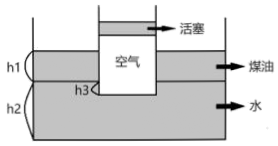

# Physics - 题目 2865

**ID**: e2dd0fe2884a4979880bacd503f4560a
**年级**: Grade 9
**难度**: Medium-Hard
**题型**: Calculation

## 题目
如图一容器浮于一水缸中，水缸中有两种液体：煤油（密度为ρ_{1}）和水（密度为ρ_{2}）容器中有一个可沿容器壁无摩擦滑动的活塞，质量为m_{1}，容器（不含活塞）质量为m_{2}，容器中封闭了一段空气。​​​​​​​‌煤油比热容为c_{1}，水的比热容为c_{2}，水缸底面积为S_{1}，容器底面积为S_{2}，h_{3}、h_{2}为已知量，h_{1}为未知量。忽略空气和容器壁吸热，大气压强为p。（1）h_{1}=？（2）外界以极缓慢的速度使水缸中液体上升 $\Delta T$ ，若将该系统（即容器和水缸）看成一个热机，加热后活塞上升 $Δh$ 求其热机效率。

## 解答

1. 解：（1）容器与活塞在水缸中漂浮，则所受浮力为 $F{{}_{浮}}=G{{}_{总}}=G{{}_{1}}+G{{}_{2}}=m{{}_{1}}g+m{{}_{2}}g$ ，容器与活塞在水中所受的浮力为 $F{{}_{浮水}}=ρ{{}_{2}}gV{{}_{水}}=ρ{{}_{2}}gS{{}_{2}}h{{}_{3}}$ ，容器与活塞在水中所受的浮力为 $F{{}_{浮煤油}}=ρ{{}_{1}}gV{{}_{煤油}}=ρ{{}_{1}}gS{{}_{2}}h{{}_{1}}$ ，又因为 $F{{}_{浮}}=F{{}_{浮水}}+F{{}_{浮煤油}}$ ，所以可得 $F{{}_{浮煤油}}=F{{}_{浮}}-F{{}_{浮水}}=m{{}_{1}}g+m{{}_{2}}g-ρ{{}_{2}}gS{{}_{2}}h{{}_{3}}=ρ{{}_{1}}gS{{}_{2}}h{{}_{1}}$ ，即 $h{{}_{1}}=\frac {m{{}_{1}}g+m{{}_{2}}g-ρ{{}_{2}}gS{{}_{2}}h{{}_{3}}}{ρ{{}_{1}}gS{{}_{2}}}=\frac {m{{}_{1}}+m{{}_{2}}-ρ{{}_{2}}S{{}_{2}}h{{}_{3}}}{ρ{{}_{1}}S{{}_{2}}}$
2. （2）根据压强公式 $p=\frac {F}{S}$ ，活塞所受空气压力为 $F=pS{{}_{2}}$ ，加热后活塞上升 $Δh$ ，则该热机获得的有用功为 $W=Fs=pS{{}_{2}}Δh$ ，水缸中煤油的体积为 $V{{}_{煤油}}=（S{{}_{1}}-S{{}_{2}}）h{{}_{1}}=（S{{}_{1}}-S{{}_{2}}）\centerdot \frac {m{{}_{1}}g+m{{}_{2}}g-ρ{{}_{2}}gS{{}_{2}}h{{}_{3}}}{ρ{{}_{1}}gS{{}_{2}}}$ ，水的体积为 $V{{}_{水}}=S{{}_{1}}(h{{}_{2}}-h{{}_{3}})+(S{{}_{1}}-S{{}_{2}})h{{}_{3}}$ ，根据密度公式 $ρ=\frac {m}{V}$ ，水缸中液体质量分别为 $m{{}_{煤油}}=ρ{{}_{1}}V{{}_{煤油}}=ρ{{}_{1}}（S{{}_{1}}-S{{}_{2}}）h{{}_{1}}=ρ{{}_{1}}（S{{}_{1}}-S{{}_{2}}）\centerdot \frac {m{{}_{1}}g+m{{}_{2}}g-ρ{{}_{2}}gS{{}_{2}}h{{}_{3}}}{ρ{{}_{1}}gS{{}_{2}}}$ ， $m{{}_{水}}=ρ{{}_{2}}V{{}_{水}}=ρ{{}_{2}}\left [S{{}_{1}}(h{{}_{2}}-h{{}_{3}})+(S{{}_{1}}-S{{}_{2}})h{{}_{3}}\right ]$
3. 水缸中液体上升 $\Delta T$ ，根据比热容公式 ${\rm{Q}}={\rm{c}}{\rm{m}}Δ{\rm{t}}$ 可知，吸收的热量分为 $\hspace{-0.5em}\begin{array}{l}Q{{}_{总}}=Q{{}_{煤油}}+Q{{}_{水}}=c{{}_{1}}m{{}_{煤油}}{\rm{Δ}}T+c{{}_{2}}m{{}_{水}}{\rm{Δ}}T\\=c{{}_{1}}ρ{{}_{1}}（S{{}_{1}}-S{{}_{2}}）·\frac {m{{}_{1}}g+m{{}_{2}}g-ρ{{}_{2}}gS{{}_{2}}h{{}_{3}}}{ρ{{}_{1}}gS{{}_{2}}}{\rm{Δ}}T+c{{}_{2}}ρ{{}_{2}}\left [S{{}_{1}}(h{{}_{2}}-h{{}_{3}})+(S{{}_{1}}-S{{}_{2}})h{{}_{3}}\right ]{\rm{Δ}}T\end{array}\hspace{-0.5em}$ ，根据热机效率公式 $η=\frac {W{{}_{有用}}}{Q}\times 100{\rm{\%}}$ ，该热机的效率为 $\hspace{-0.5em}\begin{array}{l}η=\frac {W}{Q{{}_{总}}}\times 100{\rm{\%}}\\{\rm{=}}\frac {pS{{}_{2}}{\rm{Δ}}h}{c{{}_{1}}（S{{}_{1}}-S{{}_{2}}）·\frac {m{{}_{1}}g+m{{}_{2}}g-ρ{{}_{2}}gS{{}_{2}}h{{}_{3}}}{gS{{}_{2}}}{\rm{Δ}}T+c{{}_{2}}ρ{{}_{2}}\left [S{{}_{1}}\left ({h{{}_{2}}-h{{}_{3}}}\right )+\left ({S{{}_{1}}-S{{}_{2}}}\right )h{{}_{3}}\right ]{\rm{Δ}}T}\times 100{\rm{\%}}\end{array}\hspace{-0.5em}$
4. 答：（1） $h{{}_{1}}=\frac {m{{}_{1}}g+m{{}_{2}}g-ρ{{}_{2}}gS{{}_{2}}h{{}_{3}}}{ρ{{}_{1}}gS{{}_{2}}}$ ；
5. （2）其热机效率为 $\frac {pS{{}_{2}}{\rm{Δ}}h}{c{{}_{1}}（S{{}_{1}}-S{{}_{2}}）·\frac {m{{}_{1}}g+m{{}_{2}}g-ρ{{}_{2}}gS{{}_{2}}h{{}_{3}}}{gS{{}_{2}}}{\rm{Δ}}T+c{{}_{2}}ρ{{}_{2}}\left [S{{}_{1}}\left ({h{{}_{2}}-h{{}_{3}}}\right )+\left ({S{{}_{1}}-S{{}_{2}}}\right )h{{}_{3}}\right ]{\rm{Δ}}T}\times 100{\rm{\%}}$ 。

## 知识点

**中文**:
  - 有关热机效率的计算

**English**:
  - Calculations of Heat Engine Efficiency

---
