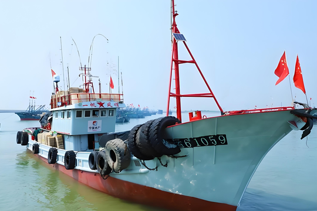

# Physics - 题目 2655

**ID**: e539dcd241a14bf988d4f782e1bdbb9c
**年级**: Grade 9
**难度**: Medium-Hard
**题型**: Calculation

## 题目
休渔政策有利于海洋渔业持续、稳定、高质量发展。​​​​​​​‌5月1日起，我市开始进入海洋伏季休渔期；9月1日休渔期结束后，各渔港码头“千帆竞发”，渔船可出海进行捕捞作业。如图为某型号渔船，其部分参数如表。（g取10N/kg）总长度（m）34.2宽度（m）6排水量（t）200最大吃水深度（m）2.1发动机额定动力输出功率（kW）280鱼舱容量（m^{3}）147（1）该渔船满载时，求它受到的浮力；（2）满载时，求船底受到海水的压强（ $ρ$_{海水}取1×10^{3}kg/m^{3}）；（3）为方便保鲜，现需要将质量为3×10^{3}kg、温度为19℃的海水降低到4℃，求此过程放出的热量；[c_{海水}取4.2×10^{3}J/（kg·℃）]（4）若发动机以额定动力输出功率运行1h，消耗燃油60kg，求内能转化为机械能的效率。（q_{油}取4.2×10^{7}J/kg）

## 解答

1. （1）渔船满载时排开水的质量 $m{{}_{排}}=200{\rm{t}}=2\times 10{^{5}}{\rm{k}}{\rm{g}}$ ，因渔船漂浮，渔船满载时受到的浮力 $F{{}_{浮}}=G{{}_{排}}=m{{}_{排}}g=2\times 10{^{5}}{\rm{k}}{\rm{g}}\times 10{\rm{N}}/{\rm{k}}{\rm{g}}=2\times 10{^{6}}{\rm{N}}$ 。
2. （2）满载时，船底受到海水的压强 $p=ρ{{}_{海水}}gh=1\times 10{^{3}}{\rm{k}}{\rm{g}}/{\rm{m}}{^{3}}\times 10{\rm{N}}/{\rm{k}}{\rm{g}}\times 2.1{\rm{m}}=2.1\times 10{^{4}}{\rm{P}}{\rm{a}}$ 。
3. （3）此过程放出的热量 $Q{{}_{放}}=c{{}_{海水}}m{{}_{海水}}\left ({t{{}_{0}}-t{{}_{末}}}\right )=4.2\times 10{^{3}}{\rm{J}}/\left ({{\rm{k}}{\rm{g}}\cdot {}\degree {\rm{C}}}\right )\times 3\times 10{^{3}}{\rm{k}}{\rm{g}}\times \left ({19{}\degree {\rm{C}}-4{}\degree {\rm{C}}}\right )=1.89\times 10{^{8}}{\rm{J}}$ 。
4. （4）发动机输出的机械能，即动力所做的功 $W=Pt=280{\rm{k}}{\rm{W}}\times 1{\rm{h}}=280{\rm{k}}{\rm{W}}\cdot {\rm{h}}=1.008\times 10{^{9}}{\rm{J}}$ ，消耗 $60{\rm{k}}{\rm{g}}$ 燃油产生的内能，即完全燃烧燃油释放的热量 $Q=m{{}_{油}}q{{}_{油}}=60{\rm{k}}{\rm{g}}\times 4.2\times 10{^{7}}{\rm{J}}/{\rm{k}}{\rm{g}}=2.52\times 10{^{9}}{\rm{J}}$ ，内能转化为机械能的效率 $η=\frac {W}{Q}=\frac {1.008\times 10{^{9}}{\rm{J}}}{2.52\times 10{^{9}}{\rm{J}}}\times 100{\rm{\%}}=40{\rm{\%}}$ 。

## 知识点

**中文**:
  - 有关热机效率的计算
  - 液体压强的大小及其计算
  - 阿基米德原理的应用
  - 比热容的概念及其计算
  - 热值及相关计算

**English**:
  - Calculations of Heat Engine Efficiency
  - Magnitude and Calculation of Liquid Pressure
  - Applications of Archimedes' Principle
  - Concept and Calculation of Specific Heat Capacity
  - Calorific Value and Calculations

---
