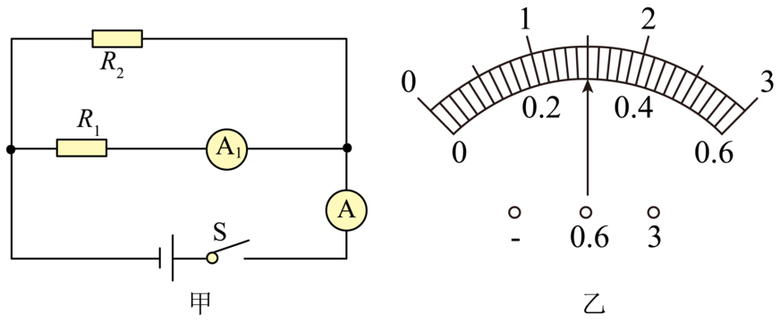

# Physics - 题目 1589

**ID**: ead47ab2a6884137a7d3efcfbe6d3c8b
**年级**: Grade 9
**难度**: Medium-Hard
**题型**: Calculation

## 题目
在图甲所示的电路中，电源电压保持不变，电阻 $R{{}_{1}}$ 的阻值为 $30{\rm Ω}$ 。​​​​​​​‌闭合开关 ${\rm S}$ ，电路正常工作，两个电流表的指针指在同一位置，如图乙所示。（1）电源电压 $U$ 是多少？（2）R_{2}通电 $10{\rm{s}}$ 所产生的热量是多少？（3）现用一个电阻 $R{{}_{x}}$ 替换电阻 $R{{}_{1}}$ 或 $R{{}_{2}}$ ，替换后一个电流表的示数减少了 $0.3{\rm{A}}$ ，另一个电流表的示数未发生变化，请判断说明电阻 $R{{}_{x}}$ 替换的是哪个电阻，并求出电阻 $R{{}_{x}}$ 的阻值。

## 解答

1. 解：由电路图可知， $R{{}_{1}}$ 与 $R{{}_{2}}$ 并联，电流表 $\mathrm{A}$ 测干路电流，电流表 $A{{}_{1}}$ 测 $R{{}_{1}}$ 支路的电流，因并联电路中干路电流等于各支路电流之和，且两电流表指针的位置相同，所以，电流表 $\mathrm{A}$ 的量程为 $0\sim 3{\rm A}$ ，分度值为 $0.1{\rm A}$ ，电流表A的读数为1.5A，干路电流 $I=1.5{\rm A}$ ；电流表 ${\rm A}{{}_{1}}$ 的量程为 $0\sim 0.6{\rm A}$ ，分度值为 $0.02{\rm A}$ ，读数为0.3A，通过 $R{{}_{1}}$ 的电流 $I{{}_{1}}=0.3{\rm A}$ 。
2. （1）因并联电路中各支路两端的电压相等，由欧姆定律可得，电源电压
3. $U=U{{}_{1}}=I{{}_{1}}R{{}_{1}}=0.3{\rm{A}}\times 30{\rm{Ω}}=9{\rm{V}}$  $（2）$ 并联电路干路电流等于各支路电流之和，通过电阻 $R{{}_{2}}$ 的电流
4. $I{{}_{2}}=I-I{{}_{1}}=1.5{\rm{A}}-0.3{\rm{A}}=1.2{\rm{A}}$  $R{{}_{2}}$ 通电 $10{\rm{s}}$ 所产生的热量
5. $Q=W=UI{{}_{2}}t=9{\rm{V}}\times 1.2{\rm{A}}\times 10{\rm{s}}=108{\rm{J}}$  $（3）$ 由题知，用电阻 $R{{}_{x}}$ 替换电阻 $R{{}_{1}}$ 、 $R{{}_{2}}$ 中的一个，替换前后，只有一个电流表的示数发生了变化；若用 $R{{}_{x}}$ 替换电阻 $R{{}_{1}}$ ，则电流表 ${\rm A}{{}_{1}}$ 所在支路的电阻发生变化，电流表 ${\rm A}{{}_{1}}$ 的示数会发生变化，同时干路电流也会发生变化，即电流表A的示数发生变化，不符合题意，因此只能是用 $R{{}_{x}}$ 替换电阻 $R{{}_{2}}$ ；替换后电流表示数减少了 $0.3{\rm A}$ ，则干路电流变为 $I{\rm{^{′}}}=I-ΔI=1.5{\rm{A}}-0.3{\rm{A}}=1.2{\rm{A}}$
6. 根据并联电路中干路电流等于各支路电流之和可知，此时通过 $R{{}_{x}}$ 的电流为 $I{{}_{x}}=I{\rm{^{′}}}-I{{}_{1}}=1.2{\rm{A}}-0.3{\rm{A}}=0.9{\rm{A}}$
7. 根据欧姆定律可得， $R{{}_{x}}$ 的阻值 $R{{}_{x}}=\frac {U}{I{{}_{x}}}=\frac {9{\rm{V}}}{0.9{\rm{A}}}=10{\rm{Ω}}$
8. 答：（1）电源电压 $U$ 的大小为 $9{\rm V}$ ；
9. （2） $R{{}_{2}}$ 通电 $10s$ 所产生的热量为 $108{\rm{J}}$ ；
10. （3） $R{{}_{x}}$ 替换的是电阻 $R{{}_{2}}$ ，未知电阻 $R{{}_{x}}$ 的阻值为 $10{\rm{Ω}}$ 。

## 知识点

**中文**:
  - 并联电路的电压规律
  - 电流表的读数
  - 电流表量程的选择
  - 并联电路的电流规律
  - 欧姆定律的应用
  - 电功与电能的计算

**English**:
  - Voltage Law in Parallel Circuits
  - Reading an Ammeter
  - Choosing Ammeter Range
  - Current Law in Parallel Circuits
  - Applications of Ohm's Law
  - Calculation of Electric Work and Energy

---
