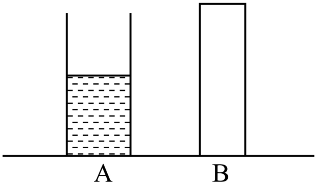

# Physics - 题目 2263

**ID**: ed2da633106049728cb4a633849f3c30
**年级**: Grade 9
**难度**: Medium-Hard
**题型**: Calculation

## 题目
如图所示，薄壁轻质柱形容器A 和均匀柱体B 置于水平地面上，A的底面积为150 cm^{2}，B的底面积为100 cm^{2}；A中盛有体积为3×10^{-3}m^{3}的水，B的密度为1.5 g/cm^{3}，B的高度 为 30cm 。​​​​​​​‌（ $ρ{{}_{水}}=1.0\times 10{^{3}}{\rm{k}}{\rm{g}}{\rm{/}}{\rm{m}}{^{{{3}}}}$ ）（1）求A中水的质量m_{水}。（2）求B对水平地面的压强p。（3）现沿水平方向在圆柱体B 上截取一定的厚度放入A容器中，A和 B对地面的压强相等，求此时B的高度。

## 解答

1. （1）由 $ρ=\frac {m}{V}$ 得，A中水的质量 $m{{}_{水}}=ρ{{}_{水}}V{\rm{=}}{{1}}\times 10{^{3}}{\rm{k}}{\rm{g}}/{\rm{m}}{^{3}}\times {{3}}\times 10{^{{{-}}3}}{\rm{m}}{^{3}}{\rm{=}}{{3}}{\rm{k}}{\rm{g}}$
2. （2）B对水平地面的压强 $p{{}_{{\rm{B}}}}=ρ{{}_{{\rm{B}}}}gh{{}_{{\rm{B}}}}=1.5\times 10{^{3}}{\rm{k}}{\rm{g}}/{\rm{m}}{^{3}}\times {{1}}{{0}}{\rm{N}}{\rm{/}}{\rm{k}}{\rm{g}}\times 30\times 10{^{-2}}{\rm{m}}{\rm{=}}{{4}}500{\rm{P}}{\rm{a}}$
3. （3）现沿水平方向在圆柱体B 上截取一定的厚度放入A容器中，A和 B 对地面的压强相等，此时A对地面的压强为 $p{{}_{{\rm{A}}}}=\frac {F{{}_{{\rm{A}}}}}{S{{}_{{\rm{A}}}}}=\frac {G{{}_{水}}{{+}}G{{}_{{\rm{A}}截}}}{S{{}_{{\rm{A}}}}}{\rm{=}}\frac {m{{}_{水}}{\rm{g}}{{+}}ρ{{}_{{\rm{B}}}}S{{}_{{\rm{B}}}}h{{}_{{\rm{B}}截}}g}{S{{}_{{\rm{A}}}}}{\rm{=}}\frac {3{\rm{k}}{\rm{g}}\times {{1}}{{0}}{\rm{N}}{\rm{/}}{\rm{k}}{\rm{g}}{{+}}1.5\times 10{^{3}}{\rm{k}}{\rm{g}}/{\rm{m}}{^{3}}\times 100\times 10{^{{{-}}4}}{\rm{m}}{^{2}}\times h{{}_{{\rm{B}}截}}\times {{1}}{{0}}{\rm{N}}{\rm{/}}{\rm{k}}{\rm{g}}}{150\times 10{^{{{-}}4}}{\rm{m}}{^{2}}}{\rm{=}}\frac {30{\rm{N}}{{+}}150{\rm{N}}{\rm{/}}{\rm{m}}\times h{{}_{{\rm{B}}截}}}{0.015{\rm{m}}{^{2}}}{\rm B}$ 对地面的压强 $p{{}_{{\rm{B}}}}{^{\prime }}=ρ{{}_{{\rm{B}}}}gh{{}_{{\rm{B}}}}{^{\prime }}=1.5\times 10{^{3}}{\rm{k}}{\rm{g}}/{\rm{m}}{^{3}}\times {{1}}{{0}}{\rm{N}}{\rm{/}}{\rm{k}}{\rm{g}}\times \left ({30\times 10{^{-2}}{\rm{m}}{{-}}h{{}_{{\rm{B}}截}}}\right ){\rm{=}}{{4}}500{\rm{P}}{\rm{a}}{{-}}1.5\times 10{^{4}}{\rm{N}}/{\rm{m}}{^{3}}\times h{{}_{{\rm{B}}截}}$ 则 $\frac {30{\rm{N}}{{+}}150{\rm{N}}{\rm{/}}{\rm{m}}\times h{{}_{{\rm{B}}截}}}{0.015{\rm{m}}{^{2}}}{\rm{=}}{{4}}500{\rm{P}}{\rm{a}}{{-}}1.5\times 10{^{4}}{\rm{N}}/{\rm{m}}{^{3}}\times h{{}_{{\rm{B}}截}}$
4. 解得 $h{{}_{{\rm{B}}截}}{\rm{=}}0.1{\rm{m}}{\rm{=}}10{\rm{c}}{\rm{m}}$
5. 则此时B的高度 $h{{}_{{\rm{B}}}}{^{\prime }}{\rm{=}}h{{}_{{\rm{B}}}}{{-}}h{{}_{{\rm{B}}截}}{\rm{=}}30{\rm{c}}{\rm{m}}{{-}}10{\rm{c}}{\rm{m}}{\rm{=}}{{2}}{{0}}{\rm{c}}{\rm{m}}$

## 知识点

**中文**:
  - 固体压强的判断与计算
  - 液体压强的判断与计算

**English**:
  - Determination and Calculation of Solid Pressure
  - Determination and Calculation of Liquid Pressure

---
