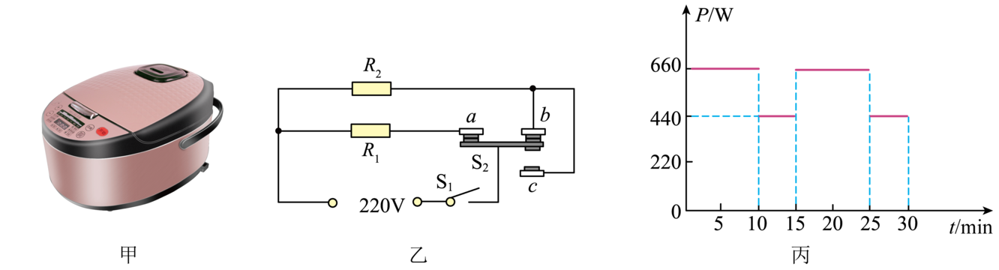

# Physics - 题目 2130

**ID**: f365e1a682ff4105b71e40a09a1398b5
**年级**: Grade 9
**难度**: Medium-Hard
**题型**: Calculation

## 题目
小涵新买的电饭锅如图甲所示，其简化电路如图乙所示。​​​​​​​‌R_{1}和R_{2}均为电热丝，开关S_{2}是自动控制开关，开关S_{2}向上与触点a、b接通，向下仅与触点c接通。煮饭过程中，通过开关S_{2}不断改变电路接通方式，从而使饭得到最佳的口感和营养：如图丙所示为这个电饭锅在某次正常煮饭全过程中总功率随时间的变化图像。求：（1）电热丝R_{2}的阻值；（2）当R_{1}工作时通过它的电流；（3）煮饭全过程消耗的电能。

## 解答

1. 解：（1）由图乙可知，当开关S_{2}向上与触点a、b接通时，电热丝R_{1}和R_{2}并联，根据并联电路的电阻特点可知，此时电路的总电阻最小，由 $P=\frac {U{^{2}}}{R}$ 可知此时电路的总功率最大，由图丙可知电路的最大总功率P_{大}=660W；当S_{2}向下仅与触点c接通时，电路为R_{2}的简单电路，电路中的电阻最大，由 $P=\frac {U{^{2}}}{R}$ 可知此时电路的总功率最小，由图丙可知最小电功率P_{小}=440W；R_{2}的阻值
2. $R{{}_{2}}=\frac {U{^{2}}}{P{{}_{小}}}=\frac {\left ({{{2}}{{2}}{{0}}{\rm{V}}}\right ){^{{{2}}}}}{{{4}}{{4}}{{0}}{\rm{W}}}{\rm{=}}{{1}}{{1}}{{0}}{\rm{Ω}}$
3. （2）因为在两种状态下电热丝R_{2}都工作，且电热丝R_{2}两端的电压不变，其阻值不变，则电热丝R_{2}消耗的电功率不变，即
4. P_{2}=P_{小}=440W
5. 因电路的总功率等于各用电器消耗电功率之和，所以，当开关S_{2}向上与触点a、b接通时，R_{1}的电功率
6. P_{1}=P_{大}-P_{2}=P_{大}-P_{小}=660W-440W=220W
7. 由P=UI可知，当R_{1}工作时通过它的电流
8. $I{{}_{1}}=\frac {P{{}_{1}}}{U}=\frac {{{2}}{{2}}{{0}}{\rm{W}}}{{{2}}{{2}}{{0}}{\rm{V}}}{\rm{=}}{{1}}{\rm{A}}$
9. （3）由图可知，在煮饭全过程中，以最大功率工作的时间
10. t_{1}=20min=1200s
11. 最小功率工作的时间
12. t_{2}=10min=600s
13. 煮饭全过程消耗的电能
14. W=W_{1}+W_{2}=P_{大}t_{1}+P_{小}t_{2}=660W×1200s+440W×600s=1.056×10^{6}J
15. 答：（1）电热丝R_{2}的阻值为110Ω；
16. （2）当R_{1}工作时通过它的电流为1A；
17. （3）煮饭全过程消耗的电能为1.056×10^{6}J。

## 知识点

**中文**:
  - 电功与电能的计算
  - 电路的动态分析
  - 电功率的计算及应用
  - 电磁继电器的常见应用

**English**:
  - Calculation of Electric Work and Energy
  - Dynamic Circuit Analysis
  - Calculation and Application of Electric Power
  - Common Applications of Electromagnetic Relays

---
