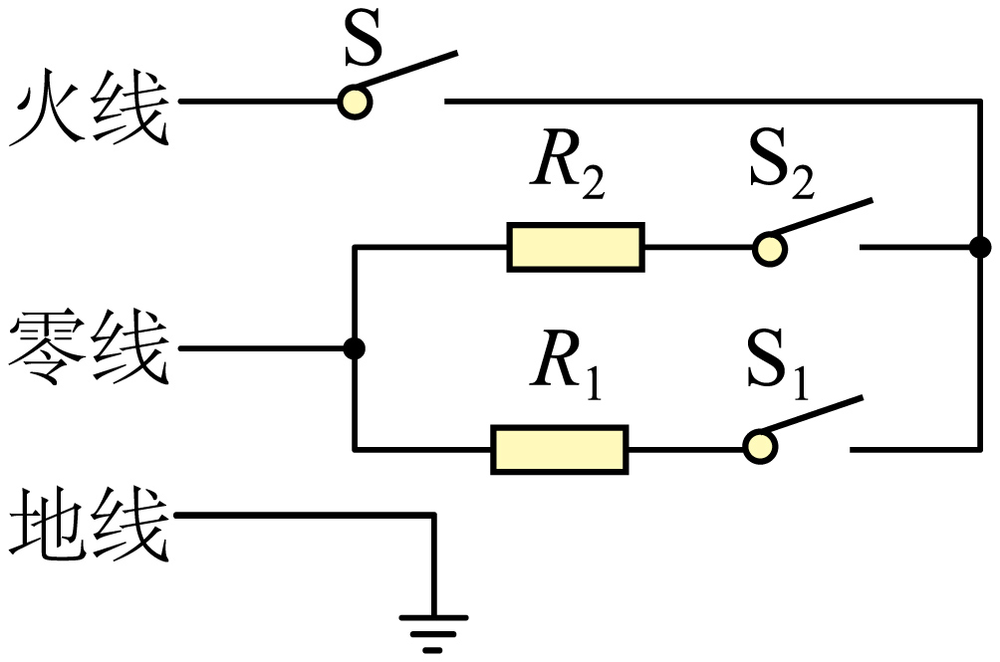

# Physics - 题目 322

**ID**: fc82503009944c9fa2495d5e51603ca7
**年级**: Grade 9
**难度**: Medium-Hard
**题型**: Calculation

## 题目
王瑞同学学习了电功率知识后，回家观察家用电器的铭牌，完成实践性作业。​​​​​​​‌该同学发现家里的电炖锅有保温、低温、高温三档，可以通过手机软件远程切换。查看说明书发现：“保温功率小于低温功率；容量 $1.5{\rm{k}}{\rm{g}}$ ；电阻 $R{{}_{1}}=242Ω$ ， $R{{}_{1}}=4R{{}_{2}}$ ”。如图是该电炖锅的原理图，汤的比热容取 $4\times 10{^{3}}{\rm{J}}/\left ({{\rm{k}}{\rm{g}}\cdot {}^\circ {\rm{C}}}\right )$（1）闭合S、S_{1}，该款电炖锅处于档；理由是。（2）电炖锅在保温档正常工作时的电流多大（计算结果保留一位小数）？(          )（3）电炖锅的低温档的额定功率为多大？(          )（4）额定电压下，使用电炖锅“高温”档加热 $10{\rm{m}}{\rm{i}}{\rm{n}}$ ，可将一锅汤从 $20{}^\circ {\rm{C}}$ 加热到 $100{}^\circ {\rm{C}}$ ，电炖锅的加热效率是多少？(          )

## 解答

1. （1）[1][2]由电路图知道，当开关S、S_{1}和S_{2}都闭合时，电阻R_{1}、R_{2}并联，电路中的总电阻最小，由 $P=\frac {U{^{2}}}{R}$ 知道，总功率最大，所以此时电炖锅为高温炖；
2. 当闭合S、S_{1}时，只有电阻R_{1}接入电路，电路中的总电阻最大，由 $P=\frac {U{^{2}}}{R}$ 知道，总功率最小，此时电炖锅为低温熬；
3. 当闭合S、S_{2}时，只有电阻R_{2}接入电路，电炖锅处于保温煮。
4. （2）[3]当电炖锅在保温档正常工作时，是R_{2}的简单电路，由 $I=\frac {U}{R}$ 知道，正常工作时的电流
5. $I=\frac {U}{R{{}_{2}}}{\rm{=}}\frac {U}{\frac {R{{}_{1}}}{4}}=\frac {{\rm{2}}{\rm{2}}{\rm{0}}{\rm{V}}\times {\rm{4}}}{{\rm{2}}{\rm{4}}{\rm{2}}{\rm{Ω}}}\approx {\rm{3}}{\rm{.}}{\rm{6}}{\rm{A}}$
6. （3）[4]由 $P=\frac {U{^{2}}}{R}$ 知道，电炖锅的低温档的额定功率
7. $P{{}_{低温}}=\frac {U{^{2}}}{R{{}_{1}}}{\rm{=}}\frac {{\left({220{\rm{V}}}\right)^{2}}}{242Ω}=200{\rm{W}}$
8. （4）[5]电炖锅为高温炖时电路的总电阻
9. $R{{}_{总}}=\frac {R{{}_{1}}R{{}_{2}}}{R{{}_{1}}+R{{}_{2}}}=\frac {R{{}_{1}}\frac {R{{}_{1}}}{4}}{R{{}_{1}}+\frac {R{{}_{1}}}{4}}=\frac {R{{}_{1}}}{5}$
10. 使用电炖锅“高温”档加热的功率
11. $P{{}_{高温}}=\frac {U{^{2}}}{R{{}_{总}}}{\rm{=}}\frac {U{^{2}}}{\frac {R{{}_{1}}R{{}_{2}}}{R{{}_{1}}+R{{}_{2}}}}{\rm{=}}\frac {{\left({220{\rm{V}}}\right)^{2}}}{\frac {{\rm{2}}{\rm{4}}{\rm{2}}{\rm{Ω}}}{5}}=1000{\rm{W}}$
12. 使用电炖锅“高温”档加热10min，消耗电能
13. $W{{}_{电}}{\rm{=}}P{{}_{高温}}t=1000{\rm{W}}\times 10\times 60{\rm{s}}{\rm{=}}{\rm{6}}\times {\rm{1}}{\rm{0}}{^{5}}{\rm{J}}$
14. 一锅汤从 $20{}^\circ {\rm{C}}$ 加热到 $100{}^\circ {\rm{C}}$ ，吸收的热量
15. $Q{{}_{吸}}=c{{}_{汤}}m{{}_{汤}}Δt{\rm{=}}4\times 10{^{3}}{\rm{J}}/\left ({{\rm{k}}{\rm{g}}\cdot ℃}\right )\times 1.5{\rm{k}}{\rm{g}}\times \left ({100℃-20℃}\right )=4.8\times 10{^{5}}{\rm{J}}$
16. 电炖锅“高温”档的加热效率是
17. $η=\frac {Q{{}_{吸}}}{W{{}_{电}}}\times 100\%=\frac {4.8\times 10{^{10}}{\rm{J}}}{6\times 10{^{10}}{\rm{J}}}\times 100\%=80\%$
18. 答：（1）闭合S、S_{1}，该款电炖锅处于低温档；理由是电路中的总电阻最大，总功率最小；
19. （2）电炖锅在保温档正常工作时的电流3.6A；
20. （3）电炖锅的低温档的额定功率为200W；
21. （4）电炖锅的加热效率80%。

## 知识点

**中文**:
  - 实际电压与实际功率
  - 焦耳定律的计算公式及其应用
  - 电与热综合计算

**English**:
  - Actual Voltage and Actual Power
  - Formula and Application of Joule's Law
  - Comprehensive Calculation of Electricity and Heat

---
