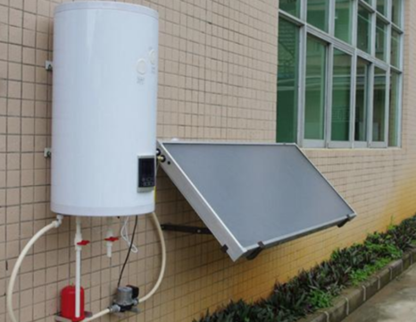

# Physics - 题目 1956

**ID**: 0925b42ab84c4f9e882797591b2da047
**年级**: Grade 9
**难度**: Medium-Hard
**题型**: Comprehensive

## 题目
如图所示是小明家一台安装在室外的电辅助壁挂式太阳能的集热器，阴天用电给水加热，天气晴朗时，用太阳能给水加热。​​​​​​​‌水箱安装在室内，其主要参数如表所示。 $ρ{{}_{水}}=1.0\times 10{^{3}}{\rm{k}}{\rm{g}}{\rm{/}}{\rm{m}}{^{{{3}}}}，g=10{\rm{N}}{\rm{/}}{\rm{k}}{\rm{g}}$ 。型号${\rm{P}}{\rm{J}}{\rm{F}}{{2}}{{-}}{{1}}{{0}}{{0}}$辅助加热电源$220{\rm{V}}～50{\rm{H}}{\rm{z}}$水箱容积100L采光面积$2.0{\rm{m}}{^{{{2}}}}$产水温度$40{^{{\rm o}}}{\rm C}～75{^{{\rm{o}}}}{\rm{C}}$辅助电加热功率1500W（1）若小明家热水器水箱进水口距离屋顶水池出水口的高度是20m，要将他家空水箱灌满水，那么这些水从出水口流到进水口，水的重力做了多少功？（2）天气晴朗时，若每平方米面积上在1小时内得到的太阳辐射能平均为 $2.8\times 10{^{6}}{\rm{J}}$ 。①太阳照射到地面上每平方米面积上的太阳能平均辐射功率是多少？ $($ 结果保留两位小数 $)$②一箱初温为 $20{^{{\rm{o}}}}{\rm{C}}$ 的水，太阳照射了2h后，天阴了，小明想用 $40{^{{\rm{o}}}}{\rm{C}}$ 的水洗澡，还需要辅助电加热器正常工作多长时间？[太阳能转化为水的内能的效率是 $45{\rm{\%}}$ ，辅助电加热器的工作效率为 $80{\rm{\%}}$ ，水的比热容为 $4.2\times 10{^{3}}{\rm{J}}{\rm{/}}\left ({{\rm{k}}{\rm{g}}{\rm{×}}{^{{\rm{o}}}}{\rm{C}}}\right )]$（3）请根据所学物理知识，谈谈在我国北方地区水箱安装在室内的优点。

## 解答

1. （1）将他家空水箱灌满水，水的质量 $m{{}_{水}}=ρ{{}_{水}}V{{}_{水}}=1.0\times 10{^{3}}{\rm{k}}{\rm{g}}{\rm{/}}{\rm{m}}{^{3}}\times 100\times 10{^{-3}}{\rm{m}}{^{3}}=100{\rm{k}}{\rm{g}}$ ，水的重力 $G{{}_{水}}=m{{}_{水}}g=100{\rm{k}}{\rm{g}}\times 10{\rm{N}}{\rm{/}}{\rm{k}}{\rm{g}}=1000{\rm{N}}$ ，对水的重力做的功 $W{{}_{水}}=G{{}_{水}}h{{}_{水}}=1000{\rm{N}}\times 20{\rm{m}}=2\times 10{^{4}}{\rm{J}}$ 。
2. （2）①太阳照射到地面上每平方米面积上的太阳能平均辐射功率 $P=\frac {W}{t}=\frac {2.8\times 10{^{6}}{\rm{J}}}{{{3}}{{6}}{{0}}{{0}}{\rm{s}}}\approx 777.78{\rm{W}}$ 。②水吸收的热量 $Q{{}_{吸}}=c{{}_{水}}mΔt=4.2\times 10{^{3}}{\rm{J}}{\rm{/}}（{\rm{k}}{\rm{g}}\cdot {^{{\rm{o}}}}{\rm{C}}）\times 100{\rm{k}}{\rm{g}}\times （40{^{{\rm{o}}}}{\rm{C}}-20{^{{\rm{o}}}}{\rm{C}})=8.4\times 10{^{6}}{\rm{J}}$ ，太阳能转化为水的内能 $W{{}_{1}}=2\times 2.8\times 10{^{6}}{\rm{J}}\times 45{\rm{\%}}=2.52\times 10{^{6}}{\rm{J}}$ ，电能转化为水的内能 $W{{}_{2}}=Q{{}_{吸}}-W{{}_{1}}=8.4\times 10{^{6}}{\rm{J}}-2.52\times 10{^{6}}{\rm{J}}=5.88\times 10{^{6}}{\rm{J}}$ ，消耗的电能 $W^{′}=\frac {W{{}_{2}}}{η^{′}}=\frac {7.35\times 10{^{6}}{\rm{J}}}{80{\rm{\%}}}=7.35\times 10{^{6}}{\rm{J}}$ ，还需要辅助电加热器正常工作的时间 $t=\frac {W^{′}}{P^{′}}=\frac {5.88\times 10{^{6}}{\rm{J}}}{{{1}}{{5}}{{0}}{{0}}{\rm{W}}}=4900{\rm{s}}$ 。
3. （3）在我国北方地区水箱安装在室内可防止水结冰后体积变大，撑破水箱。

## 知识点

**中文**:
  - 电与热综合计算

**English**:
  - Comprehensive Calculation of Electricity and Heat

---
