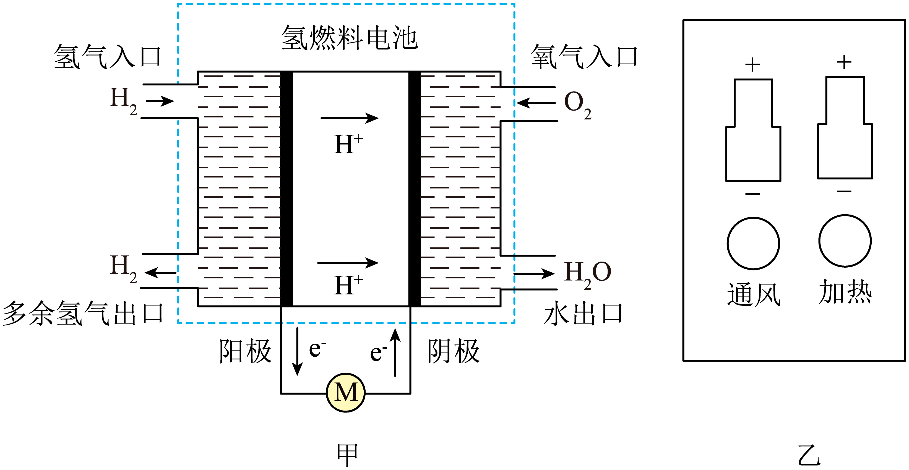
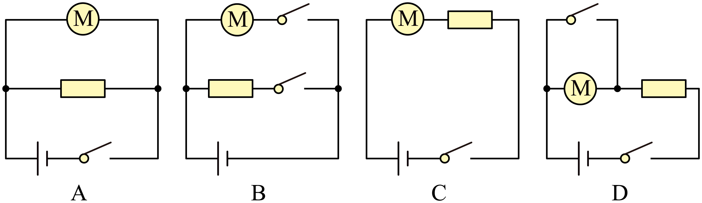

# Physics - 题目 2947

**ID**: 0d6715e43c2943969f9eebb6bd79504b
**年级**: Grade 9
**难度**: Medium-Hard
**题型**: Comprehensive

## 题目
“碳中和”是指生产生活中通过各种方式来抵消自身产生的CO_{2}（二氧化碳）排放量，达到CO_{2}的相对“零排放”，是当今共同应对气候变暖问题的全球行动。​​​​​​​‌2022年北京冬奥会是全球第一个实现了“碳中和”的冬奥会。冬奥会使用了氢燃料电池大巴，行驶时只排放水而无其它任何有害物质。大巴使用的氢燃料电池相当于发电机，电池工作原理如图甲所示。把氢和氧分别供给阳极和阴极，氢通过阳极向外扩散并与电解质发生反应后，放出的电子通过外部工作电路到达阴极，失去电子的氢离子（质子）穿过质子交换膜，到达燃料电池阴极板。（1）氢燃料电池工作时将燃料的能转化为电能；（2）图甲是氢燃料电池工作原理图，则电池正常工作时电池内部电流的方向为（选填“向左”或“向右”）；（3）如图乙，驾驶位有通风和加热两种功能，且能独立控制，以下简化电路可达到此要求的是（填字母）；（4）氢燃料电池大巴可实现CO_{2}的零排放，而柴油动力大巴每燃烧1kg柴油排放的CO_{2}约3kg。某柴油动力大巴行驶100km耗油25L，这25L柴油完全燃烧可释放热量J；如改用氢燃料电池大巴行驶100km可减少约kg的CO_{2}排放；（ρ_{柴油}=0.8×10^{3}kg/m^{3}，q_{柴油}=4.3×10^{7}J/kg）（5）请你为“低碳生活”给出一条合理的出行建议：。

## 解答

1. （1）氢燃料电池工作时，消耗氢气产生电能，将燃料的化学能转化为电能。
2. （2）图甲氢燃料电池工作原理图中，电池正常工作时带正电的氢离子向右定向移动，因此电池正常工作时电池内部电流的方向为向右。
3. （3）如图乙，驾驶位有通风和加热两种功能，且能独立控制，因此电动机和电热丝应该是并联关系，且都有各自的控制开关，因此简化电路可达到此要求的是B。A、C、D不符合题意，B符合题意。
4. （4）柴油的体积是V=25L=0.025m^{3}
5. 25L柴油的质量为m=ρ_{柴油}V=0.8×10^{3}kg/m^{3}×0.025m^{3}=20kg
6. 25L柴油完全燃烧可释放热量的热量为Q=q_{柴油}m=4.3×10^{7}J/kg×20kg=8.6×10^{8}J
7. 如改用氢燃料电池大巴行驶100km，可减少CO_{2}排放的质量约为m_{气}=3×20kg=60kg
8. （5）“低碳生活”出行建议：绿色出行。尽最大可能减少乘坐燃油车出行。

## 知识点

**中文**:
  - 有利于节约能源的措施
  - 热值及相关计算
  - 能量的转化

**English**:
  - Measures for Energy Conservation
  - Calorific Value and Calculations
  - Transformation of Energy

---
