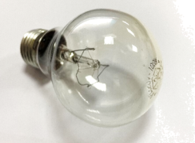
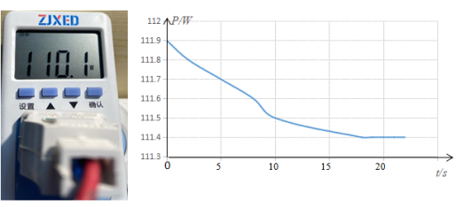

# Physics - 题目 2979

**ID**: 0f82f017f7334f7c8b069dffe5358215
**年级**: Grade 9
**难度**: Medium-Hard
**题型**: Comprehensive

## 题目
阅读短文，回答问题：白炽灯是一种热辐射光源，电流通过灯丝（钨丝制成）后由于电流的热效应会使灯丝加热到白炽状态，其温度可高达两千摄氏度到三千摄氏度之间，灯丝在处于白炽状态时，就像烧红了的铁能发光一样而发出耀眼的白光来.。​​​​​​​‌多功能计量插座是一种新型插座，它由数字显示屏和普通插座等几个部分组成，它不仅可以给用电器供电，还可以直接测出该用电器的电功率，操作简单、读数快捷. 如下图是一款多功能计量插座测量一盏标有“220V 100W”白炽灯的情形。兴趣小组的小明同学将白炽灯接入家庭电路中，观察白炽灯的发光情况，同时，用多功能计量插座记录了白炽灯从刚接入电路到一段时间以后的电功率，并画出了电功率随时间的变化图象，如下图所示.通过观察图象可以看出，白炽灯接入电路的前15s内实际电功率逐渐降低，20s后状态稳定。问：（1）白炽灯接入电路的前15s内，电功率逐渐降低，主要原因是；（2）兴趣小组的小红认为：“白炽灯在第15s时的亮度一定比第1s时的低”，这种说法是的（选填“正确”或“错误”）；（3）小明接着用多功能计量插座测出另一款LED灯的实际功率，他通过比较发现LED灯的额定功率和实际功率比该白炽灯低很多，但LED灯却更亮，则LED灯的发光效率比白炽灯；（选填：“更高”、“更低”或“相同”）（4）如图所示，下列关于小明测量小灯泡的电学实验图象，正确的是。

## 解答

1. （1）[1]白炽灯接入电路的前15s内，灯丝温度升高，电阻变大根据 $P=\frac {U{^{2}}}{R}$ 可知，R变大，P变小。
2. （2）[2]如果电压不稳定，开始电压小，稳定后电压大，则第一秒时的功率由于电压较小可能小于第15秒时的功率，则亮度在15s时可能高于第1s，所以说法错误。
3. （3）[3]因为LED灯用更小的功率发出了更亮的光，说明LED灯的发光效率比白炽灯高。
4. （4）[4] AB．当电流增大，灯丝的电阻R也增大，根据 $I=\frac {U}{R}$ 可知，故A错误，B正确；
5. CD．当电流增大，灯丝的电阻R也增大，根据 $P=I{^{2}}R=\frac {U{^{2}}}{R}$ 可知，当电压增大时，电功率也会增大，故CD错误。
6. 故选B。

## 知识点

**中文**:
  - 实际电压与实际功率

**English**:
  - Actual Voltage and Actual Power

---
