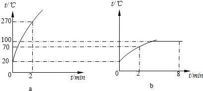

# Physics - 题目 1862

**ID**: 114b3e89e62f442e861a0192d0335f6f
**年级**: Grade 9
**难度**: Medium-Hard
**题型**: Comprehensive

## 题目
鲁能巴蜀中学初2014级物理兴趣小组的同学在研究“沙子和水谁的吸热本领大”时，选用了两只完全相同的酒精灯分别给质量都是200g的沙子和水加热，他们绘制出沙子与水的温度随加热时间变化的图象如图所示。​​​​​​​‌已知酒精的热值是3×10^{7}J/kg，加热时酒精灯平均每分钟消耗1g酒精。那么请问：（1）经分析：图是沙子吸热升温的图象。（2）加热满2min时，水吸收了多少热量？（）（3）酒精完全燃烧过程中热量的利用率是多少？（）（4）试求出沙子的比热容。（）

## 解答

1. （1）因为沙子和水的质量相等，沙子的比热容比水小，吸收相同热量时（即加热相同的时间），由 $Δt=\frac {Q{{}_{吸}}}{cm}$ 可知，沙子的温度升高得多，所以图a表示的是沙子吸热升温的过程。
2. （2）由图象知，水加热2分钟时的温度是70℃，则水吸收的热量
3. Q_{吸}=cmΔt=4.2×10^{3}J/(kg·℃)×0.2kg×(70℃-20℃)=4.2×10^{4}J
4. （3）2min消耗的酒精
5. m=2min×1g/min=2g
6. 完全燃烧放出的热量
7. Q_{放}=m_{酒}q=2×10^{-3}kg×3×10^{7}J/kg=6×10^{4}J
8. 热量的利用率
9. $η=\frac {Q{{}_{吸}}}{Q{{}_{放}}}\times 100\%=\frac {4.2\times 10{^{4}}{\rm{J}}}{6\times 10{^{4}}{\rm{J}}}\times 100\%=70\%$
10. （4）水和沙子均加热2min，吸收相等的热量，则
11. Q_{沙吸}=Q_{水吸}
12. c_{沙}m_{水}Δt_{沙}=c_{水}m_{水}Δt_{水}
13. 由图象可知
14. t_{0}=20℃，t_{水}=70℃，_{沙}=270℃
15. $c{{}_{沙}}=\frac {m{{}_{水}}(t{{}_{水}}-t{{}_{0}})}{m{{}_{沙}}(t{{}_{沙}}-t{{}_{0}})}c{{}_{水}}=\frac {0.2kg\times (70℃-20℃)}{0.2kg\times (270℃-20℃)}\times 4.2\times 10{^{3}}{\rm{J}}{\rm{/}}{\rm{(}}{\rm{k}}{\rm{g}}\cdot ℃{\rm{)}}=0.84\times 10{^{3}}{\rm{J}}{\rm{/}}{\rm{(}}{\rm{k}}{\rm{g}}\cdot ℃{\rm{)}}$

## 知识点

**中文**:
  - 热量综合计算专题

**English**:
  - Comprehensive Heat Calculations

---
