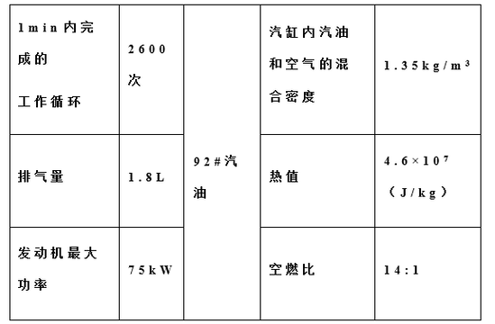

# Physics - 题目 1986

**ID**: 2c1ccbe434904d37a606462c4e454e9b
**年级**: Grade 9
**难度**: Medium-Hard
**题型**: Comprehensive

## 题目
某台以汽油为燃料的汽车，发动机内有四个汽缸，其相关数据如下表所示：(1)汽车发动机工作时通常用水来冷却，原因是水的较大。​​​​​​​‌(2)汽车的排气量是指发动机汽缸的工作容积，汽车排气量越大，功率越大。空燃比指汽缸内空气和燃油的质量比。当发动机1min内完成的工作循环为2600次时，发动机达到最大功率，则根据表中数据求出汽车发动机的效率是。（计算结果保留一位小数）

## 解答

1. (1)因为水的比热容较大，所以常用做冷却剂。
2. (2)做一次功时燃气的质量
3. $m{{}_{燃气}}=ρV{\rm{=}}{\rm{1}}{\rm{.}}{\rm{3}}{\rm{5}}{\rm{k}}{\rm{g}}{\rm{/}}{\rm{m}}{^{{\rm{3}}}}\times {\rm{1}}{\rm{.}}{\rm{8}}\times {\rm{1}}{\rm{0}}{^{{\rm{-}}{\rm{3}}}}{\rm{m}}{^{{\rm{3}}}}{\rm{=}}2.43\times {\rm{1}}{\rm{0}}{^{{\rm{-}}{\rm{3}}}}{\rm{k}}{\rm{g}}$
4. 因为空燃比为14:1，所以做一次功消耗汽油的质量
5. $m{{}_{油}}=\frac {1}{15}m{{}_{燃气}}{\rm{=}}\frac {{\rm{1}}}{{\rm{1}}{\rm{5}}}\times {\rm{2}}{\rm{.}}{\rm{4}}{\rm{3}}\times {\rm{1}}{\rm{0}}{^{{\rm{-}}{\rm{3}}}}{\rm{k}}{\rm{g}}{\rm{=}}{\rm{1}}{\rm{.}}{\rm{6}}{\rm{2}}\times {\rm{1}}{\rm{0}}{^{{\rm{-}}{\rm{4}}}}{\rm{k}}{\rm{g}}$
6. 1min内汽油释放的热量
7. $Q{{}_{放}}=m{{}_{汽油}}q{\rm{=}}{\rm{1}}{\rm{.}}{\rm{6}}{\rm{2}}\times {\rm{1}}{\rm{0}}{^{{\rm{-}}{\rm{4}}}}{\rm{k}}{\rm{g}}\times {\rm{4}}{\rm{.}}{\rm{6}}\times {\rm{1}}{\rm{0}}{^{{\rm{7}}}}{\rm{J}}{\rm{/}}{\rm{k}}{\rm{g}}\times {\rm{2}}{\rm{6}}{\rm{0}}{\rm{0}}{\rm{=}}{\rm{1}}{\rm{.}}{\rm{9}}{\rm{3}}{\rm{7}}{\rm{5}}{\rm{2}}\times {\rm{1}}{\rm{0}}{^{{\rm{7}}}}{\rm{J}}$
8. 该汽车的1min内做的有用功
9. $W=Pt={\rm{7}}{\rm{5}}{\rm{0}}{\rm{0}}{\rm{0}}{\rm{W}}\times {\rm{6}}{\rm{0}}{\rm{s}}{\rm{=}}{\rm{4}}{\rm{.}}{\rm{5}}\times {\rm{1}}{\rm{0}}{^{{\rm{6}}}}{\rm{J}}$
10. 该汽车发动机的效率
11. $η=\frac {W}{Q{{}_{放}}}{\rm{×}}{\rm{1}}{\rm{0}}{\rm{0}}％{\rm{=}}\frac {{\rm{4}}{\rm{.}}{\rm{5}}\times {\rm{1}}{\rm{0}}{^{{\rm{6}}}}{\rm{J}}}{{\rm{1}}{\rm{.}}{\rm{9}}{\rm{3}}{\rm{7}}{\rm{5}}{\rm{2}}\times {\rm{1}}{\rm{0}}{^{{\rm{7}}}}{\rm{J}}}\times {\rm{1}}{\rm{0}}{\rm{0}}％\approx {\rm{2}}{\rm{3}}{\rm{.}}{\rm{2}}％$

## 知识点

**中文**:
  - 有关热机效率的计算
  - 水的比热容的特点及应用
  - 热量综合计算专题

**English**:
  - Calculations of Heat Engine Efficiency
  - Characteristics and Applications of Water's Specific Heat
  - Comprehensive Heat Calculations

---
